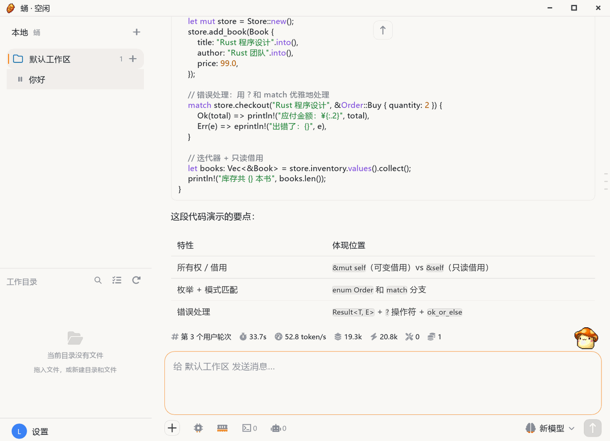
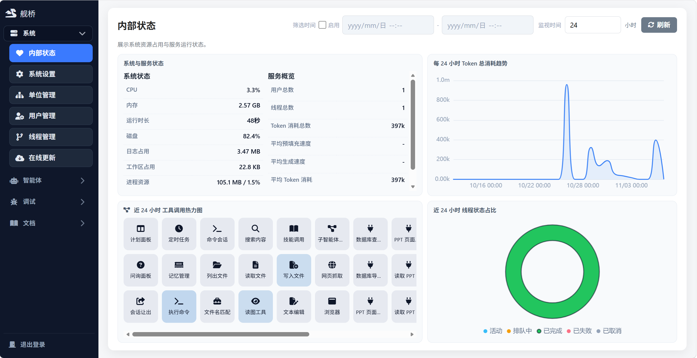
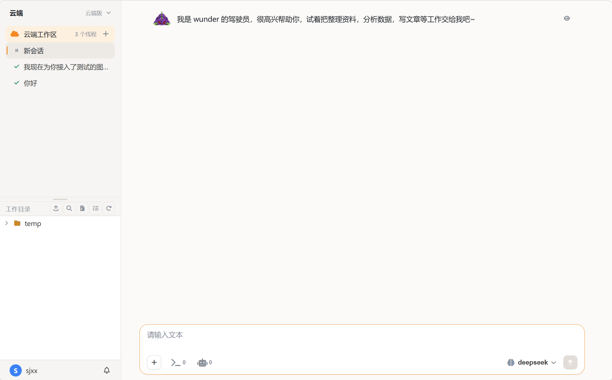
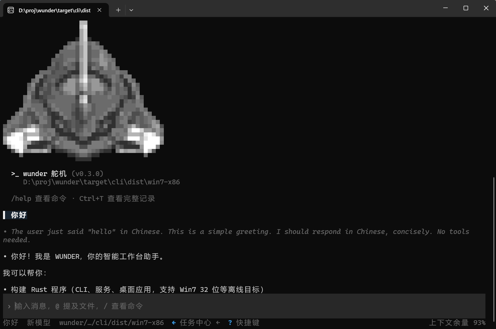
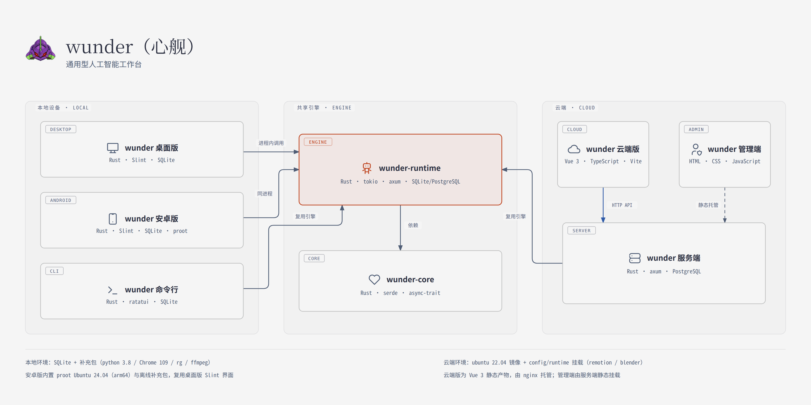

# wunder (Xinjian)

wunder (Xinjian) is a **multi-form agent workbench**:

- **Diverse**: multiple platforms — 32-bit Windows 7 and Ubuntu 18.04 — and multiple forms — web, local, and mobile.
- **Fast**: starts instantly and responds without lag.
- **Superior**: stable enough to run 24/7, with a high degree of intelligence.
- **Efficient**: extremely low CPU and memory use and minimal context consumption, plus a ready-made agent runtime — set up once and forget it.

## Quick Start

Download the matching installer from [Releases](https://github.com/ylsdamxssjxxdd/wunder/releases):

- **Windows 7 32-bit**: download the `wunder-desktop-*-win7-x86-setup.exe` installer.
- **Linux x64 / arm64**: download the `wunder-desktop-*-linux-*.run` installer.
- **Android**: download the `wunder-android-*-arm64.apk` and install it.

On first launch, configure a model on the settings page and you are ready to go.

## Design Philosophy

**Radically minimal: solve the problem fast, not show off complexity.**

The interface keeps only the information and actions needed to finish the task; complex capabilities unfold on demand, and decoration, status detail, or technical detail never takes over the main path. Complexity stays in the engine — the interface states the result and the next step.

## Interface

**🍯 wunder Desktop** — local AI workbench (flagship form)

**🐉 wunder Admin** — the Server's governance console

**🐝 wunder Cloud** — cloud AI workbench

**⚙️ wunder CLI** — terminal TUI entry point

## Form Matrix

| Icon | Form | Tech Stack | Role | How It Runs | Platforms |
| :--- | :--- | :--- | :--- | :--- | :--- |
| 🚀 | wunder Server | Rust + axum 0.8; PostgreSQL | User-and-agent management platform. All users share a single sandbox with no barriers between them | Server daemon, Docker deployment | Linux / Docker |
| 🐉 | wunder Admin | Plain HTML + CSS + JavaScript (`web/`, no build) | Server's governance console (four nav groups: system, agents, debugging, docs) | Browser access, statically mounted by the Server at `/` | Cross-platform browsers |
| 🐝 | wunder Cloud | Vue 3 + TypeScript (Vite build, `frontend/`) | Cloud AI workbench (the Server's user frontend) | Browser access; the built `frontend/dist` is mounted read-only into an nginx container and served externally (default port 18001) — **not hosted by the Server** | Cross-platform browsers |
| 🍯 | wunder Desktop | Rust + Slint 1.18 (default frontend `crates/wunder-desktop/frontend/`, native UI, software rendering); SQLite | Local AI workbench (flagship form, install and go) | Local desktop process calling the engine in-process (no local HTTP); Electron / Tauri shells are no longer maintained | Windows 7 x86 and up; Linux (ubuntu18.04 baseline) x64 / arm64 via the `.run` installer |
| 📱 | wunder Android | Rust + Slint 1.18 (`crates/wunder-android/`, single native Activity shell reusing the Desktop theme, timeline and composer; Skia rendering); SQLite | The Desktop's Android form — local AI workbench on a phone | Native Activity APK calling the shared engine in-process; Ubuntu runtime bundled by default (arm64) | Android 8.0 (API 26) and up; arm64-v8a (the x86_64 slice is for emulator verification only) |
| ⚙️ | wunder CLI | Rust terminal TUI (ratatui + crossterm); SQLite | Hands-on local entry point (terminal work, scripting, automation) | Local terminal process calling the engine in-process; JSONL output supported | Windows 7 and up (GNU toolchain); Linux amd64 / arm64 (ubuntu18.04 sysroot) |

All forms share one engine (wunder-runtime) and one core (wunder-core): threads, tools, storage abstractions, realtime events, and permission semantics are a single codebase — only the access layer differs. wunder Desktop, wunder Android and wunder CLI run standalone without the Server.

One agent can own multiple independent task threads at the same time; scheduling, locks, and live status are isolated per thread. Workspaces can coexist as a local directory, the cloud directory `/workspaces/<user>/workspace`, and remote-device workspaces.

## Tool Matrix

Canonical tool names are mostly Chinese (what the model sees), each with English aliases normalized via `resolve_tool_name` (`crates/wunder-runtime/src/services/tools/catalog.rs`). MCP tools (`server@tool`), skill names, knowledge-base names, and user-tool aliases are registered dynamically and are not listed here.

| Tool (canonical) | English alias | Description | Category |
| :--- | :--- | :--- | :--- |
| 计划面板 | `update_plan` | Push a structured task plan panel to the frontend | Wrap-up & frontend |
| 问询面板 | `question_panel` | Show structured options, ask the user, and wait for a choice | Wrap-up & frontend |
| 会话让出 | `sessions_yield` | Yield the current turn's control and be woken later | Wrap-up & frontend |
| 列出文件 | `list_files` | List directory contents | Workspace & code |
| 文件名匹配 | `glob` | Find file paths by glob pattern | Workspace & code |
| 搜索内容 | `search_content` | Search file contents by regex | Workspace & code |
| 读取文件 | `read_file` | Read file contents, with range reads | Workspace & code |
| 写入文件 | `write_file` | Write or overwrite a file | Workspace & code |
| 文本编辑 | `edit` / `edit_file` | Exact replacement / patch / subcommand modes (`apply_patch` merged in) | Workspace & code |
| 执行命令 | `execute_command` | Run shell / system commands | Workspace & code |
| 命令会话 | `command_session` | Manage long-lived background command sessions with foreground/background switching | Workspace & code |
| 技能调用 | `skill_call` | Read a skill's body and run its scripts | Workspace & code |
| 网页抓取 | `web_fetch` | Fetch and parse web page content (requires enabling) | Web |
| 浏览器 | `browser` | One strict action tool for navigation, observation, interaction, waits, and screenshots | Web |
| 读图工具 | `read_image` | Read image content for the model to understand (requires vision) | Multimodal |
| 图像生成 | `generate_image` | Generate an image from a prompt | Multimodal |
| 视频生成 | `generate_video` | Generate a video from a prompt | Multimodal |
| 语音生成 | `generate_speech` | Text to speech | Multimodal |
| 声转文 | `transcribe_speech` | Speech to text | Multimodal |
| 桌面控制 | `desktop_control` | Operate and observe the local desktop (mouse, keyboard, windows) | Desktop |
| 子智能体控制 | `subagent_control` | Spawn temporary subagents during a task and reclaim them after results return | Threads & subagents |
| 会话线程控制 | `thread_control` | Manage task threads / forked threads (not exposed on desktop) | Threads & subagents |
| 自我状态 | `self_status` | Query the agent's own runtime status | System & memory |
| 记忆管理 | `memory_manager` | Read and write long-term memory | System & memory |
| 定时任务 | `schedule_task` | Create and manage scheduled / periodic tasks | System & memory |
| `goal` | `get / create / edit / pause / resume / complete / blocked` | Goal-state tool, auto-injected per session by the runtime; not selectable on desktop | Goal state |

## Absorbed Matrix

| Taken from | Project | Link |
| :--- | :--- | :--- |
| Project prototype | EVA | https://github.com/ylsdamxssjxxdd/eva |
| Agent foundation | OpenAI Codex | https://github.com/openai/codex |
| Frontend foundation | HuLa | https://github.com/HuLaSpark/HuLa |
| Protocol foundation | Claude Code | https://github.com/anthropics/claude-code |
| User foundation | OpenClaw | https://github.com/openclaw/openclaw |
| Tool foundation | deepseek-harness (dsh) | https://github.com/deepseek-ai/deepseek-harness |
| Android foundation | Operit | https://github.com/AAswordman/Operit |
