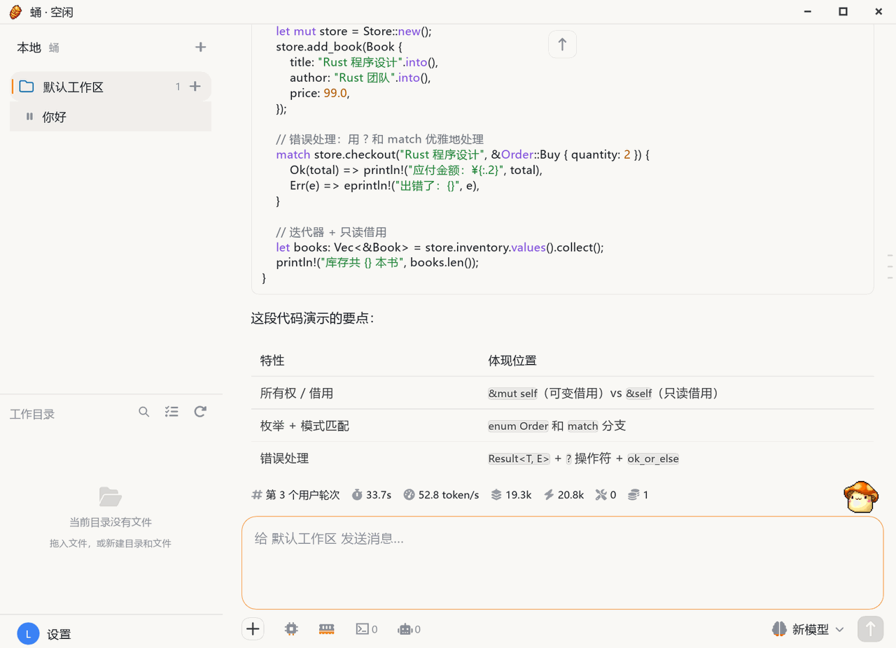
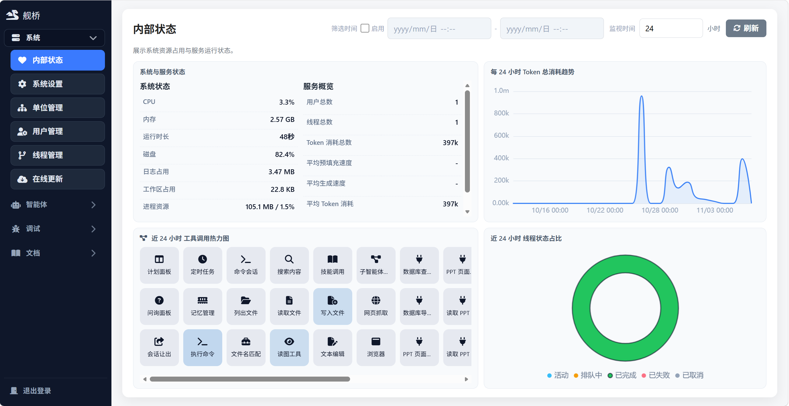
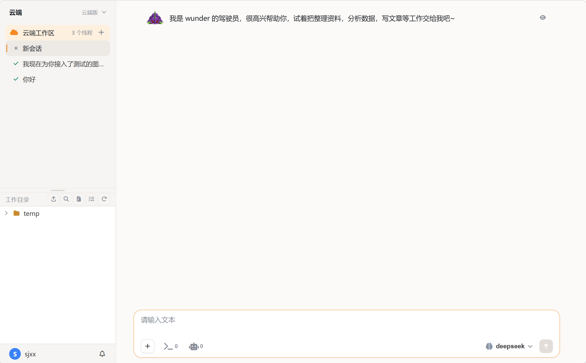
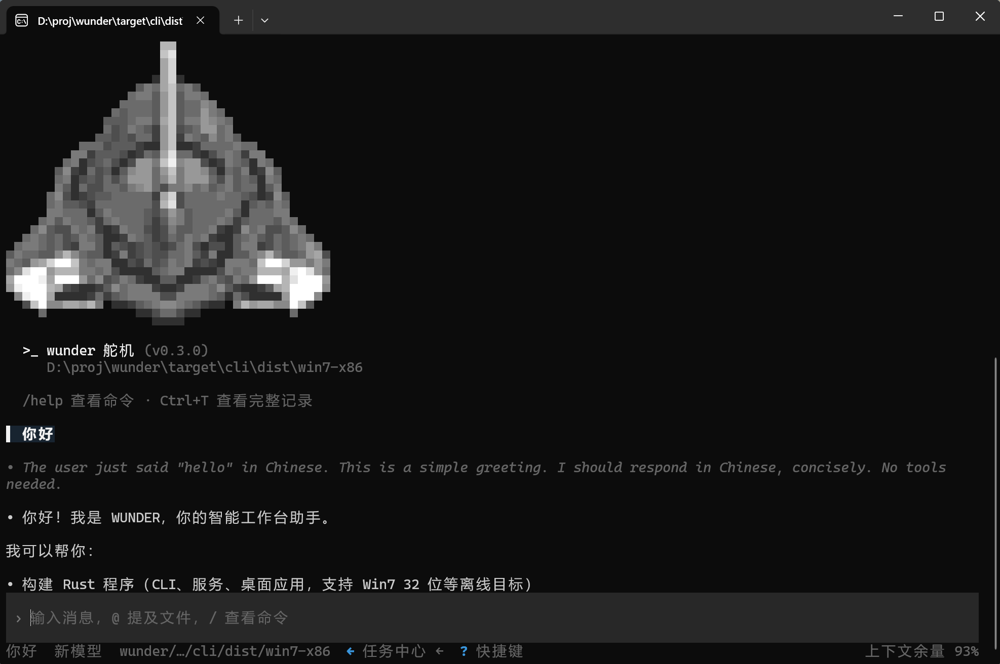
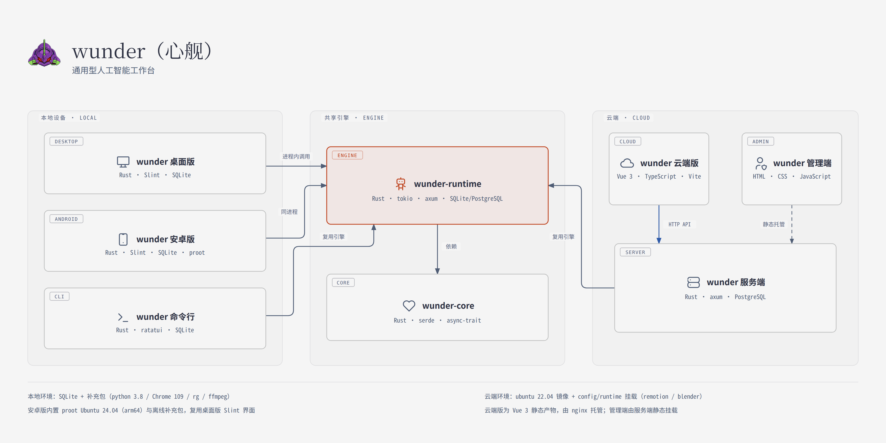

# wunder 心舰

wunder 心舰 是一个多形态的智能体工作台

- 多：支持多平台，32位win7/ubuntu18.04；支持多形态，网页版本/本地版本/移动版本
- 快：启动速度快，秒开，响应速度快不卡顿
- 好：稳定性强，可 7×24 运行，智能程度高；自带预制的智能体运行环境（浏览器、视频制作组件等）
- 省：cpu/内存占用极低，上下文消耗极低

## 快速开始
从 [Releases](https://github.com/ylsdamxssjxxdd/wunder/releases) 下载对应安装包：

- Windows 7 32 位：下载 `wunder-desktop-*-win7-x86-setup.exe` 安装包，开箱即用。
- Linux x64 / arm64：下载 `wunder-desktop-*-linux-*.run` 安装包，开箱即用。
- Android：下载 `wunder-android-*-arm64.apk` 安装包，开箱即用。

初次运行请先在配置页面配置好模型即可使用

## 开发过程

**自举：使用wunder对wunder进行开发**

**精简：旨在快速解决问题，界面只保留完成任务所需的最少信息与操作**

## 界面预览

**🍯 wunder 桌面版 desktop** —— 本地 AI 工作台（主推形态）

<table>
  <tr>
    <td width="50%" valign="top">
      <strong>🐉 wunder 管理端 web</strong> —— 服务端的治理后台 
      
    </td>
    <td width="50%" valign="top">
      <strong>🐝 wunder 云端版 web</strong> —— 云端 AI 工作台 
      
    </td>
  </tr>
  <tr>
    <td width="50%" valign="top">
      <strong>⚙️ wunder 命令行 cli</strong> —— 终端 TUI 入口 
      
    </td>
    <td width="50%" valign="top">
      <strong>📱 wunder 安卓版 android</strong> —— 手机端本地 AI 工作台 
      &nbsp;
    </td>
  </tr>
</table>

## 形态矩阵

| 程序图标 | 形态名称 | 技术栈 | 定位 | 运行方式 | 系统支持 |
| :--- | :--- | :--- | :--- | :--- | :--- |
| 🚀 | wunder 服务端 server | Rust + axum 0.8；PostgreSQL | 用户与智能体管理平台，所有用户共用一个沙盒，彼此没有隔阂| 服务端常驻进程，Docker 部署| Linux / Docker |
| 🐉 | wunder 管理端 web | 原生 HTML + CSS + JavaScript（`web/`，无构建） | 服务端的治理后台（系统、智能体、调试、文档四组面板） | 浏览器访问，由服务端静态挂载于 `/` | 跨平台浏览器 |
| 🐝 | wunder 云端版 web | Vue 3 + TypeScript（Vite 构建，`frontend/`） | 云端 AI 工作台（服务端的用户端） | 浏览器访问；构建产物 `frontend/dist` 由 nginx 容器只读挂载对外服务（默认端口 18001），**不由服务端托管** | 跨平台浏览器 |
| 🍯 | wunder 桌面版 desktop | Rust + Slint 1.18（默认前端 `crates/wunder-desktop/frontend/`，原生界面、软件渲染）；SQLite | 本地 AI 工作台（主推形态，开箱即用） | 本地桌面进程，同进程原生直调引擎（不经本机网络）；Electron / Tauri 壳已停止维护 | Windows 7 x86 起；Linux（ubuntu18.04 基线）x64 / arm64，`.run` 安装包 |
| 📱 | wunder 安卓版 android | Rust + Slint 1.18（`crates/wunder-android/` 单 Activity 原生壳，复用桌面版主题、时间线、输入组件；Skia 渲染）；SQLite | 桌面版的 Android 形态，本地 AI 工作台（手机端） | APK 原生 Activity，同进程直调共享引擎；默认内置 Ubuntu 运行环境（arm64） | Android 8.0（API 26）起；arm64-v8a（x86_64 切片仅用于模拟器验证） |
| ⚙️ | wunder 命令行 cli | Rust 终端 TUI（ratatui + crossterm）；SQLite | 手工本地操作入口（终端、脚本化、自动化） | 本地终端进程，同进程直调引擎，支持 JSONL 输出 | Windows 7 起（GNU 工具链）；Linux amd64 / arm64（ubuntu18.04 sysroot） |

各形态共享同一引擎（wunder-runtime）与核心（wunder-core）：线程、工具、存储抽象、实时事件和权限语义是同一份代码，差异只在接入层。桌面版、安卓版与命令行不依赖服务端，可独立运行与分发。

一个智能体可同时拥有多个独立任务线程，调度、锁与实时状态均按任务线程隔离；工作区可为本地目录、云端 `/workspaces/<user>/workspace` 与远程设备工作区并存。

## 工具矩阵

模型看到的工具规范名大多为中文，另配英文别名，由 `resolve_tool_name` 归一（`crates/wunder-runtime/src/services/tools/catalog.rs`）。MCP 工具（`server@tool`）、技能名、知识库名与用户工具别名按配置动态注册，不在下表之列。

| 工具（规范名） | 英文别名 | 简介 | 分类 |
| :--- | :--- | :--- | :--- |
| 计划面板 | `update_plan` | 向前端推送结构化的任务计划面板 | 收尾与前端协同 |
| 问询面板 | `question_panel` | 弹出结构化选项，向用户提问并等待选择 | 收尾与前端协同 |
| 会话让出 | `sessions_yield` | 主动让出当前回合控制权，稍后再被唤起 | 收尾与前端协同 |
| 列出文件 | `list_files` | 列出目录内容 | 工作区与代码 |
| 文件名匹配 | `glob` | 按通配模式查找文件路径 | 工作区与代码 |
| 搜索内容 | `search_content` | 在文件中按正则搜索匹配内容 | 工作区与代码 |
| 读取文件 | `read_file` | 读取文件内容，支持分段读取 | 工作区与代码 |
| 写入文件 | `write_file` | 写入或整体覆盖文件 | 工作区与代码 |
| 文本编辑 | `edit` / `edit_file` | 精确替换 / 补丁 / 子命令三形态（`apply_patch` 已并入） | 工作区与代码 |
| 执行命令 | `execute_command` | 执行 Shell / 系统命令 | 工作区与代码 |
| 命令会话 | `command_session` | 管理后台长驻命令会话，支持前后台切换 | 工作区与代码 |
| 技能调用 | `skill_call` | 读取技能正文并执行技能脚本 | 工作区与代码 |
| 网页抓取 | `web_fetch` | 抓取并解析网页正文（需启用配置） | Web |
| 浏览器 | `browser` | 单一严格 action 工具，覆盖导航、观察、交互、等待与截图 | Web |
| 读图工具 | `read_image` | 读取图片内容供模型理解（需 vision 能力） | 多模态 |
| 图像生成 | `generate_image` | 按提示词生成图片 | 多模态 |
| 视频生成 | `generate_video` | 按提示词生成视频 | 多模态 |
| 语音生成 | `generate_speech` | 文本转语音 | 多模态 |
| 声转文 | `transcribe_speech` | 语音转文字 | 多模态 |
| 桌面控制 | `desktop_control` | 操作本机桌面并观察（鼠标、键盘、窗口） | 桌面 |
| 子智能体控制 | `subagent_control` | 在任务中临时派生子智能体，结果回传后回收 | 线程与子智能体 |
| 会话线程控制 | `thread_control` | 管理任务线程 / 分支线程（桌面端不开放） | 线程与子智能体 |
| 自我状态 | `self_status` | 查询智能体自身的运行状态 | 系统与记忆 |
| 记忆管理 | `memory_manager` | 读写长期记忆 | 系统与记忆 |
| 定时任务 | `schedule_task` | 创建与管理定时 / 周期任务 | 系统与记忆 |
| `goal` | `get / create / edit / pause / resume / complete / blocked` | 目标态工具，由运行时按会话自动注入，不对桌面端开放选择 | 目标态 |

## 吞噬矩阵

| 吞噬 | 项目 | 地址 |
| :--- | :--- | :--- |
| 项目原型 | EVA | https://github.com/ylsdamxssjxxdd/eva |
| 智能体基础 | OpenAI Codex | https://github.com/openai/codex |
| 前端基础 | HuLa | https://github.com/HuLaSpark/HuLa |
| 协议基础 | Claude Code | https://github.com/anthropics/claude-code |
| 用户基础 | OpenClaw | https://github.com/openclaw/openclaw |
| 工具基础 | deepseek-harness（dsh） | https://github.com/deepseek-ai/deepseek-harness |
| 安卓基础 | Operit | https://github.com/AAswordman/Operit |
