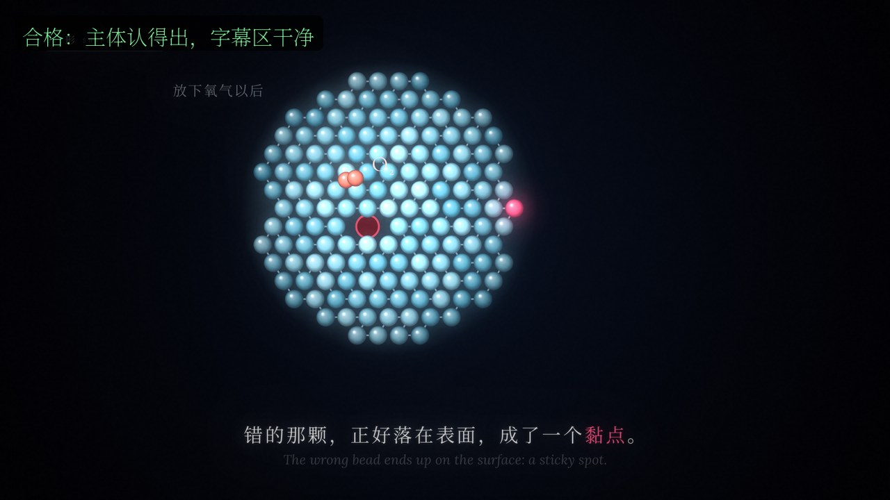
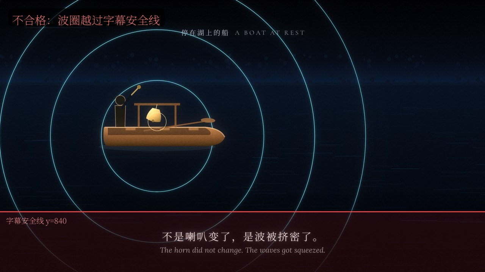

# 样张对标：什么叫"合格"

`examples/` 里的工程是看别人怎么做，不是零件库。这里给两张标好的样张，用来回答"复刻参考片的 look，
到什么程度算合格"。看图时先遮住字幕和小字，再问：这是什么 / 它在干什么 / 我明白了什么。

## 合格：主体认得出，字幕区干净



- 主体是一串有光泽的珠子，外行叫得出名字，不是点线圈的代替物。
- 一颗珠子变色、表面出现黏点，动词真的发生在屏上。
- 主体最低点在 y=840 以上；纵向 80% 以下只有一行字幕，没有装置、量尺或标注压进去。
- 全片一个世界、一套色；这一刻只有主体在动，旁观文字不抢。

## 不合格：非字幕元素越过安全线



- 波圈虽然衬在字幕后面，但最低点已经越过 y=840；按本 skill 的规矩，纵向 80%–95% 只属于字幕。
- 这张图对应 `--check-safe` 的真实输出：`未命名 ellipse: 19.84–49.59s，最低 y=1687`。
- 改法不是把字幕加粗，而是把波圈收小 / 把装置整体上移 / 在该镜压低波圈透明度，直到检查通过。
- 装置用 `fr.mark('船', …)` 命名后，报告会直接写"船"，不用靠猜 `未命名 ellipse`。

## 自己生成对标图

```bash
python engine/render.py <工程> --sheet 16                 # 全片 16 帧，先看整体
python engine/render.py <工程> --stills 12.5 --mark 船    # 原尺寸 + 包围盒
python engine/render.py <工程> --check-safe               # 安全区越界表（时刻 + 元素名）
python engine/render.py <工程> --overlap                  # 命名元素包围盒相交（遮挡）表
python engine/render.py --diff A.mp4 B.mp4                # 两版逐帧差分
```

判断标准不是"像不像参考片"，而是上面三条：主体认得出、动作为剧情服务、字幕区干净。
`--check-safe`/`--overlap` 只能查几何，查不了"像不像"；最后仍要人眼看图。
