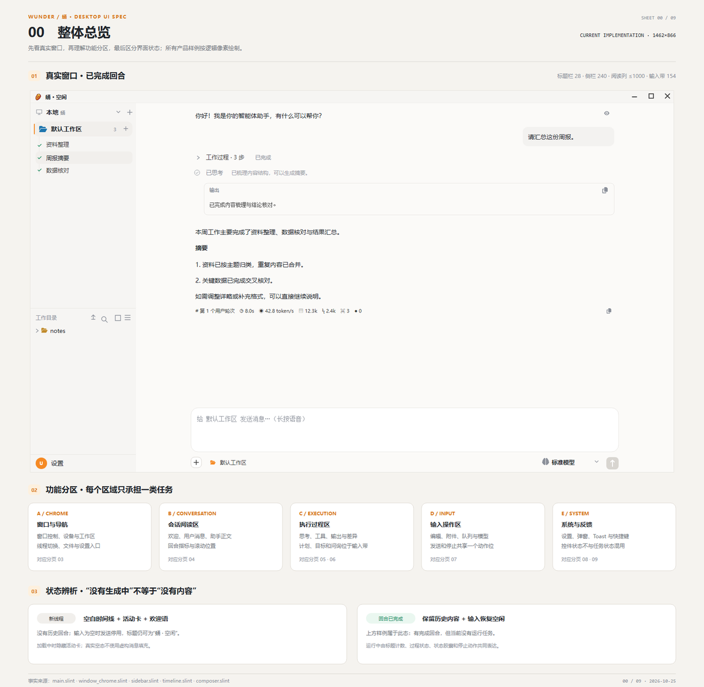
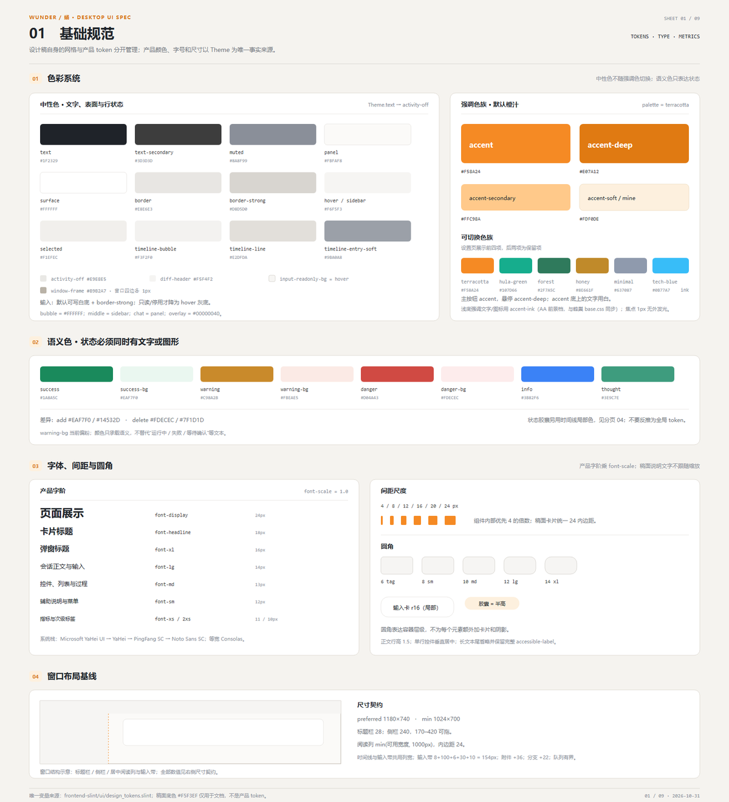
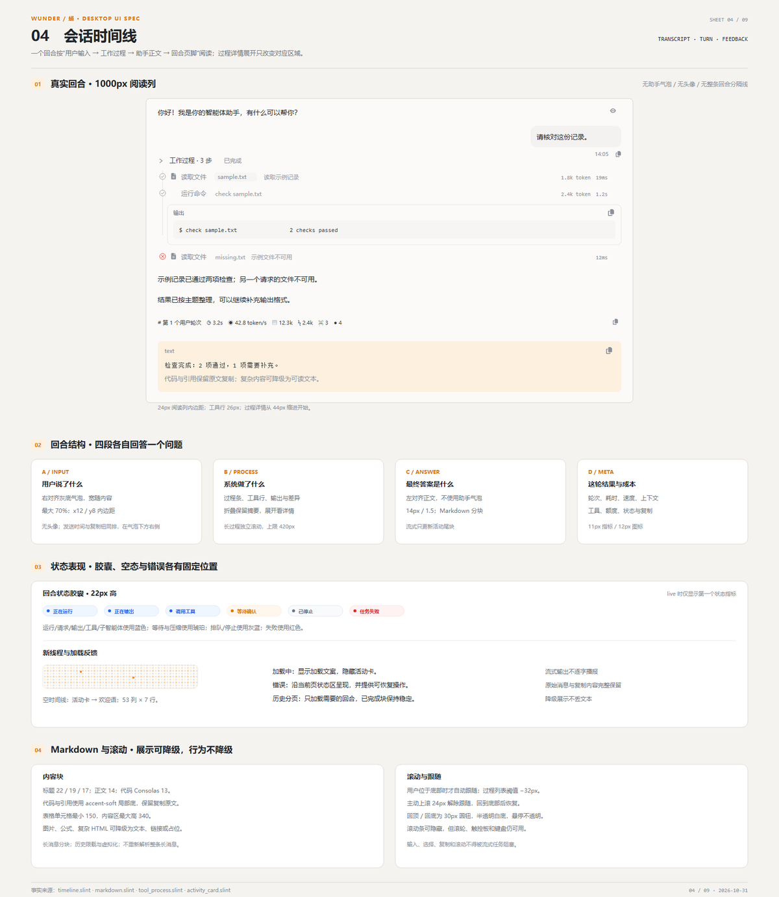
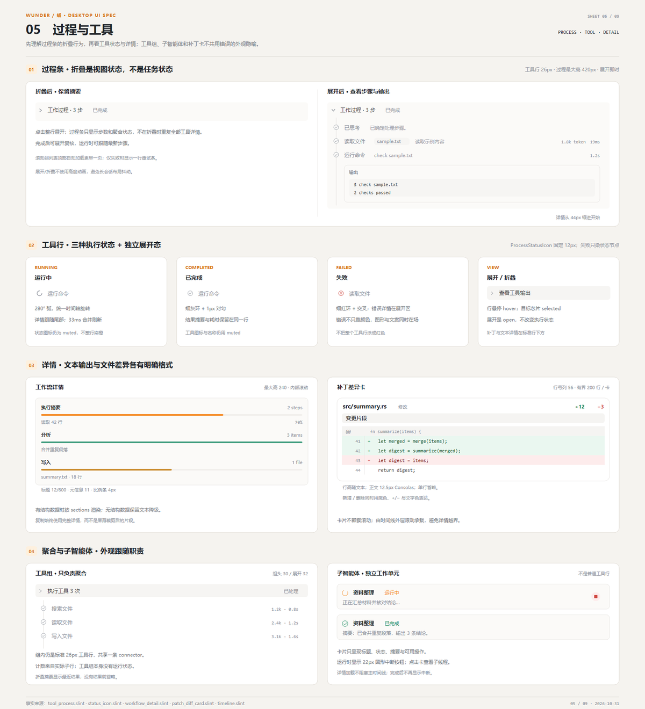
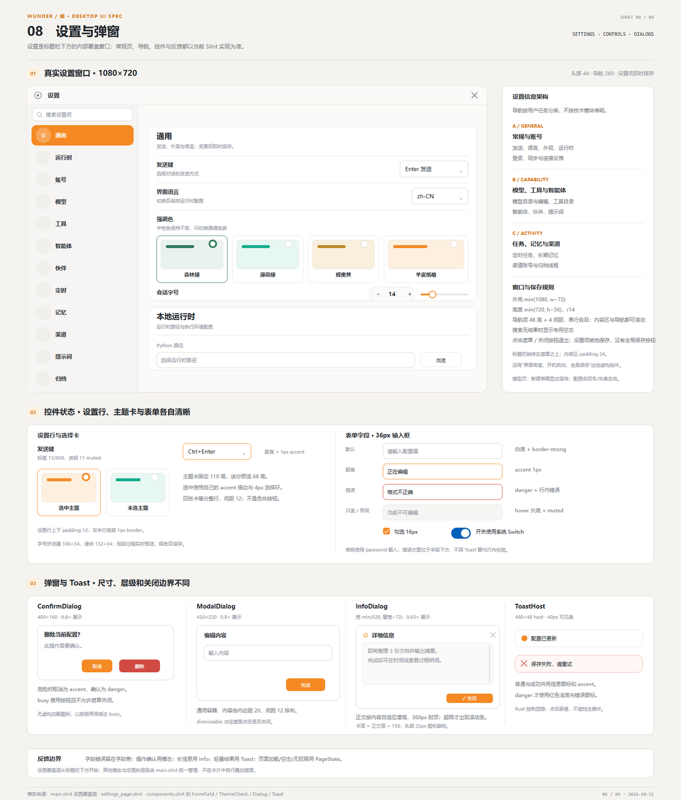
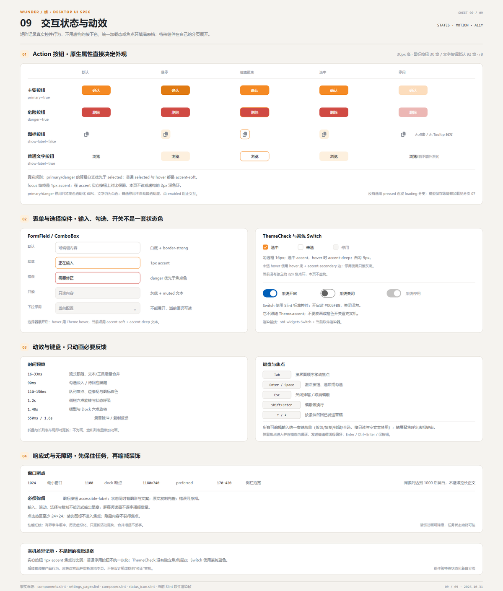

<!-- help-manual: zh -->
<!-- 正文是标准 Markdown；topic: 链接指向站内主题，art/*.png 指向内嵌图册。 -->
<!-- topic id="welcome" block="start" title="欢迎" group="开始" keywords="开始,欢迎,手册,帮助" -->

# wunder 桌面版使用手册

桌面版是本地 AI 工作台：把目标交给智能体，它拆解任务、调用工具、交付结果。文件与线程保存在本机。

这份手册介绍桌面版的核心能力与日常操作。左侧**目录**按四块组织内容——开始、工具、界面、能力，点分区标题可以展开或收起；**索引**按关键词检索，**搜索**支持全文匹配。点击正文中的绿色链接可以跳转到相关主题。

- [**快速上手**](topic:quickstart)：新建线程、发送消息、切换模型，几分钟完成第一次对话。
- [**多快好省**](topic:core-overview)：四个核心：多平台多形态、秒开且响应不卡顿、可 7×24 运行且智能程度高、CPU 内存与上下文消耗低并自带预制运行环境。
- [**目标**](topic:core-goal)：让智能体进入目标态并持续完成一项任务。
- [**工具总览**](topic:tools-overview)：内置工具矩阵，按八个分类组织。
- [**界面导览**](topic:interface)：认识侧栏、线程列表、工作过程与轨迹视图。
- [**设置总览**](topic:settings)：常规偏好、模型配置、云账号与设备互通的入口。
- [**常见问题 FAQ**](topic:faq)：注册、记忆加载、子智能体、工具可见性等常见结论。
- [**诊断与排查**](topic:troubleshooting)：健康检查、按症状列出的检查项与诊断导出。

> **提示：**在设置分类列表顶部的搜索框输入关键词，可以直接定位到对应分类。

<!-- topic id="quickstart" block="start" title="快速上手" group="开始" keywords="新建线程,发送消息,切换模型,对话,第一次" -->

# 快速上手

## 新建线程

点击侧栏的**新建线程**按钮即可开始。每个线程都有独立的历史、工具调用记录与模型选择，互不干扰。

## 发送消息

- 在输入框输入内容，按发送键（默认 Enter，可在设置中改为 Ctrl+Enter）发送。

- 智能体会流式输出回复；调用工具的过程显示在回复上方的**工作过程**折叠条中，点击可就地展开。

- 支持截图、录音等多模态输入，随消息一起发送给智能体。

## 为线程选择模型

输入框旁的模型切换器只影响**当前线程**，不会改动默认配置。线程建立后，系统提示词与模型即在该线程内保持稳定。

> 所有对话数据保存在本地 SQLite 数据库中，离线也能查看历史线程。

<!-- topic id="forms" block="start" title="形态矩阵" group="开始" keywords="形态,桌面版,云端版,命令行,服务端" -->

# 形态矩阵

wunder 是多形态的智能体工作台，同一套引擎对外有多个程序形态，差异只在接入层。

| 程序图标 | 形态名称 | 技术栈 | 定位 | 运行方式 | 系统支持 |
| --- | --- | --- | --- | --- | --- |
| 🚀 | wunder 服务端 | Rust + axum 0.8；PostgreSQL | 用户与智能体管理平台（多租户、用户与单位、智能体应用构建发布、网关接入与调度） | 服务端常驻进程，Docker 部署，HTTP / WebSocket 接入 | Linux / Docker |
| 🐉 | wunder 管理端 | 原生 HTML + CSS + JavaScript（` web/ `，无构建） | 服务端的治理后台（系统、智能体、调试、文档四组面板） | 浏览器访问，由服务端静态挂载于 ` / ` | 跨平台浏览器 |
| 🐝 | wunder 云端版 | Vue 3 + TypeScript（Vite 构建，` frontend/ `） | 云端 AI 工作台（服务端的用户端） | 浏览器访问；构建产物 ` frontend/dist ` 由 nginx 容器只读挂载对外服务（默认端口 18001），**不由服务端托管** | 跨平台浏览器 |
| 🍯 | wunder 桌面版 | Rust + Slint 1.18（默认前端 ` crates/wunder-desktop/frontend/ `，原生界面、软件渲染）；SQLite | 本地 AI 工作台（主推形态，个人用户默认入口） | 本地桌面进程，同进程原生直调引擎（不经本机网络）；Electron / Tauri 壳已停止维护 | Windows 7 x86 起；Linux（ubuntu18.04 基线）x64 / arm64 AppImage |
| ⚙️ | wunder 命令行 | Rust 终端 TUI（ratatui + crossterm）；SQLite | 手工本地操作入口（终端、脚本化、自动化） | 本地终端进程，同进程直调引擎，支持 JSONL 输出 | Windows 7 起（GNU 工具链）；Linux x64 / arm64（ubuntu18.04 sysroot） |

各形态共享同一引擎（wunder-runtime）与核心（wunder-core）：线程、工具、存储抽象、实时事件和权限语义是同一份代码，差异只在接入层。桌面版与命令行不依赖服务端，可独立运行与分发。

## 选择依据

- **个人用户** → wunder 桌面版。本地 AI 工作台，个人用户的默认入口，装好即用。

- **团队或用浏览器访问** → wunder 云端版。服务端的用户端，随服务端提供，部署服务端后成员用浏览器访问。

- **终端与脚本** → wunder 命令行。手工本地操作入口，终端驱动、脚本化、自动化。

- **多人管理与治理** → wunder 服务端。多租户、用户与单位管理、智能体应用构建发布、网关统一接入与调度。治理后台用wunder 管理端，随服务端启动，面向管理员。

<!-- topic id="install" block="start" title="wunder 桌面版入门" group="开始" keywords="安装,启动,下载,桌面端" -->

# wunder 桌面版入门

同进程原生调用引擎，没有独立端口，也不走 HTTP/WebSocket 中转。个人用户装它即可，不需要先部署wunder 服务端。

## 适用条件

| 场景 | 选桌面版 |
| --- | --- |
| 想直接开始用，不想先部署服务 | ✅ |
| 需要操作本地文件、窗口、浏览器 | ✅ |
| 更习惯图形界面 | ✅ |
| 需要交互式终端与截图采集 | ✅ |
| 需要托盘、系统通知与全局热键 | ✅ |
| 后面可能接远端，但现在先跑起来 | ✅ |
| 需要多用户治理与管理员后台 | ❌ 选wunder 服务端 |
| 需要在浏览器里访问 | ❌ 选云端版（web，随服务端） |

桌面版面向本地单人场景；多人共用走服务端 + 云端版。

## 安装与启动

从 Releases 下载对应系统的安装包并运行。安装向导默认全选：桌面版、命令行与全部补充组件（Python/Git/rg/ffmpeg 等）直接回车即装出完整环境，不需要的项可取消勾选，Windows 组件页的“全选”可一键恢复（本机已有这些工具或已装过一次可以取消对应项）；安装目录默认 ` ~/.wunder `，也可以改成任意可写目录。安装根会写入 ` .wunder-home `，桌面版和命令行启动时以该根作为 ` WUNDER\_HOME `；显式设置的非空 ` WUNDER\_HOME ` 优先。

- **可执行文件**：安装后的 ` bin/wunder-desktop.exe `（Windows）或 ` bin/wunder-desktop `（Linux）；开发构建为 ` wunder-desktop `

- **终端命令**：安装器把安装根的 ` bin ` 加入用户 PATH（Windows），或在 ` ~/.local/bin ` 建立命令链接（Linux）；新开终端后可直接运行 ` wunder-cli `（命令行）和 ` desktop ` / ` wunder-desktop `（桌面版）

- **菜单与桌面入口**：Windows 开始菜单和桌面快捷方式名称为“桌面版”，命令行快捷方式为“命令行”；Linux 默认注册“桌面版”应用菜单项，并在 XDG 桌面目录创建“桌面版”启动图标

- **开发启动**：Windows 下用项目自带的 ` run.bat `

- **平台**：主要面向 32 位 Win7 与 Ubuntu 18.04；现代 Windows / Linux 均可运行

- **无端口、无必需参数**：启动后直接同进程调用引擎

- 另有一个兼容用的 bridge 端口（默认 18123），只服务既有兼容客户端，日常使用不走这条路

- Electron / Tauri 前端壳**停止日常维护与功能迭代**（不代表桌面版后端停止维护）

## 本地数据

| 内容 | 位置 |
| --- | --- |
| 根目录 | 安装时选择的目录（` WUNDER\_HOME `；默认 ` ~/.wunder `，由 ` .wunder-home ` 标记） |
| 工作区 | 桌面版：` /workspace `；命令行：启动命令时所在的目录（` -C ` 可覆盖） |
| 临时目录 | ` WUNDER\_DESKTOP\_TEMP\_ROOT ` |
| 桌面设置 | ` /config/desktop.settings.json ` |
| 会话与工具日志 | 本地 SQLite |

迁到新机器：复制整个安装根（默认 ` ~/.wunder `）到新机器即可。「本地优先」指数据留在本机，不影响访问远程模型或网页。

启动时扫描工作树（最多 4096 项），恢复上次没跑完的任务状态，并清理会话锁与残留任务。

## 界面结构

主窗只有「对话」和「设置」两个可切换页面，其余能力都以面板和对话框挂在两页之内。

## 对话页

- **左栏**：任务与线程树、**工作目录区**（本地文件树 + 用量条 + **云端工作区**）、底部设置入口

- **右栏**：顶栏（工作区 / 线程名）+ 时间线 + 输入区

- 未选中线程时显示欢迎页；文件预览、在线编辑等以浮层弹出，不改变两栏结构

- 一个智能体可以并行多个**独立任务线程**，工作区可以是**多个**：本地 + 云端 + 通过设备互通访问的远程设备工作区

## 设置页

**11 个分类**：通用、账户、模型、工具、智能体、形象、定时、记忆、渠道、归档、帮助。

分类导航支持搜索过滤。**没有「设备互通」类目**。

## 首次运行

## 启动准备

启动后先显示轻量启动页，再准备本地工作目录、配置与会话。窗口出现不代表会话已就绪；进入工作台后即可操作。首次启动或设备较慢时准备时间可能更长。

## 模型配置

设置 → 模型 → 添加：

- API Key

- 接口地址（` https://example.com/v1 ` 这类中性端点）

- 模型名称与参数（温度、上下文长度等）

保存前用「测试连接」确认。想接入 TTS / 图像 / 视频模型也在这里；**TTS 当前只能配置，无播放实现**。

## 账户资料

设置 → 账户：用户名、邮箱、头像；如需长期使用请设置登录密码。

## 第一次对话

回到对话页，输入：

```
帮我列出当前工作目录的文件
```

看到模型思考 → 工具批次 → 最终回复落到聊天区，就说明跑通。

## 桌面版独有的能力

以下能力在云端版、管理端、命令行上都没有：

- **交互式终端**（Windows 用 winpty，Linux 用 PTY）

- **截图采集**（Linux 走 X11，Windows 走 Win32 接口）

- **托盘与系统通知**

- **全局热键**

- **语音输入**

## 设备互通界面

桌面版里能用的互通面**只有两处**：

- 侧栏「工作目录区」的**云端工作区**：网络不可用时会明确显示「离线」并给出「连接」按钮

- **远端命令审批弹窗**：设备互通里的高危命令（L3）会弹窗确认，边框标红，同时展示命令级别、风险与来源，另有「不允许记忆」提示

设置页里还留着一套设备互通的配置项，但没有接到任何界面上，**当前入口未开放**。

## 一键重置工作状态

会话、子智能体或工作区状态混乱时，用「设置 → 通用 → 一键重置工作状态」：

- **会做**：停止运行中的会话、清空排队任务、清理会话锁

- **保留**：技能、知识库、长期记忆、用户配置、工作区文件、会话历史

它是**清理工作状态**，不是「恢复出厂设置」。

## 交互约束

两个默认行为需要区分：

- **会话队列默认开启**：运行中再发消息会排队，而不是被判「用户忙」。关掉它，运行中再发消息就会被直接打回，也不进排队条——保持默认即可。

- **子智能体运行时的提示**：任务派生了子智能体时，聊天区会显示仍在工作的子运行状态；子智能体是主智能体临时创建的工作单元，任务结束即回收。

<!-- topic id="core-overview" block="capabilities" title="核心概览" group="核心能力" keywords="多快好省,多平台,多形态,启动速度,响应速度,稳定性,智能程度,CPU 占用,内存占用,上下文消耗" -->

# 核心概览

wunder（心舰）是多形态的智能体工作台：把目标交给智能体，由它拆解任务、调用工具、交付结果。功能清单见工具与能力速查。

## 多快好省

多与好决定能力面，快与省约束实现方式：接入层保持薄、执行路径保持短，队列、缓存、视图与上下文一律有界。

| 核心 | 含义 |
| --- | --- |
| **多** | 多平台，多形态。一套核心与引擎支撑桌面版、云端版、命令行、服务端，覆盖 32 位 Win7、Ubuntu 18.04 与现代 Windows / Linux / Docker，并提供网页版与本地版两种用法；模型、渠道与工作区按同一接入面扩展 |
| **快** | 启动速度快，秒开不卡顿。本地形态同进程直调引擎，不经本机 HTTP；线程与历史从本地存储直接恢复；流式事件按帧合并、增量投影，工具在允许范围内并行 |
| **好** | 稳定性强，可 7×24 运行，智能程度高。队列、缓存、视图与上下文都有界，配合会话锁、轮次上限、配额与重试熔断支持长时间运行；目标态、子智能体、工具链、长期记忆与知识库支撑复杂任务从拆解到交付 |
| **省** | CPU 内存占用极低，上下文消耗极低。Rust 原生进程与本地 SQLite，不依赖浏览器运行时，补充包自带预制的智能体运行环境，省去自行搭建；工具结果裁剪、提示词冻结复用缓存、记忆索引只注入一次，并用上下文微压缩与历史压缩控制 token 消耗 |

目标、兼容性、上下文压缩、子智能体、定时任务、渠道通信、记忆、多线程、流式输出与实时状态、稳定性、多租户 11 项逐页展开的核心能力见能力 › 核心能力。

<!-- topic id="core-goal" block="capabilities" title="目标" group="核心能力" keywords="目标,目标态,相位,轮上限" -->

# 目标

目标挂在会话上之后，智能体按它持续工作，直到完成、受阻或用完轮次预算。

## 驱动工具

| 工具 | 作用|
| --- | --- |
| ` goal ` | 通过 \`action=get / create / edit / pause / resume / complete / blocked\` 读取、创建、编辑、暂停、恢复、完成或报告受阻 |

## 相位

四种取值：` active `（活跃）、` paused `（挂起）、` blocked `（受阻）、` complete `（已完成）。

更新走 CAS-on-revision：更新必须带上目标当前的版本号，对不上就被拒绝。已启动轮次只增不减。

## 默认值

| 项 | 值 |
| --- | --- |
| 目标轮上限 | 256 |
| 连续无进展自动受阻 | 3 轮 |

## 入口

| 入口 | 位置 |
| --- | --- |
| 接口 | ` /wunder/chat/sessions/{id}/goal ` |
| 斜杠命令 | ` /goal ` |

## 限制

- 目标没有 token 预算，轮次之间也没有冷却。是否停下只看轮次预算、相位与是否 armed。

- armed 状态**不持久**：进程重启或会话 resume 之后，即使相位仍是 ` active `，也需要显式 ` goal action=resume ` 重新 arm。目标不动了先查它有没有被 arm。

- 桌面端不开放目标选择，运行时按会话注入。

- 管理端没有 goal 界面，目标操作在云端版、桌面版、命令行里做。

<!-- topic id="core-compatibility" block="capabilities" title="兼容性" group="核心能力" keywords="兼容性,Win7,Ubuntu,离线" -->

# 兼容性

## 系统支持

| 系统 | 做法 |
| --- | --- |
| Windows 7 32 位 | 专用 ` i686-win7-windows-gnu ` Tier 3 目标 + build-std 离线工具链 |
| Ubuntu 18.04 x64 / arm64 | 离线构建链与 sysroot |

## 运行环境约束

- **界面不依赖 GPU**：Slint 走软件渲染。

- **构建不依赖联网**：Windows 7 32 位与 Ubuntu 18.04 两条链都是离线工具链，Ubuntu 侧另配 sysroot。

- **命令会话适配旧终端**：命令会话用 winpty 承载，输出按 GBK 解码。

- **启动检查**：启动时做恢复扫描与自检。

两条链离线可用，界面不依赖 GPU，命令会话适配旧终端——Windows 7 32 位与 Ubuntu 18.04（x64 / arm64）上可以直接安装运行桌面版与命令行。

## 限制

- 构建脚本仍残留 Tauri 死链——指向已不存在的目录，属工程缺口，不代表能力。

- win7 互通节点不声明 ` tool.exec `，旧设备的能力面因此收窄。

<!-- topic id="core-context-compression" block="capabilities" title="上下文压缩" group="核心能力" keywords="上下文压缩,压缩,上下文" -->

# 上下文压缩

单条对话能携带的历史长度由模型的上下文窗口决定。对话变长后，历史与工具结果的总和可能超出上限，压缩在不中断对话的前提下精简历史，让对话继续跑下去。

压缩不是删除。删除是直接砍掉内容，不管重要不重要；压缩是重新组织内容，保留关键事实、精简冗余部分。

## 触发条件

这些情况容易触发压缩：长时间持续对话（几十轮以上）、工具返回了大量内容（读大文件、搜索结果很多）、复杂的多步骤任务。

少触发压缩的做法：一个话题做完就开新线程，而不是一直续着老线程；提问尽量精简，避免大段重复粘贴；也可以用 ` /compact ` 命令主动触发，在合适的时机整理对话。

## 分级

渐进式策略从温和到激进，只在必要时升级：

| 级别 | 策略 | 损失程度 |
| --- | --- | --- |
| 1 级 | 移除工具中间结果 | 很低，工具结果可以重新获取 |
| 2 级 | 对历史消息做摘要 | 中等，保留语义、损失细节 |
| 3 级 | 移除较早的对话轮次 | 较高，只保留最近的内容 |
| 4 级 | 只保留核心设定和当前请求 | 很高，紧急降级 |

## 保护范围

没有压缩，长对话最终只有三种结局：直接报错、被粗暴截断、或要你手动控制对话长度。压缩做成系统能力后，对话长度不需要手动管理。

压缩优先保护三件事：对话的连续性，不让对话因为太长而中断；真正需要的事实，优先保留当前任务用得上的信息；可追溯性，每次压缩都有记录，管理员能查看压缩了什么、保留了什么。

有两条底线。一，压缩只能精简和重组已有内容，不会凭空编造。二，线程的核心设定（系统提示词）在创建时就冻结，压缩只作用于对话历史和工具结果，智能体不会因为压缩而"忘记自己是谁"。

## 压缩记录

每次压缩都会留下记录，包含用了什么策略、压缩前后的上下文大小、以及大致的信息损失评估。管理员据此判断压缩是否影响了任务质量。

## 本地精简

自动压缩触发时，系统从较早的文件读取、搜索和列表结果开始缩短。最近 5 组工具结果、失败信息、媒体和需要继续分页的结果会被保留。旧结果缩短后仍带定位信息、头尾预览和省略提示，必要时智能体可以重新读取。

如果本地精简已经腾出足够空间，就不再额外调用模型生成摘要；不够时再走摘要流程。手动压缩和溢出修复则直接生成摘要。摘要默认最多输出 2048 token，如果模型本身配置了更小的输出上限，以更小的为准。

管理员可以在进度记录里看到本地精简的估算节省量。这个估算只用于诊断，实际 token 消耗以模型供应商的报告为准。

## 限制

压缩之后系统会优先保留当前任务需要的信息。极端情况下（很长的对话叠加大量工具结果），智能体对早期细节可能记得不够准，开一个新的对话线程即可。

<!-- topic id="core-subagent" block="capabilities" title="子智能体" group="核心能力" keywords="子智能体,派生,协作" -->

# 子智能体

父线程把一项子任务交给独立执行体，执行体跑完把结果回传给父线程。

## 控制动作

` 子智能体控制 ` 提供 11 种动作：

| 动作 | 动作 | 动作 |
| --- | --- | --- |
| ` spawn ` | ` batch\_spawn ` | ` wait ` |
| ` interrupt ` | ` close ` | ` resume ` |
| ` report ` | ` send ` | ` status ` |
| ` list ` | ` history `|

父子轮次引用编码为 ` user\_round ` + ` model\_round `，子执行体的轮次挂在这对父轮引用下。子会话的用户消息隐藏，并以 auto-wake 唤醒。

## 限制

- 协作形态**只有子智能体**。蜂群编排（蜂群工具、蜂房、编排态、team run、蜂群包）已从引擎与协议层移除，不是待实现，也不是被开关隐藏。

- TUI 提示、前端 i18n 标签与兼容垫片仍有蜂群残留，空目录待清理。这些残留不代表能力存在。

<!-- topic id="core-scheduled-tasks" block="capabilities" title="定时任务" group="核心能力" keywords="定时任务,计划,cron" -->

# 定时任务

任务定义持久化在存储里，后台循环按到期时间领取执行，与你当前正看着哪个会话无关。每次执行都有记录（` /wunder/cron/runs `），能回答「跑了没有、成功还是失败、下次什么时候跑」；失败有退避与自动禁用；进程重启任务定义也不会丢。

它与会话内等待不同：会话让出只影响当前线程，定时任务创建的是未来的新执行。

## 排程类型

` kind ` 取 ` at `、` every `、` cron ` 三者之一。

| 类型 | 语义 | 输入 | 边界 |
| --- | --- | --- | --- |
| ` at ` | 一次性定点 | RFC3339 时间戳 | 最远 365 天内；执行完即自动禁用（失败则带原因禁用） |
| ` every ` | 固定间隔 | ` every\_ms `（可选起始时间） | 1,000 ms ≤ 间隔 ≤ 86,400,000 ms（24 小时） |
| ` cron ` | 表达式周期 | 5–7 字段表达式 + 可选时区 | 字段只允许数字与 ` \* / - , ? `；时区用具名时区解析，缺省用本地时区 |

在工具和快捷输入里也能用自然语言，系统会折算成上面的类型：` every 5 minutes ` 折算成固定间隔，` daily at 9am `、` weekdays at 6pm ` 折算成对应的 cron 表达式；识别不了时会提示可用的格式。

内容上限：任务名不超过 128 字符，触发消息不超过 16,384 字符。

## 结果投递

` session\_target ` 有两个取值。

| 取值 | 行为 |
| --- | --- |
| ` main `（缺省） | 结果投递到绑定的当前会话，续写同一段对话 |
| ` isolated ` | 每次执行新建独立线程会话，并保留父会话溯源 |

需要留痕、不想打扰主对话的周期性任务选 ` isolated `；希望结果直接接在现有上下文后面的选 ` main `。

## 执行保障

多实例部署时靠**租约**防止重复执行：领取任务时写入运行者标识、运行令牌与租约到期时间，运行期间持续心跳续租；进程崩溃后租约过期，任务可被其他实例重新领取。每条记录还带去重键与连续失败计数，并写明被禁用的原因。

默认调度参数：

| 参数 | 默认值 |
| --- | --- |
| 并发执行上限 | 1 |
| 轮询间隔 | 1000 ms |
| 空闲最长休眠 | 5000 ms |
| 租约有效期 / 心跳 | 300 秒 / 60 秒 |
| 连续失败自动禁用阈值 | 5 |

失败后按连续失败次数逐级退避：**30 秒 → 60 秒 → 5 分钟 → 15 分钟 → 1 小时**，之后停在最后一档。达到失败上限后任务自动禁用并写明原因；重新启用会清零失败计数。

## 总开关

关掉总开关（` cron.enabled=false `）后，被拒绝的是四类写操作：` add `、` update `、` enable `、` run `，各自返回明确提示。查询状态、列表、单条详情、运行记录、删除、禁用仍然可用，方便查看与清理存量任务。

## 入口与形态支持

| 面 | 情况 |
| --- | --- |
| 接口 | ` /wunder/cron/\* ` 共 11 个端点（状态/列表/运行记录/新增/修改/删除/启用/禁用/详情/运行/动作），属**用户面**，按用户归属隔离 |
| 工具 | 内置工具 ` 定时任务 `（别名 ` schedule\_task `），与接口同一处理器，模型可以自建任务 |
| 云端版 | 设置里的定时任务分类页 |
| 桌面版 | 定时任务页，另有原生入口，同进程调用同一处理器 |
| 命令行 | **没有定时任务**：本地引擎启动时显式关闭调度器，也没有相关斜杠命令 |
| 管理端 | 没有用户级任务管理页，只在「预设智能体」里作为模板配置存在 |

需要定时执行时，在云端版、桌面版或服务端侧配置。

<!-- topic id="core-channels" block="capabilities" title="渠道" group="核心能力" keywords="渠道,飞书,QQ,微信,IM" -->

# 渠道

## 职责范围

一切执行都在引擎里。渠道只做两件事：把外部消息解析成统一的入站形态，再把统一的出站形态投回外部协议。协议适配到入口为止，它不复制业务逻辑、不自建存储、也不改变线程语义。同一个任务线程可以从云端版发消息、从飞书续聊、用桌面版收尾，渠道不会创造第二套执行。

形态（桌面版/云端版/命令行/服务端）是运行与接入的形状，渠道（飞书/QQ/微信……）是站外平台，两者不是一层。多入口共用一套引擎这句话成立，容易写错的是支持范围。

## 支持范围

- **飞书 feishu**：长连接加 webhook，完整实现，有专用 webhook 入口。

- **QQ Bot qqbot**：长连接加 webhook，完整实现，有专用 webhook 入口。

- **微信 weixin**：走长连接（iLink 长轮询），完整实现，规模最大。

- **XMPP xmpp**：长连接加 webhook。默认处于未启用状态，此时它只是占位，收发一律返回"未启用"的提示；只有显式开启后才成为真正的实现。

- **企业微信 wechat**：仅 webhook，部分实现（收发与签名校验），没有长连接。

- **公众号 wechat\_mp**：仅 webhook，部分实现，没有长连接。

- **WhatsApp Cloud whatsapp\_cloud**：仅 webhook，部分实现，没有长连接。

长连接只有四个：飞书、QQ Bot、XMPP、微信 weixin。企业微信、公众号、WhatsApp Cloud 是纯 webhook 回调。

以下几种平台没有任何适配器：telegram、discord、slack、LINE、DingTalk。它们只作为通用 webhook 的目录项存在，走通用入口加通用解析——不做平台专属的签名校验、富文本映射、附件下载或主动推送。目录里看得见、可以挂通用 webhook 收发文本，但不具备平台专属适配；把它们写成"已支持渠道"是错的。

## 绑定解析

入站消息先做绑定解析：按特异性打分，取唯一最优的一条，分数并列时再比优先级。

| 维度 | 分值 | 说明 |
| --- | --- | --- |
| peer\_id 精确匹配 | 8 | 支持 \* 通配，通配不计分 |
| peer\_kind 匹配 | 4 | dm/direct/single/user 互相视为同类 |
| account\_id 匹配 | 2 | 留空即通配 |
| channel 匹配 | 1 | 留空即通配 |

命中后得到目标智能体与工具覆盖项，再决定工作区：留空、以及 default 与 \_\_default\_\_ 别名，都指向该用户的默认智能体工作区。服务端形态下工作区按用户摊平为唯一的云端目录，所以同一个用户从不同渠道进来的文件落点一致。

## 入站、出站与限流

入站用有界队列：容量 512，并发处理 8，入队超时 80 毫秒。队列满或入队超时即视为背压，会报队列忙，而不是无限堆积。表现是平台侧重投或短暂延迟，不会静默丢消息。

出站走持久化队列加指数退避，默认轮询间隔 500 毫秒、单批 50 条、最多重试 5 次，退避基数 2 秒、上限 60 秒。

出站投递有一个开关。关掉它之后，投递改在入队处同步尝试一次，不再由轮询循环重投。排查"收到但不回"时先确认这个开关：一旦关掉，而同步那一次又失败，消息就会停在这个出站队列里等人工处理。

限流按渠道账号维度做令牌桶 QPS 加并发上限，两项都为 0 表示不限流。触发限流时不占并发额度，交给出站队列退避重投。

## 附件与媒体

入站媒体会先下载、转码，落到该渠道对应的工作区，再交给引擎；平台专属文件另有各自的下载入口，同样写入工作区；还有一类待取文件先占位、后按需取。出站附件则从正文、Markdown 或工作区路径里抽取，再上传。渠道客户端通常不认内部路径，所以附件要走上传回链，而不是把路径字符串丢给用户。

## Webhook 入口与校验

通用入口是 ` POST /wunder/channel/{provider}/webhook `；飞书与 QQ Bot 另有专用入口 ` POST /wunder/channel/feishu/webhook `、` POST /wunder/channel/qqbot/webhook `。

校验方式按平台不同：有的用配置里的校验令牌做回环，有的用内容签名，企业微信还要验签并解密加密消息。通用 webhook 不做平台专属验签，所以走通用入口的平台需要自己在网关或反向代理侧收口，保证来源可信。

## 消息排查

- **在线状态**：长连接渠道看它的连接进程是否在跑；仅 webhook 的渠道没有"在线"概念，只看回调有没有到达。

- **回调有没有进来**：查平台侧的推送日志和渠道运行日志。

- **有没有被路由到**：检查绑定打分结果和启用状态；绑定到了别的智能体，看起来就像没反应。

- **进来了没回**：看出站队列里有没有滞留记录、出站投递循环是不是被关了、限流是不是被命中。

- **XMPP 特别项**：确认它是否已启用——默认未启用时它只是占位，报错会直接说未启用。

## 易混淆点

- telegram / discord / slack / LINE / DingTalk 没有适配器，只是通用目录项。

- 企业微信和公众号没有长连接，长连接只有飞书、QQ Bot、XMPP、微信四个。

- XMPP 默认未启用，未启用时是占位。

- 渠道不能配置业务逻辑，它只有目标智能体与工具覆盖两层，其余都在引擎与管理侧。

- 渠道之间的核心能力是同一套，差异只在协议表达（富文本、附件、卡片）和是否支持长连接。

- 入站队列不会无限排队保证不丢，队列 512 有界、入队 80 毫秒超时，超出走背压由平台重投。

- 出站失败不会直接丢，持久化队列加指数退避，最多重试 5 次。

- 桌面版、命令行不经过渠道层：桌面版是同进程原生调用，命令行走自己的接入。

<!-- topic id="core-memory" block="capabilities" title="记忆" group="核心能力" keywords="记忆,长期记忆,知识库" -->

# 记忆

智能体需要长期资料——用户是谁、偏爱什么、组织有什么制度、项目有什么背景。这类资料在线程创建时注入一次，之后保持冻结，不会每轮对话动态改写。

由此有三条结果：线程运行期间认知边界稳定，不会越聊越漂移；系统提示词稳定，利于缓存加速；能明确回答这条线程是基于什么背景启动的。用户侧看到的是个人偏好在新对话自动生效、工作区与知识库里的长期资料能被用上；管理侧看到的是注入规则可控、敏感信息不外泄、同类对话基于相同背景启动、线程初始化背景可追溯。

## 两层结构

第一层是线程初始化注入。线程创建时，系统把关键长期资料写进系统提示词，成为线程的认知底座。

第二层是运行期补充检索。执行中如果需要更多资料，系统通过 recall 动态检索补充，而不是改写系统提示词。

## 结构

记忆采用结构化碎片，而不是一大段自由文本：命中更快（智能体能快速找到需要的信息）、替换只影响单个碎片、过期信息可标记失效、片段之间的版本关系可追溯。

## 冻结规则

系统提示词一旦确定就保持冻结，后续对话不会动态修改，这是为了线程行为稳定。长期记忆只在线程创建时注入一次；运行中即使触发 recall，结果也只是补充参考，不会改写系统提示词。

## 来源分工

工作区、知识库、记忆都能提供资料，但职责不同：

| 来源 | 特点 | 用途 |
| --- | --- | --- |
| 工作区 | 当前任务现场 | 存放正在处理的文件 |
| 知识库 | 长期文档来源 | 检索制度、资料、参考文档 |
| 记忆 | 结构化沉淀 | 记住用户是谁、偏好、历史决策 |

## 更新时机

记忆更新何时生效取决于线程：新线程创建时自动应用最新记忆，已存在的线程不受影响，保持创建时的那一份。更新了个人偏好之后，需要开新对话才会生效。

## 限制

记忆和上下文压缩分工不同：压缩治理的是对话历史这类近场信息，记忆提供的是长期背景这类远场信息。压缩不触及系统提示词里的记忆。

记忆也不是越多越好。注入过多会挤占对话上下文空间、引入无关信息干扰判断、增加 token 消耗。系统因此有选择与限制机制，不会无限制注入。

## 易混淆点

记忆不会每轮自动更新，它只在初始化注入，运行期不改。recall 是动态补充，不会改写底座。工作区文件也不等于记忆——工作区是当前任务现场，记忆是长期沉淀。

<!-- topic id="core-multithreading" block="capabilities" title="多线程" group="核心能力" keywords="多线程,并发,线程,队列" -->

# 多线程

单个用户可以同时持有多个任务线程，调度、锁与实时状态都按线程隔离，互不阻塞。

## 并发控制

- **引擎级会话队列**默认开启，配合 ` 会话让出 ` 让位。

- **会话锁** TTL 120 秒并带心跳续约，持有方异常退出后由 TTL 释放。

- **工具并行度 ≤ 4**：并行执行的工具取读锁，独占执行的工具取写锁。

- **轮次上限、活跃会话上限、日配额、重试熔断**构成四条硬约束。

## 默认值

| 项 | 值 |
| --- | --- |
| 会话锁 TTL | 120 秒（带心跳） |
| 工具并行度 | ≤ 4 |
| 轮次上限 | 默认 1000 |

## 限制

- 关闭 ` agent\_queue.enabled ` 后，运行中再发消息会被判「用户忙」，也不再进排队条（服务端启动时会告警）。这是配置取舍，不是故障。

- blocking 分类配额与有界队列是硬上限，满了即报 busy，不会排队等待。

<!-- topic id="core-realtime" block="capabilities" title="流式输出与实时状态" group="核心能力" keywords="流式输出,实时状态,增量,终态,补水,断线" -->

# 流式输出与实时状态

回复与执行过程都是**流式**到达界面的：正文按增量逐字显示，工具调用与中间输出实时进入[工作过程](topic:interface)折叠条。桌面版默认同进程直调引擎，事件直接投递到界面，不经本机网络；只有兼容 bridge 与[设备互通](topic:interlink)场景才走网络通道。

## 真相与投影

线程记录是唯一真相源：每条事件先写入本地会话记录，再推给界面。界面显示的文本与刷新后读到的文本同源，不存在"流里有、记录里没有"的中间态。

由此有三条判断依据：

- 推送丢了可以补回来，记录不会丢。

- 界面显示异常时，以实际执行状态为准，不凭界面猜任务是否结束。

- 判断一轮是否结束，看**轮次终态**（带状态与停止原因），不靠"好像不动了"。等待审批或等待输入时，线程仍在生命周期内。

## 事件与增量

- **条目事件**（工具调用、模型调用、可见回复、审批、压缩、轮次终态）按条目 id 覆盖更新，进时间线。

- **传输增量**（正文尾块、命令输出）只负责把字补连续，不单独成为条目。

- **用量统计**（上下文占用、Token 用量）只用于显示，不进时间线。

文本增量与模型轮次是两种粒度：一轮内可能有成千上万个增量，"看到字在出"不等于"循环转了很多轮"。

## 常见现象

| 现象 | 解释 |
| --- | --- |
| 出现重复气泡 | 同一条目被追加而非覆盖，用"轮次 + 模型轮次"定位同一项 |
| 重进后内容变长 | 重进读的是落库正文，可能比流式尾块更完整 |
| 输出突然停住 | 先看是否在等审批或输入，再看轮次终态；都不是才是异常 |
| 界面与实际状态不一致 | 等几秒，重启应用，仍不一致用「一键重置工作状态」 |

## 限制

- 断开观察不等于执行中断：已受理的轮次继续执行，重新打开线程即可接上，按游标补齐缺口，不重放整段历史。

- 流式连续性优先于富文本完整性；长消息按块稳定组织，只有活动尾块在更新。

<!-- topic id="core-stability" block="capabilities" title="稳定性与恢复" group="核心能力" keywords="稳定性,熔断,恢复,队列,超时,重试,有界" -->

# 稳定性

引擎用四类硬约束保证稳定：**有界**（所有队列容量固定，满了就报忙，不静默丢弃）、**预算**（轮次、工具调用、超时都有上限）、**熔断**（同一问题反复失败会被暂时叫停）、**单写者**（线程记录串行写入，写入顺序与界面所见一致）。

## 关键默认值

| 项 | 值 |
| --- | --- |
| 用户输入上限 | 1,048,576 字符（图片附件不计入） |
| 模型调用默认超时 | 120 秒 |
| 工具默认超时 | 120 秒（下限 1 秒） |
| 工具并行度 | ≤ 4 |
| 轮次上限 | 默认 1000 |
| 会话锁有效期 | 120 秒（带心跳续约） |

## 恢复机制

| 场景 | 系统在做什么 |
| --- | --- |
| 流式卡住 | 空闲看门狗按"无活动时长"判定，不按总时长掐 |
| 模型返回空或不可用输出 | 关闭思考后自动重试 1 次，仍失败才报输出异常 |
| 上下文超限 | 渐进压缩（见[上下文压缩](topic:core-context-compression)），溢出恢复最多 8 次 |
| 网络或订阅断开 | 按游标补水，不重放整段历史 |

## 熔断

同一指纹的失败反复出现会触发熔断：非重试类失败 5 次、参数或结构类失败 2 次（确定性错误，重试不改变结果）、可重试失败或同一工具连续失败 5 次、有成功但无进展 4 次。**熔断看的是"同一问题重复几次"，不是"总共调了几次"**：一万次的工具预算不会被一个死循环耗尽。

## 现象与处置

| 现象 | 系统在做什么 | 该做什么 |
| --- | --- | --- |
| 显示压缩中或排队中 | 正常处理 | 等 |
| 反复同一工具失败后被停 | 熔断已触发 | 改参数或换路径，重复提交无用 |
| 报输出异常 | 自动恢复已用完 | 换模型配置或改问法 |
| 被判「用户忙」 | 该任务线程仍在执行 | 稍后再发，或让出/取消该线程 |
| 界面与后端状态不一致 | 投影落后 | 刷新或重启；仍不一致用[一键重置](topic:desktop-ui) |

<!-- topic id="core-multi-user-management" block="capabilities" title="多用户管理" group="核心能力" keywords="多租户,账号,配额,权限" -->

# 多用户管理

多用户治理是wunder 服务端形态的基础能力；桌面版与命令行是本地单机形态，不涉及账号体系。面板上的具体操作见参考章。

## 身份校验

- **管理门**：管理路径（如 ` /wunder/admin/\* `）在服务端要求 API key 或 Bearer，且账户必须是管理员；单位负责人则在指定路径上单独放行。

- **用户归属**：面向用户的请求先由 Bearer 解析出用户，再校验归属，确保只能碰自己的会话、工具和任务。

- **实时通道**：WebSocket 连接在握手时携带令牌，六条实时通道各自鉴权。

## 令牌

| 凭据 | 形态 | 默认有效期 |
| --- | --- | --- |
| Access token | 以 ` wund\_ ` 开头的随机串，按值查库校验 | 7 天 |
| Refresh token | 以 ` wundr\_ ` 开头的随机串 | 30 天 |
| 外部登录一次性码 | 以 ` wundc\_ ` 开头，内存态 | 短时效 |

令牌不是自包含的 JWT，不含声明、不能离线解析；校验靠查库，吊销即时生效。

几条关键语义：

- **刷新是 OAuth 式族轮换**：一次刷新发新的 access 加新的 refresh，同属一个轮换族；拿着已经吊销的令牌再来刷新，会被判定为令牌被盗，整个族（包括在用的 access）立即吊销。

- **会话来源决定谁能续期**：登录读取 ` x-wunder-session-scope ` 头，只有桌面版、命令行这类本地来源有可续期的刷新链，浏览器会话不走这条路。

- **同一来源重复登录会挤号**：同一用户在同一来源再次登录，旧会话会收到被顶替的通知并被断开。排查"另一端的连接为什么掉了"，看是不是同来源重登。

- 口令用 Argon2 哈希存储，明文不落库。

## 在线状态

在线状态按客户端类型分别记录，云端版（web）、桌面版（desktop）、命令行（cli）三路独立，约 90 秒没有心跳就算离线，清扫周期 30 秒（下限 10 秒）。因此用户列表里在线拆成了 web、desktop、cli 三列——"在线"不再是一个是非值，谁在哪种形态上在线，看对应的列。管理出口在 ` /wunder/admin/gateway/presence `。

## 单位树

启动时如果单位表是空的，会按一份单位模板自动播种。单位树最深 4 级。

负责人身份只在 ` /wunder/admin/org\_units ` 和 ` /wunder/admin/user\_accounts ` 两条路径上放行；其数据范围等于自己担任负责人的单位及其后代单位，越出范围即权限拒绝。前端的确认只是体验，负责人边界最终由服务端兜底判定。

## 等级与额度

**等级**偏娱乐与成长：XP 等于会话运行秒数取整，等级上限 200（` MAX\_USER\_LEVEL `），升到下一级所需 XP 按 ` 240 + 28L + 0.9L² ` 递增。等级不会解锁任何资源，只反映使用时长。

**额度**偏治理：每个用户持有一个整数 Credits 账户，含余额、累计发放、累计消耗和每日发放（默认每日 1000）。它是发放与扣减的抽象额度，不是 token 数——每次向模型服务发一次请求就扣 1 Credit，与 token 计量相互独立。余额不足时，新一轮请求会被配额拒绝并返回剩余额度快照；管理员账户豁免扣减，但仍记录请求数。

## worker card 与线程

| 概念 | 是什么 |
| --- | --- |
| worker card（` .worker-card.json `） | 智能体可移植的定义文档，包含基本信息（标识、名称、描述、图标）、提示词、能力、交互、运行设置，以及预设发布状态 |
| 线程 / 会话 | 智能体被调用后的连续执行单元，一个智能体可以同时拥有多个独立任务线程 |

会话按 agent id 绑定智能体，各任务线程彼此独立。预设智能体发布后，可以控制它对哪些单位可见，也可以决定绑定用户能改哪些字段。预设卡片的磁盘目录（` user\_agents.worker\_cards\_root `）默认是空字符串——不显式配置就没有从磁盘加载的预设卡，这项能力不是出厂自带的。审批模式有 suggest、auto\_edit、full\_auto 三种，默认 full\_auto。

## 数据隔离

会话、任务、工作区、工具、渠道绑定等一律按用户归属隔离，用户面逐处理器校验归属。云端文件和执行边界由沙箱承担：读写与执行类操作在每个用户各自的容器里跑，只挂该用户自己的目录，路径校验不再负责租户隔离。配额、等级、在线状态是账户级；模型配置和预设智能体是单位级或全局级。

## 易混淆点

- 令牌不是自包含的 JWT，不能离线解析——它是不透明随机串，校验靠查库，吊销即时生效。

- refresh 丢了不能拿旧的再刷，旧 refresh 重放会触发整族吊销，正确做法是重新登录。

- Credits 不是 token 预算，它是整数请求额度，每次模型请求扣 1，token 用量另行计量。

- 负责人不能管所有管理页，只在单位和用户账户两条路径放行，且范围限于后代单位。

- worker card 不是任务线程，它是智能体的定义文档，线程是执行单元，两者不同层。

- 系统不自带一批预设智能体卡，磁盘预设目录缺省为空，未配置即没有。

<!-- topic id="tools-overview" block="tools" title="工具总览" group="工具" keywords="工具,工具矩阵,MCP,别名" -->

# 工具总览

工具规范名大多为中文，另配英文别名，由 ` resolve\_tool\_name ` 归一（` crates/wunder-runtime/src/services/tools/catalog.rs `）。MCP 工具（` server@tool `）、技能名、知识库名与用户工具别名按配置动态注册，不在下表之列。

## 工具矩阵

| 工具（规范名） | 英文别名 | 简介 | 分类|
| --- | --- | --- | --- |
| 计划面板 | ` update\_plan ` | 向前端推送结构化的任务计划面板 | 收尾与前端协同|
| 问询面板 | ` question\_panel ` | 弹出结构化选项，向用户提问并等待选择 | 收尾与前端协同|
| 会话让出 | ` sessions\_yield ` | 主动让出当前回合控制权，稍后再被唤起 | 收尾与前端协同|
| 列出文件 | ` list\_files ` | 列出目录内容 | 工作区与代码|
| glob | — | 按通配模式查找文件路径 | 工作区与代码|
| 搜索内容 | ` search\_content ` | 在文件中按正则搜索匹配内容 | 工作区与代码|
| 读取文件 | ` read\_file ` | 读取文件内容，支持分段读取 | 工作区与代码|
| 写入文件 | ` write\_file ` | 写入或整体覆盖文件 | 工作区与代码|
| 文本编辑 | ` edit ` / ` edit\_file ` | 精确替换 / 补丁 / 子命令三形态（` apply\_patch ` 已并入） | 工作区与代码|
| 执行命令 | ` execute\_command ` | 执行 Shell / 系统命令 | 工作区与代码|
| 命令会话 | ` command\_session ` | 管理后台长驻命令会话，支持前后台切换 | 工作区与代码|
| 技能调用 | ` skill\_call ` | 读取技能正文并执行技能脚本 | 工作区与代码|
| 网页抓取 | ` web\_fetch ` | 抓取并解析网页正文（需启用配置） | Web|
| 浏览器 | ` browser ` | 单一严格 action 工具，覆盖导航、观察、交互、等待与截图 | Web|
| 读图工具 | ` read\_image ` | 读取图片内容供模型理解（需 vision 能力） | 多模态|
| 图像生成 | ` generate\_image ` | 按提示词生成图片 | 多模态|
| 视频生成 | ` generate\_video ` | 按提示词生成视频 | 多模态|
| 语音生成 | ` generate\_speech ` | 文本转语音 | 多模态|
| 声转文 | ` transcribe\_speech ` | 语音转文字 | 多模态|
| 桌面控制 | ` desktop\_control ` | 操作本机桌面并观察（鼠标、键盘、窗口） | 桌面|
| 子智能体控制 | ` subagent\_control ` | 在任务中临时派生子智能体，结果回传后回收 | 线程与子智能体|
| 会话线程控制 | ` thread\_control ` | 管理任务线程 / 分支线程（桌面端不开放） | 线程与子智能体|
| 自我状态 | ` self\_status ` | 查询智能体自身的运行状态 | 系统与记忆|
| 记忆管理 | ` memory\_manager ` | 读写长期记忆 | 系统与记忆|
| 定时任务 | ` schedule\_task ` | 创建与管理定时 / 周期任务 | 系统与记忆|
| ` goal ` | \`action=get / create / edit / pause / resume / complete / blocked\` | 目标态工具，由运行时按会话自动注入，不对桌面端开放选择 | 目标态 |

` 网页搜索 ` 属代码保留、当前**临时下架**（对模型与用户不可见，见 ` default\_tool\_profile.rs `）。已彻底移除：` ptc `、渠道工具、用户世界工具、` a2a\_\* ` 工具、` final\_response `、` a2ui `、LSP 查询类工具。

## 场景与工具

| 场景 | 用什么 |
| --- | --- |
| 手上有明确 URL，要读这一页正文 | 网页抓取 |
| 只有关键词，要找公开网页来源 | 网页搜索当前临时下架；拿到 URL 后再走网页抓取 |
| 要点击、输入、等页面动态渲染 | 浏览器 |
| 看本地代码 | 先用 工作区文件 列目录或搜索，再读片段 |
| 小而精确、带上下文匹配的改代码 | ` 文本编辑 ` 的补丁形态 |
| 一次精确文本替换 | 工作区文件 里的 ` 文本编辑 ` |
| 复杂替换逻辑 | 执行命令 跑脚本 |
| 整份重写或新建文件 | 工作区文件 里的 ` write\_file ` |
| 编译、测试、跑脚本 | 执行命令 |
| 当前会话里临时拉起子运行 | 子智能体控制 |
| 管理任务线程 / 分支线程 | 会话线程控制 |

## 分类与文档

| 分类 | 说明页|
| --- | --- |
| 收尾与前端协同 | 计划面板 / 问询面板 / 会话让出：计划面板 / 问询面板 / 会话让出|
| 工作区与代码 | 列出文件 / glob / 搜索内容 / 读取文件 / 写入文件 / 文本编辑：工作区文件；执行命令 / 命令会话：执行命令；技能调用：技能调用|
| Web | 网页抓取：网页抓取；浏览器：浏览器工具族|
| 多模态 | 读图工具：读图工具；图像生成 / 视频生成 / 语音生成 / 声转文：多模态生成|
| 桌面 | 桌面控制：桌面控制|
| 线程与子智能体 | 子智能体控制：子智能体控制；会话线程控制：会话线程控制|
| 系统与记忆 | 自我状态：自我状态；记忆管理：记忆管理；定时任务：定时任务|
| 目标态 | ` goal `（\`action=get / create / edit / pause / resume / complete / blocked\`）由运行时按会话自动注入，不对桌面端开放选择 |

## 结果外壳

大多数内置工具成功时返回同一套外壳：是否成功、动作名、状态、一句摘要，以及承载业务结果的数据区。业务结果优先在数据区里取。部分工具还会再补一句“下一步该怎么做”。

常见的状态包括：已完成、仅预演、已接收、运行中、已让出、等待输入、部分完成、超时、无改动。超时不一定代表彻底失败。

失败时也走统一外壳：一句错误、可读的原因说明和修复提示，以及能帮助定位的数据。

不套统一外壳的例外：

- **最终回复**（已移除）：只是终结信号，只回一条给用户的答案。

- **定时任务**：返回压缩后的调度结果。

- **浏览器工具组**：结果采用内容块结构（见 浏览器）。

- **网页搜索**（临时下架）：曾用于关键词搜公开网页，结果在数据区的 ` results ` 里；现在要正文直接用网页抓取。

- **网页抓取**：成功时直接返回抓取结果对象。

- **文本编辑**（旧名 ` apply\_patch `）：成功走统一外壳；补丁形态失败时，错误语义比普通文件工具更严格。

<!-- topic id="tools" block="tools" title="工具与技能" group="工具" keywords="工具,技能,MCP,知识库,服务器" -->

# 工具与技能

设置中的**工具与技能**页面集中管理智能体可以调用的能力，分为内置工具、MCP 工具、技能、知识库等分栏。

## 分栏说明

- 内置工具：随应用提供的本地能力，如文件读写、终端执行等。

- MCP 工具：通过 MCP 服务器接入的外部工具。

- 技能：以资源形式组织的扩展能力包。

- 知识库：为智能体提供长期知识检索能力。

> 本地能力以最小权限原则运行：系统能力调用必须显式声明，不会默默暴露给远端。

<!-- topic id="interface" block="interface" title="界面导览" group="界面" keywords="界面,侧栏,工作过程,轨迹,布局" -->

# 界面导览

## 主界面布局

主窗口分为三个区域：左侧**侧栏**承载线程列表与主要入口；中间是**对话区**，展示消息气泡与工作过程；底部是**输入区**，提供模型切换与发送控制。

## 工作过程

智能体执行任务时的工具调用、中间输出会实时进入**工作过程**折叠条。每个工具条目右侧标注了上下文占用与执行耗时，例如 ` 5.6k token 262ms `。

## 轨迹视图

轨迹视图按轮次完整回放一次任务的执行时间线，包括模型思考、工具调用与上下文压缩事件，适合排查复杂任务的执行过程。

> **建议：**日常使用看工作过程即可；需要完整复盘时再打开轨迹视图。

<!-- topic id="desktop-ui" block="interface" title="桌面版界面" group="界面" keywords="界面,桌面端,侧栏,布局" -->

# 桌面版界面

整台跑在你自己的电脑上：没有单独的后端端口，也不需要网络中转，界面直接调用本地引擎。它是个人用户的默认入口。

## 启动与运行

打开桌面应用就能用，不用指定端口，也没有必需参数。

- 数据根目录：` ~/.wunder `，可用环境变量 ` WUNDER\_HOME ` 改到别处

- 工作区：` ~/.wunder/workspace `

- 桌面设置：` /config/desktop.settings.json `

- 会话与工具日志：本地数据库

- 另有一个独立的兼容端口（默认 18123），只给少数老客户端用，日常使用不涉及

「本地优先」说的是数据留在本机，不影响访问远程模型或网页。

迁到别的电脑：把 ` ~/.wunder ` 整个复制过去（含工作区、数据库和设置）。首次启动时它会扫描工作树，把之前排队、等待、运行中、正在取消的任务状态恢复回来。

## 主窗结构

主窗只有**对话页**和**设置页**两个可切换页面，其余能力都以面板和对话框的形式挂在两页之内。

## 对话页

左右两栏：

- **左栏**：任务与线程树、工作目录、设置入口

- 工作目录里能同时看到本地工作树和**云端工作区**

- 一个智能体可以同时拥有**多个独立任务线程**，工作区也可以有**多个**：本地目录、云端工作区，以及通过设备互通访问的远程设备工作区；线程之间的锁和实时状态互相隔离

- **右栏**：顶栏（工作区 / 线程名）+ 时间线 + 输入区

- 没选中线程时显示欢迎页

- 输入区里有模型切换（弹窗底部可进入模型配置）、审批模式、附件、语音输入按钮（可用时）、截图按钮（可用时）、发送 / 停止

- 每轮回复下方的「工作过程」把中间思考、工具批次和中间打印折叠起来

会话队列开启时，运行中新建线程发送的消息进入排队，而不是被判「用户忙」。

## 设置页

共 **12 个分类**：

| 分类 | 说明 |
| --- | --- |
| 通用 | 界面语言、外观、启动行为 |
| 账户 | 用户名、邮箱、密码、头像 |
| 模型 | 添加 / 编辑 LLM、TTS、图像、视频模型；TTS 只能配不能播 |
| 工具 | 打开工具对话框，按内置 / MCP / 技能 / 知识库分组管理 |
| 智能体 | 系统提示词、默认审批模式、默认技能集 |
| 形象 | 形象包选择、浮窗大小；仅 Windows 有桌面浮窗 |
| 定时 | 定时任务入口 |
| 记忆 | 长期记忆管理、命中记录 |
| 渠道 | 渠道绑定与状态 |
| 归档 | 归档线程列表 |
| 帮助 | 内嵌文档、版本号 |

分类导航条支持搜索过滤，搜不到时显示空态，而不是一片空白。

## 面板与对话框

这些区域都收在两页之内，不是独立页面：

- **侧栏 / 时间线 / 输入区**：对话页的三个组件

- **终端视图**：交互式命令会话，可以像在终端里一样敲命令

- **工具管理对话框**：按内置 / MCP / 技能 / 知识库分组

- **形象对话框**：形象包列表和预览

- **工作区对话框**：切换或新建工作区

- **工作目录**：文件树 + 工具栏 + 用量条 + 云端工作区

- **线程轨迹**：整条线程的执行台账（取代了旧的日志对话框）

- **子智能体详情**

- **渠道页**：用户面渠道管理

- **定时页**：用户面定时任务

- **活动卡 / 专家数据 / 补丁差异卡**

- **截图遮罩**：全屏截图后回填到输入区

- **托盘与系统通知**：后台运行、完成提醒

- **远端命令审批弹窗**：互通命令的高危确认，有醒目边框、风险等级和来源信息，还有「不允许记忆」提示

## 桌面版独有能力

云端版、管理端、命令行上都没有这些：

| 能力 | 是什么 |
| --- | --- |
| **交互式终端** | 可以直接在里面跑命令；云端版、管理端、命令行都没有 |
| **截图采集** | 全屏截图后回填输入区 |
| **托盘与系统通知** | 后台运行、任务完成时提醒 |
| **全局热键** | 用系统快捷键唤起 |
| **语音输入** | 用麦克风说话转成文字 |
| **本地文件与桌面控制** | 直接读写本机文件、操作桌面，需要视觉能力 |

## 未开放的入口

- **设置页的「设备互通」分类没接线**：入口在代码里做了，但没有真正渲染出来，当前打不开。桌面版能用的互通只有两处——侧栏「工作目录」里的云端工作区，和远端命令审批弹窗。

- **语音输出（TTS）没有实现**：设置里能配 TTS 模型，但没有播放；语音部分只有输入。想听语音输出请用云端版。

- **早期的桌面壳已停止维护**：用 Electron / Tauri 做的那套前端壳不再维护，功能也不再更新。这不影响桌面版底层的引擎，对话等能力照常运行。

## 一键重置工作状态

会话卡在运行中、子智能体状态不一致、界面显示和实际对不上时，用「设置 → 通用 → 重置工作状态」。

它会：停止运行中的会话、清空排队任务、清理会话锁和状态。

它保留：技能、知识库、长期记忆、用户配置、工作区文件、会话历史。

所以它是**清理工作状态**，不是「恢复出厂」。

## 与云端版的差异

| 项 | 桌面版 | 云端版 |
| --- | --- | --- |
| 运行方式 | 装在自己电脑上的桌面应用 | 浏览器访问云端 |
| 数据存放 | 本地（` ~/.wunder `） | 服务端存储 |
| 交互式终端 | ✅ 有 | ❌ 无 |
| 语音输入 / 输出 | 输入 ✅，输出 ❌ | 双向 ✅ |
| 托盘 / 系统通知 / 全局热键 / 截图 | ✅ | ❌ |
| 设备互通设置面板 | 分类未开放；仅云端工作区 + 审批弹窗 | ✅ 设备分类 + 互通视图 |
| 一个智能体 | 多个线程、多个工作区 | 一样 |

<!-- topic id="art-overview" block="interface" title="00 整体总览" group="美术" keywords="美术,设计稿,整体总览,窗口布局" -->

# 00 整体总览

桌面版桌面端的整窗基线：1462×866 逻辑像素，侧栏 240、阅读列 1000、输入区固定 154 高。侧栏、时间线、输入区放在同一张图里，方便对照布局。



*00 整体总览 · 窗口 1462×866（参考截图 2558×1515，175% DPI）*

> 设计稿源文件在 docs/wunder美术设计稿/蛹。改完 SVG 后运行 python scripts/render\_art\_previews.py，再运行 python scripts/build\_help\_manual.py 更新手册里的预览图。

<!-- topic id="art-foundations" block="interface" title="01 基础规范" group="美术" keywords="美术,基础规范,颜色,字阶,间距,圆角" -->

# 01 基础规范

中性色、强调色、语义色、字阶、间距尺度、圆角和窗口布局基线；颜色与尺寸 token 与 design\_tokens.slint 一一对应。



*01 基础规范 · 色彩、文字、间距、圆角*

<!-- topic id="art-icons" block="interface" title="02 图标系统" group="美术" keywords="美术,图标,生产资产,桌面版图标,状态图标" -->

# 02 图标系统

30 个真实生产图标，按导航、会话、输入和状态分类；保留实心、线性与代码绘制状态符的差异。


*02 图标系统 · 真实资产、尺寸、着色与状态*

<!-- topic id="art-shell" block="interface" title="03 外壳与侧栏" group="美术" keywords="美术,外壳,侧栏,标题栏,分隔柄" -->

# 03 外壳与侧栏

标题栏、侧栏宽度、分组、工作区行、线程行、工作目录工具条，以及分隔柄在静止、悬停、拖拽三态下的尺寸。侧栏分隔柄静止时不画条，悬停显示 2×32 胶囊。


*03 外壳与侧栏 · 标题栏、侧栏、分隔柄*

<!-- topic id="art-timeline" block="interface" title="04 会话时间线" group="美术" keywords="美术,时间线,消息,回合页脚,状态胶囊" -->

# 04 会话时间线

阅读列与滚动、用户消息、回合页脚、运行状态胶囊、Markdown 降级样式和空态。流式输出只更新活动尾块，历史块保持稳定。



*04 会话时间线 · 消息、页脚、状态胶囊*

<!-- topic id="art-process" block="interface" title="05 过程与工具" group="美术" keywords="美术,过程,工具,思考,子智能体" -->

# 05 过程与工具

工作过程条、思考条目、工具行、展开后的输出面板、工具组和子智能体卡；各状态的图标、折叠预算与缩进关系都在图里。



*05 过程与工具 · 过程条、工具行、子智能体*

<!-- topic id="art-plan" block="interface" title="06 计划与问询" group="美术" keywords="美术,计划,问询,目标,无偏好" -->

# 06 计划与问询

计划胶囊、展开卡片、目标横幅和问询面板。选项行包含「无偏好」与「其他」，问询底部不设独立提交键。


*06 计划与问询 · 计划卡、目标横幅、问询面板*

<!-- topic id="art-composer" block="interface" title="07 输入区" group="美术" keywords="美术,输入区,发送,停止,队列" -->

# 07 输入区

输入卡 972×100、底栏 30 高、附件行、录音中、生成中与发送停用等状态，以及队列和模型菜单的规格。停止方块 10.5，发送箭头 16。


*07 输入区 · 输入卡、底栏、停止与队列*

<!-- topic id="art-settings" block="interface" title="08 设置与弹窗" group="美术" keywords="美术,设置,弹窗,控件,校验" -->

# 08 设置与弹窗

设置行解剖、输入与选择控件、按钮、校验与提示，以及弹窗的密度和层级关系。



*08 设置与弹窗 · 设置行、控件、校验*

<!-- topic id="art-motion" block="interface" title="09 交互状态与动效" group="美术" keywords="美术,交互,状态,动效,键位,断点" -->

# 09 交互状态与动效

行与输入状态、动效时间表、性能红线、键位、无障碍反馈和断点；长列表与流式输出期间哪些操作不能阻塞，也写在这一张。



*09 交互状态与动效 · 状态、时间表、键位*

<!-- topic id="interlink" block="capabilities" title="三端互通" group="能力" keywords="三端互通,设备互通,隧道,远程" -->

# 三端互通

桌面版首先是可离线使用的本地 AI 工作台。登录服务端后，可以在不开放本机端口的情况下访问云端智能体和线程；如用户明确开启本地共享，云端版可经服务端中继查看并操作该设备授权范围内的工作区与线程。命令行提供同一能力的手工、脚本化入口。

## 登录与共享

首次在桌面版或命令行登录云端后，只获得独立的设备会话；不会自动向云端版开放本地文件或线程。用户可在账户设置中选择关闭、摘要共享或完整共享，管理端还可继续收紧设备能力。

“登录有效”“隧道在线”和“本次操作已获授权”是不同状态：登录用于访问云端；隧道在线才可操作本地设备；写入和执行是否可用还取决于设备能力、策略和审批。

## 前提

- 桌面版或命令行已登录服务端。

- 需要访问本地设备时，该设备已在线并由用户启用共享。

- 服务端是账号、设备、额度与策略的唯一权威。

## 能力

| 编号 | 能力 | 说明 |
| --- | --- | --- |
| R1 | 设备状态 | 服务端区分登录会话、隧道连接和可用能力，并显示 ` online ` / ` away ` / ` busy ` / ` reconnecting ` / ` offline ` |
| R2 | 工作区互见 | 本地工作区以**影子投影**出现在云端版，投影的是元数据摘要（线程目录、目录树摘要、定时任务、用量）；**文件内容不镜像**，按用户操作经互通隧道按需拉取 |
| R3 | 云端控制本地 | 云端版可对在线本地节点发起分级操作（查询 / 会话控制 / 工作区写 / 工具执行），敏感操作经本地**人在回路审批**，全程审计 |
| R4 | 本地控制云端 | 桌面版/命令行把云端当作对称节点——浏览云端工作区、向云端线程发消息、读取线程事件流；命令行提供脚本化命令组 |

统一状态模型：

| 状态 | 语义 |
| --- | --- |
| ` online ` | 在线且空闲 |
| ` busy ` | 在线且执行中 |
| ` away ` | 在线但闲置 |
| ` reconnecting ` | 断线恢复中 |
| ` offline ` | 离线 |

## 入口

## 桌面版

| 入口 | 说明 |
| --- | --- |
| 账户设置 | 登录状态、是否允许本地共享及共享级别 |
| 云端智能体与线程 | 智能体、最近线程、发送、停止、工具审批、实时状态、历史页和完整原文复制 |
| 本地审批 | 处理云端版向本机发出的受控操作 |

## 云端版（web）

| 入口 | 说明 |
| --- | --- |
| 侧栏 | 本地工作区与云端工作区同级展示：默认目录显示为“设备名-本地工作区”，具名目录显示为“设备名-工作区名”；选中某项后在其下展开该工作区的本地线程 |
| 「云端/设备」下拉切换器 | 已移除 |

## 命令行

| 入口 | 说明 |
| --- | --- |
| ` cloud ` 子命令组 | ` devices ` / ` ws ` / ` threads ` / ` thread ` / ` send ` / ` watch ` / ` audit ` / ` approve ` |
| ` cloud status ` | 整合四段：互通隧道、待决审批、其他设备、云端工作区用量 |
| ` cloud watch ` | 帧型为 ` snapshot ` / ` delta ` / ` command ` / ` error ` / ` close ` |

## 安全边界

| 边界 | 含义 |
| --- | --- |
| 零公网入口 | 反向隧道：本地只出站长连接，不开监听端口，控制流复用已建链路下发 |
| 最小能力 | 每类远程操作是声明式能力，默认只开只读 |
| 显式授权 | 写与执行类必须本地用户授权，管理员可在管理端再收敛 |
| 逐级审批 | L0–L3 风险分层，见下表 |
| 完整审计 | 每次远程操作成链可查 |
| 一键关停 | kill switch 由用户掌握 |

风险分层：

| 级别 | 覆盖的操作 | 审批|
| --- | --- | --- |
| L0 只读 | ` node.summary ` / ` shadow.refresh ` / \`workspace.list\\ | search\\ | stat\\ | read ` / ` threads.list\\ | get\` | 免审批 |
| L0+ | ` workspace.read:binary ` | 免审批 + 审计|
| L1 会话 | ` thread.create ` / ` thread.message ` / ` thread.cancel ` / ` thread.answer ` | 操作本地设备默认需本地审批；操作自己的云端线程由账号鉴权|
| L2 工作区写 | \`workspace.write\\ | mkdir\\ | move\\ | copy\\ | delete\` | 强制审批，不可降 |
| L3 执行 | ` tool.exec `（白名单命令） / ` agent.spawn ` | 强制审批 + 管理员默认禁用，可开|

- **L3 默认关闭**：` tool.exec ` / ` agent.spawn ` 默认不在设备能力集；审批永不记忆；执行结果只回摘要。

- **L2 写先备份**：写操作先备份到 ` 工作区/.interlink\_backup// `（保留最近 50 代），结果给出前后 SHA256。

## 约束

## 断线与恢复

桌面版断线后会按退避策略重新连接。服务端进程持续运行时，尚未发送的有界队列会在设备重连后继续送达；已经发送、正在执行或等待设备审批的命令在旧连接结束时明确失败，避免重复操作。

服务端重启后，遗留命令会分批结算为 ` SERVER\_RESTARTED `，不会继续显示为等待执行。命令正文不持久化，系统不会从摘要重建参数或自动重做写入。查询可重新发起；写操作应先核对实际结果，再重新发起并按原规则审批。重连后的远程线程视图重新获取快照。

## 边界

- 本地与云端线程不合并。互通是远程操作，不是数据同步。

- 不做工作区文件全量镜像与双向同步，只有元数据投影 + 按需拉取。

- 不做图形化远控，控制粒度止于引擎与文件 API。

- 不做 NAT 穿透打洞，所有流量经服务端中继。

- 桌面版与命令行之间不直接互通，本地互访一律经服务端中转。

远程文件读取以 256 KiB 内联结果为界，较大文件通过有界分片传输；云端直执行没有设备数据通道，超过该大小的读写需要拆分。云端版不提供二进制上传、归档和批量文件操作。

<!-- topic id="settings" block="capabilities" title="设置总览" group="参考" keywords="设置,语言,主题,云账号,偏好" -->

# 设置总览

设置页面按分类组织，顶部搜索框可以按关键词快速定位分类。

| 分类 | 内容 |
| --- | --- |
| 常规 | 发送、外观、运行环境与诊断 |
| 模型设置 | 模型清单、默认模型与参数 |
| 工具管理 | 内置工具、MCP、知识库与资源 |
| 智能体设置 | 内置智能体的提示词与行为 |
| 桌宠 | 形象库、显示方式与动画联动 |
| 定时任务 | 按计划触发的任务与运行记录 |
| 记忆碎片 | 长期记忆条目，可增删改 |
| 渠道设置 | 渠道账号、绑定与日志 |
| 提示词 | 分段编辑与最终提示词预览 |
| 归档 | 已归档线程，可查看或彻底删除 |
| 帮助 | 快捷键、关于与诊断导出 |
| 设备互通 | 隧道状态、设备与云端工作区 |
| 账号 | 云账号、登录状态与用量统计 |

语言、主题与字号修改后立即生效，无需重启。

<!-- topic id="models" block="capabilities" title="模型" group="参考" keywords="模型,参数,默认模型,渠道,多模态参数,温度" -->

# 模型

在设置的**模型配置**分类中添加和管理模型。每个模型可以单独配置密钥、服务地址与各类参数。

## 常用参数

| 参数 | 说明 |
| --- | --- |
| 温度 | 控制输出随机性，数值越高越发散。 |
| 超时 | 单次请求的最长等待时间。 |
| 最大输出 | 单轮回复的输出长度上限。 |
| 最大上下文 | 会话上下文的长度上限，超过后触发压缩。 |
| 最大轮数 | 单次任务允许的模型轮次上限。 |

## 多模态参数

同一个模型记录可以分别配置对话（LLM）、语音识别（ASR）、语音合成（TTS）、图像生成与视频生成的参数，按需填写即可。

> **提示：**保存前可以使用「探测」按钮校验上下文长度或音色列表是否可用。

<!-- topic id="threads" block="capabilities" title="智能体线程" group="参考" keywords="轮次,工具调用,上下文压缩,子智能体,线程" -->

# 智能体线程

## 用户轮次与模型轮次

用户每发送一条消息记 1 个**用户轮次**；模型每执行一次动作（模型调用、工具调用或最终回复）记 1 个**模型轮次**。一次任务可以包含多轮用户轮次与多轮模型轮次。

## 工具调用

对大模型来说一切皆工具。智能体在执行任务时会按需调用工具，调用条目实时显示在工作过程中，并标注上下文占用与耗时。

## 上下文压缩

当上下文接近上限时，系统会自动压缩历史内容并显示压缩卡片，压缩后上下文占用会明显下降，任务得以继续执行。

## 子智能体

复杂任务会被拆解给子智能体执行。子智能体是主智能体临时创建的工作单元，执行过程以工具条目形式显示在工作过程中。

> 线程的系统提示词在首次创建后保持冻结；长期记忆只在线程初始化时注入一次，保证模型提示词缓存的稳定性。

<!-- topic id="workspace" block="tools" title="文件与工作区" group="工作区" keywords="文件,工作区,本地,存储,导出" -->

# 文件与工作区

桌面版使用本地工作区目录存放文件资产。设置中的**工作区目录**指定根路径，智能体产出的文件、导出的内容都保存在本地。

会话中的文件、截图与生成内容可以通过文件面板查看和管理，支持拖拽与系统文件管理器互操作。

> **建议：**把工作区放在空间充足的磁盘分区，定期备份重要产出。

<!-- topic id="multimodal" block="tools" title="多模态输入" group="多模态" keywords="截图,录音,语音识别,语音合成,图像生成,视频生成" -->

# 多模态输入

## 截图与图片

通过输入区的截图入口可以截取屏幕内容，也可以直接粘贴或拖拽图片到输入框。图片会随消息发送给智能体，用于识别与理解。

## 录音与语音识别

按住输入区的录音按钮开始录音，松开后自动识别为文字填入输入框，确认后即可发送。语音识别使用[模型配置](topic:models)里设置的服务。

## 语音合成与生成能力

配置 TTS 音色后，智能体的回复可以朗读播出；图像与视频生成参数配置后，智能体可以在任务中调用相应能力产出内容。

> **提示：**多模态能力依赖对应参数是否填写，未配置的项目不会出现在输入区。

<!-- topic id="privacy" block="capabilities" title="数据与隐私" group="参考" keywords="数据,隐私,离线,SQLite,备份,存储位置" -->

# 数据与隐私

## 数据都在本机

- 对话历史、工具记录与配置保存在本地 SQLite 数据库中。

- 文件资产保存在本地工作区目录，见「文件与工作区」。

- 离线状态下可以正常查看历史线程；只有发起对话与调用在线服务时才需要网络。

- 模型请求直连你所配置的服务地址，桌面版不经手、不存储第三方中转。

## 备份建议

需要备份时，同时备份数据库文件与工作区目录即可完整保留会话与文件资产。更换设备迁移时按同样方式复制。

> **说明：**导出诊断信息（见「诊断与排查」）只包含与本机设置和能力计数相关的密钥无关内容，用于排查问题。

<!-- topic id="usage" block="capabilities" title="Token 用量与额度" group="参考" keywords="token,用量,额度,费用,上下文占用,credits" -->

# Token 用量与额度

## Token 是观测指标

Token 数**不是费用**，只是上下文长度与消耗的计量：工作过程条目右侧标注的 ` 5.6k token 262ms ` 就是当时的上下文占用与耗时。实际费用取决于模型服务商的计费规则，与这里的数字没有固定换算关系。

能看到 Token 指标的地方：

- 工作过程：每个条目的上下文占用与耗时。

- 轨迹视图：按轮次回放每一步的计量。

- [模型配置](topic:models)：「最大上下文」「最大输出」等参数决定计量上限。

## 额度是服务端的概念

额度（Credits）限制模型请求次数，属wunder 服务端多用户治理：每次向模型服务发起请求扣 1 额度，与 token 计量相互独立。桌面版本地单机使用没有额度扣减；通过[设备互通](topic:interlink)使用远端服务端上的智能体时，才受账号额度约束，额度不足时远端会拒绝新的模型请求。

> **提示：**模型请求次数与额度消耗是两个指标。免额度场景请求数照增，额度消耗为 0。

<!-- topic id="faq" block="capabilities" title="常见问题" group="帮助" keywords="FAQ,常见问题,注册,费用,记忆,子智能体,密码,工具可见性" -->

# 常见问题

## 需要注册吗？

本地使用不需要注册。只有使用[三端互通](topic:interlink)同步云侧线程、管理设备时，才需要登录云账号。

## Token 数是费用吗？

不是。Token 只是上下文长度与消耗的计量，实际费用取决于模型服务商的计费规则，详见 [Token 用量与额度](topic:usage)。

## 对话开头设定的要求会一直生效吗？

线程的系统提示词在首次创建后保持冻结，开头的设定会锁定并贯穿整个线程，不需要重复说明。想换设定就开新线程。

## 长期记忆什么时候加载？

只在线程初始化时注入一次，运行中 recall 的结果只是补充参考，不会改写。更新记忆后需要开新线程才生效，见[记忆](topic:core-memory)。

## 子智能体是什么？

子智能体是智能体在任务中临时创建的工作单元，把可并行推进的事拆开做完，结果回传后即回收。用户侧始终只有一个智能体实例，见[子智能体](topic:core-subagent)。

## 桌面版需要先部署服务端吗？

不需要。桌面版本地独立运行；需要多人协作和统一管理时再部署服务端，见[形态矩阵](topic:forms)。

## 上传的临时文件会被清理吗？

会。临时目录里的内容可能被清理，重要文件放进工作区持久保存，见[文件与工作区](topic:workspace)。

## 工具不出现怎么办？

可能原因：工具未启用、MCP 服务未开启、当前智能体没有挂载该工具。逐项检查设置里的[工具与技能](topic:tools)分栏；仍不行看[诊断与排查](topic:troubleshooting)。

## 网页抓取和浏览器工具有什么区别？

网页抓取只读一页正文；浏览器像真人一样操作网页（点击、滚动、填表、等待渲染）。

<!-- topic id="troubleshooting" block="capabilities" title="诊断与排查" group="帮助" keywords="诊断,排查,故障,FAQ,症状,日志" -->

# 诊断与排查

先按症状查找，再翻日志。[常见问题](topic:faq)收的是"不会用"，这里收的是"不正常"。

## 健康检查

1. 应用能启动、界面可操作。

2. [模型配置](topic:models)的「探测」按钮通过。

3. 工作区目录存在且可写。

## 导出诊断信息

遇到问题时，点击设置「帮助」分类下方的**导出诊断信息**，应用会把密钥无关的本机设置与能力计数写入诊断文件，便于排查问题。导出完成后会弹窗提示文件位置。

## 症状与检查项

### 模型连接失败

- 密钥与服务地址是否正确，本机能否访问该服务

- 用「探测」按钮定位是网络问题还是参数问题

### 回复中断或不完整

- 多为请求超时或网络波动，适当调大[模型](topic:models)的超时时间后重试

- 已产出的部分内容会保留在线程中

### 工具执行失败

- 展开消息上方的工作过程折叠条，查看失败条目的输出与耗时

- 多数情况能直接看出原因：路径不存在、权限不足、服务未启动

### 频繁触发上下文压缩

- 说明任务上下文较大：调大该模型的「最大上下文」参数，或把长任务拆成多个线程

### 麦克风或截图按钮不可用

- 系统是否授权了麦克风与屏幕权限（Windows 在隐私设置里检查）

- 录音等能力依赖的补充组件（如 ffmpeg）是否随补充包安装

### 界面卡顿或无响应

- 先看是否正在跑重任务（长输出、大工作区扫描），等它结束

- 重启应用后是否复现；仍复现时附带诊断文件反馈

### 帮助手册空白或打不开

- 手册随应用内嵌，正常不应空白；多为渲染异常，重启帮助窗口或应用

- 若持续出现，附带诊断文件反馈

### 会话状态整体乱了

- 用「一键重置工作状态」：停止运行中的会话和任务，重建干净的线程

- 不删除技能、知识库等长期资产

> **提示：**排查执行类问题时，[轨迹视图](topic:interface)能按轮次完整回放每一步。

## 问题反馈内容

提交问题时附带：

- 形态与版本（wunder 桌面版）

- 出问题的操作步骤

- 关键报错信息与诊断文件

- 是否涉及子智能体、MCP、设备互通

<!-- topic id="glossary" block="capabilities" title="术语表" group="帮助" keywords="术语,名词,定义,概念" -->

# 术语表

| 术语 | 含义 |
| --- | --- |
| 桌面版 | 本地 AI 工作台，本手册描述的应用。 |
| 智能体线程 | 一次完整对话的容器，拥有独立的历史、工具记录与模型选择。 |
| 用户轮次 | 用户每发送一条消息记 1 轮。 |
| 模型轮次 | 模型每执行一次动作（调用、工具、回复）记 1 轮。 |
| 工作过程 | 消息上方实时展示工具调用与中间输出的折叠条。 |
| 轨迹视图 | 按轮次回放任务执行时间线的完整视图。 |
| 渠道 | 模型服务的接入配置，含地址、密钥与参数。与文档站的「渠道通信」（飞书、QQ、微信等 IM 渠道）不是同一件事。 |
| MCP | 接入外部工具的标准协议，工具经 MCP 服务器提供。 |
| 技能 | 以资源形式组织的扩展能力包。 |
| 知识库 | 为智能体提供长期知识检索的能力。 |
| 工作区 | 本地存放文件资产的根目录。 |
| 上下文压缩 | 上下文接近上限时自动压缩历史内容以继续任务。 |
| 流式输出 | 回复与执行过程按增量实时到达界面，先落记录再推送。 |
| 轮次终态 | 一轮结束时的正式信号，带状态与停止原因；判断结束只看它。 |
| 补水 | 断线或重进后按游标补齐错过的变更，不重放整段历史。 |
| 熔断 | 同一指纹的失败反复出现后暂时叫停，防止死循环耗尽预算。 |
| 额度 | 服务端侧限制模型请求次数的账户计量，桌面版本地不涉及。 |
