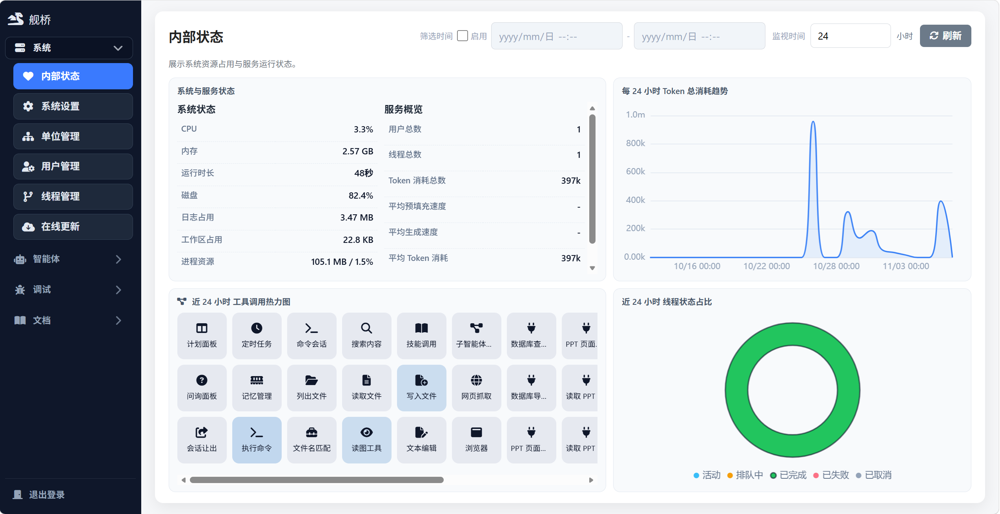

# Admin Interface

The governance and debugging backend that ships with the Server; only administrators get in, and day-to-day chat happens in Desktop or Cloud. It starts together with the Server and has no separate installer or build step.

## Interface

<figure class="docs-preview-hero">
  
  <figcaption><strong>Admin</strong>: a dense, easy-to-scan governance and debugging backend.</figcaption>
</figure>

Top-level navigation has **4 groups and 19 items**:

- **System (7)**: internal state, system settings, system messages, org units, users, threads, online update
- **Agents (5)**: model config, preset agents, companions, tool management, system prompts
- **Debug (5)**: debug panel, throughput test, performance test, capability evaluation, multimodal debug
- **Docs (2)**: manual, API

Tables, logs and monitoring panels are paginated, filtered or capped instead of rendering everything at once; the debug panel's right side is the thread trajectory view.
