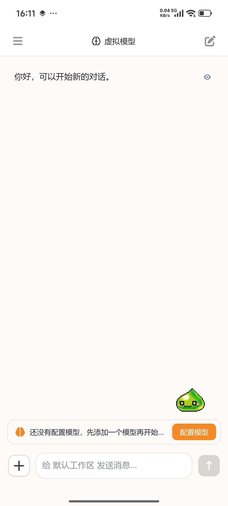
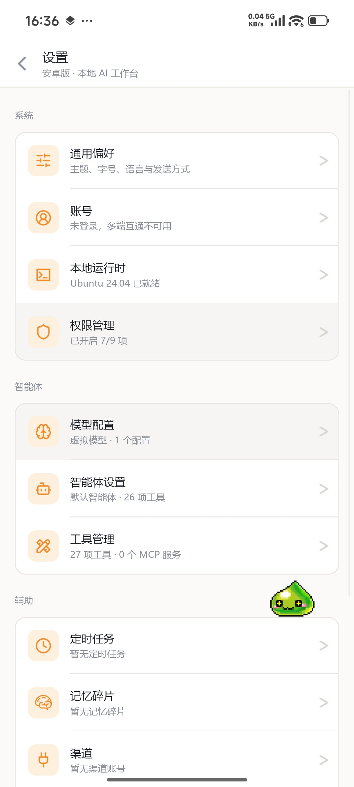

# Android Interface

The Desktop's Android form: it lives on your phone, calls the same engine in-process, keeps data on the device, and needs neither a Server nor a computer.

## Interface

  <figure>
    

      
      
    

    <figcaption><strong>Android</strong>: the Desktop's phone form — chat on the left, settings and permissions on the right.</figcaption>
  </figure>

- **Single column**: the session drawer and model entry at the top, the timeline in the middle, the composer and plus panel at the bottom, reusing the Desktop's interface components.
- **Type in place**: the composer card is the editor — tapping it raises the keyboard in place and the card grows with the draft (about six lines, then it scrolls inside) instead of opening a separate page.
- **Plus panel**: above the keyboard, with Preset questions / Upload file / Take photo — presets fill the draft with the active agent's template, upload opens the system picker, and a photo is saved into the workspace `temp/chat_media/source` and attached to the composer, so the next message tells the model about it.
- **Hold to talk**: with an empty composer, the right-hand key is the microphone. Hold it and a strip appears above the card (red dot, timer, "Release to transcribe, slide up to cancel"); releasing puts the text straight into the composer for editing, and sliding up a row before releasing drops the clip. Recognition uses the speech model configured in Settings; without one it falls back to the phone's own recognizer, marked "On-device recognition" on the strip, and only asks you to add a model when neither is available.
- **Settings**: models, appearance, archive, local runtime, permissions, online update and help.
- **Permissions**: notification, microphone, overlay, accessibility service, battery optimization and app-install state in one place; tapping jumps to the matching system page and the list refreshes on return.
- Narrow screens unfold complex capabilities on demand, with the same interaction habits as the Desktop.
