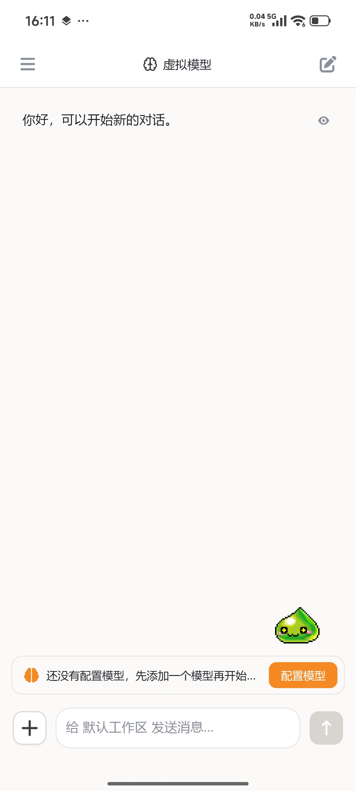
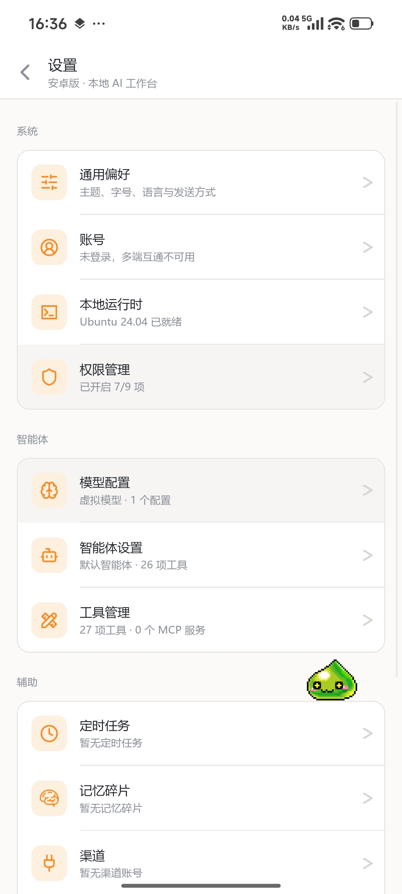

# Android Interface

The Desktop's Android form: it lives on your phone, calls the same engine in-process, keeps data on the device, and needs neither a Server nor a computer.

## Interface

  <figure>
    

      
      
    

    <figcaption><strong>Android</strong>: the Desktop's phone form — chat on the left, settings and permissions on the right.</figcaption>
  </figure>

- **Single column**: the session drawer and model entry at the top, the timeline in the middle, the composer and plus panel at the bottom, reusing the Desktop's interface components.
- **Settings**: models, appearance, archive, local runtime, permissions, online update and help.
- **Permissions**: notification, microphone, overlay, accessibility service, battery optimization and app-install state in one place; tapping jumps to the matching system page and the list refreshes on return.
- Narrow screens unfold complex capabilities on demand, with the same interaction habits as the Desktop.
