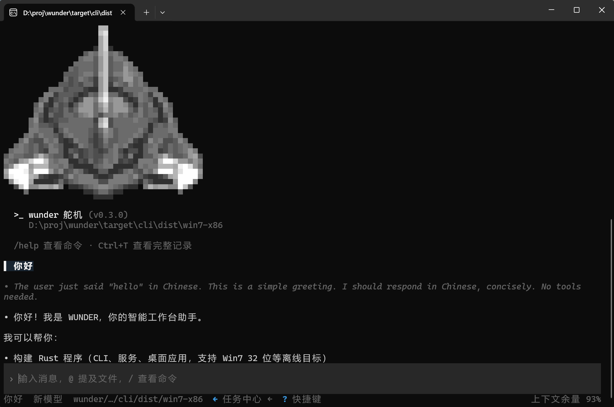

# CLI Interface

The manual local entry point: terminal-driven, scriptable and pipeline-friendly. It calls the engine in-process and reuses the same configuration, tools and storage — no second execution path.

## Interface

<figure class="docs-preview-hero">
  
  <figcaption><strong>CLI</strong>: the manual local entry point inside a terminal.</figcaption>
</figure>

- **Layout**: conversation area on top, composer at the bottom; `/` opens the command palette and `!` runs a shell command directly.
- **Trace view**: `/trajectory` (alias `/trace`) opens the lane-style thread trajectory with search, folding and JSONL export; `t` in the task center opens it without switching threads.
- **Scriptable**: `exec --json` emits a JSONL event stream (`thread` / `turn` / `item.*`) for pipes and automation.
- Thinking, tool batches and results all scroll in the same window; images can be pasted with `Ctrl+V` or dropped in.
