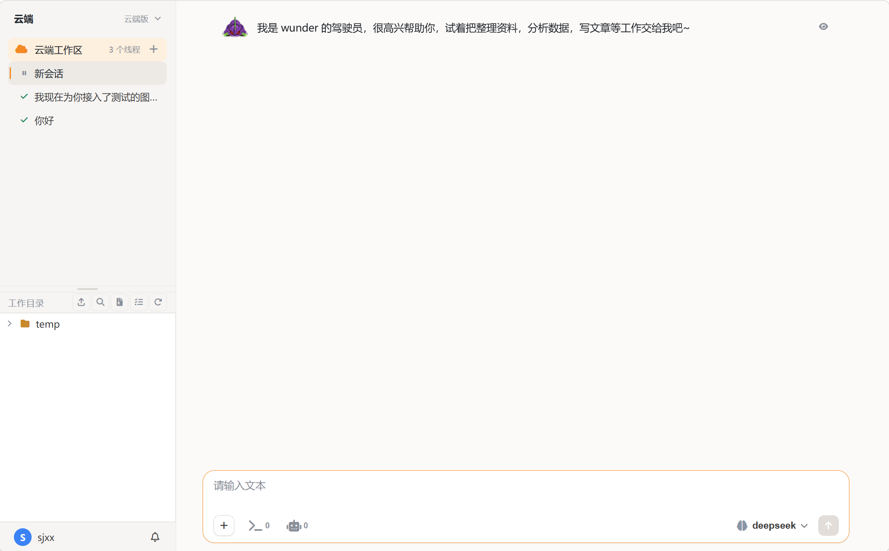

# Cloud Interface

The cloud AI workbench, delivered with the Server: once the Server is deployed, members open it in a browser. It has no process of its own — the build output is served by the web-service container, and data lives on the Server.

## Interface

<figure class="docs-preview-hero">
  
  <figcaption><strong>Cloud</strong>: the single-page app in a browser — left column, timeline and composer.</figcaption>
</figure>

- **Three columns**: the left column holds new tasks, search, the workspace and thread tree, the working directory and the settings entry; the right column holds the chat header, timeline and composer; overlays carry file preview, online editing and companions.
- **10 settings categories**: General, Account, Tool management, Agent settings, Companions, Scheduled tasks, Memory fragments, Channels, My devices, Archived threads. Tool management splits into built-in / MCP / skills / knowledge base; My devices is the device-interlink entry, and command approvals pop up inline in the timeline.
- **Composer**: message input (slash commands work too), attachments, send / stop, model switching, approval mode (suggest / auto-edit / full-auto, full-auto by default) and thinking level (grey follows the model; empty / half / full).
- **Timeline**: each reply folds its thinking, tool batches and interim prints under "work process"; the latest turn is expanded by default. States are running / waiting (needs your input or approval) / done.
- **Slash commands**: `/new`, `/stop`, `/compact`, `/help`, `/goal`.
- **Voice**: both voice input and TTS; there is no interactive terminal.
