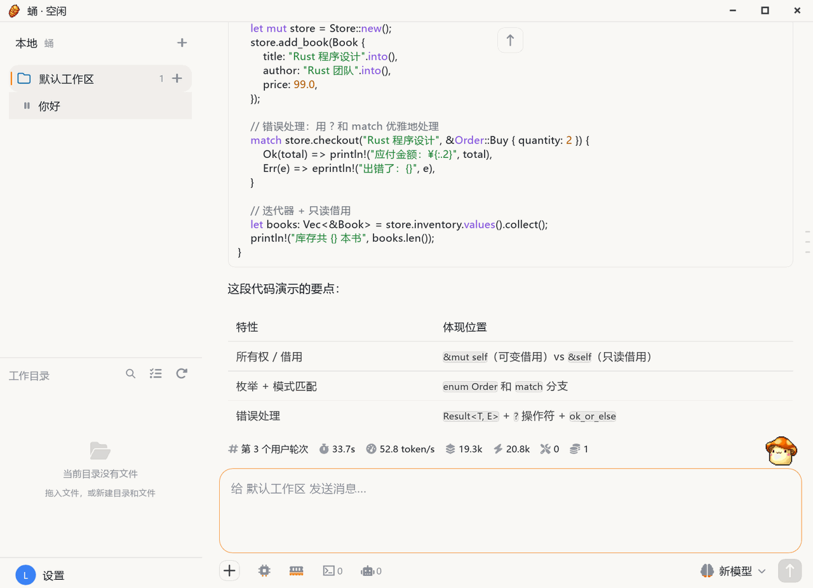

# Desktop Interface

The local AI workbench and the default entry point for individual users: it runs on your own computer, calls the engine natively in-process, occupies no port and needs no local HTTP/WebSocket hop — and no Server has to be deployed first.

## Interface

<figure class="docs-preview-hero">
  
  <figcaption><strong>Desktop</strong>: the local AI workbench; the main window has only two pages, Chat and Settings.</figcaption>
</figure>

- **Two pages only**: Chat and Settings. Every other capability is a panel or dialog on demand, and does not change the two-column layout.
- **Chat page**: the left column holds the task and thread tree, the working directory (local file tree, usage bar, cloud workspaces) and the settings entry; the right column holds the header (workspace / thread name), the timeline and the composer. With no thread selected the right side shows a welcome page.
- **Settings, 11 categories**: General, Local runtime, Account, Models, Tool management, Agent settings, Companions, Scheduled tasks, Memory fragments, Channels, Archived threads. Help sits inside General; the category list is searchable.
- **Panels and dialogs**: interactive terminal, tool management (built-in / MCP / skills / knowledge base), companions, workspaces, working directory, thread trajectory, subagent details, channels, schedules, expert data, patch diff cards, screenshot overlay, tray and notifications, remote-command approval.
