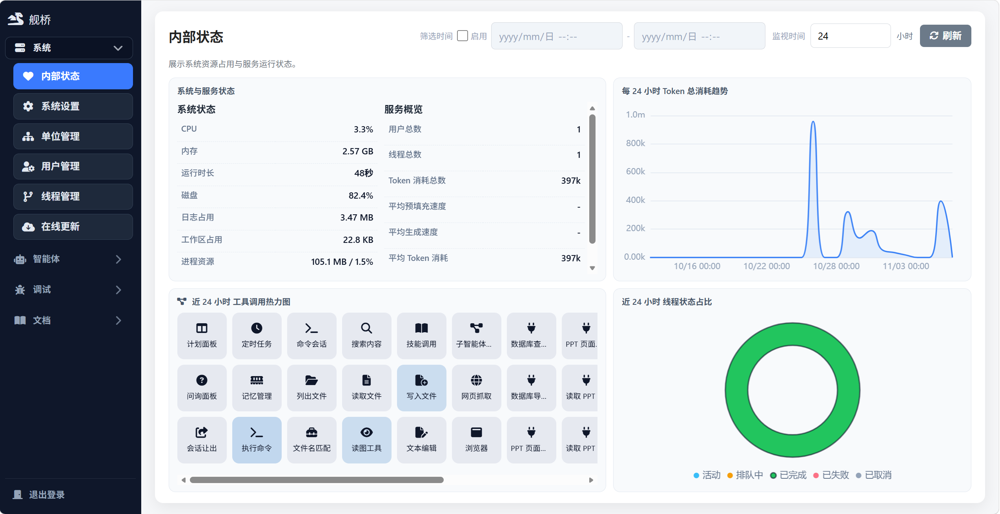

# 管理端界面

服务端自带的治理与调试后台，只有管理员能进；日常对话在桌面版或云端版里做。它跟着服务端一起启动，没有单独的安装包与构建步骤。

## 界面

<figure class="docs-preview-hero">
  
  <figcaption><strong>管理端</strong>：信息密集、适合扫读的治理与调试后台。</figcaption>
</figure>

顶层导航 **4 组 19 项**：

- **系统（7）**：内部状态、系统设置、系统消息、单位管理、用户管理、线程管理、在线更新
- **智能体（5）**：模型配置、预设智能体、形象管理、工具管理、系统提示词
- **调试（5）**：调试面板、吞吐量测试、性能测试、能力评估、多模调试
- **文档（2）**：使用说明书、接口

表格、日志与监控面板都做了分页、筛选或限量，不会一次铺出大量数据；调试面板右侧是线程轨迹视图。
