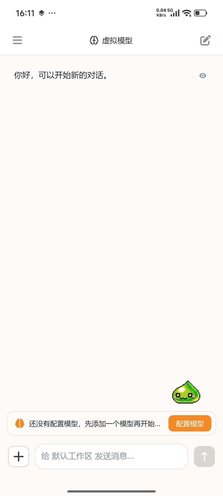
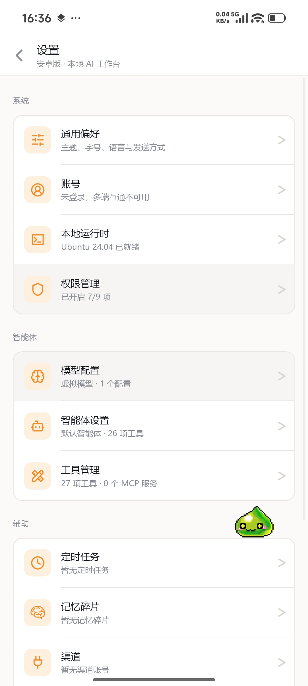

# 安卓版界面

桌面版的 Android 形态：装在自己手机上，同进程直调同一套引擎，数据保存在手机上，不依赖服务端，也不需要连电脑。

## 界面

  <figure>
    

      
      
    

    <figcaption><strong>安卓版</strong>：桌面版的手机形态，左为对话，右为设置与权限管理。</figcaption>
  </figure>

- **单列排布**：顶部是会话抽屉与模型入口，中间是时间线，底部是输入区与加号面板，复用桌面版的同一套界面组件。
- **就地输入**：底部那张输入卡点一下就是编辑区，键盘直接弹出来，卡片随草稿行数长高（约六行封顶，再多在卡片内滚动），不会另开一页。
- **加号面板**：点加号在键盘上方弹出——「预设问题」把当前智能体的一句话模板填进输入框、「上传文件」走系统文件选择，「拍照」直接调用相机；照片存进工作区的 `temp/chat_media/source`，并作为附件挂在输入框上，随下一条消息一并告知模型。
- **按住说话**：输入框里没有草稿时，右下角那颗键就是麦克风。按住说话，输入卡上方出现录音条（红点、计时与「松手转写，上滑取消」），松手后文字直接填进输入框，可以改完再发；手指往上滑过一格再松手即放弃这段录音。识别优先用设置里配置的语音识别模型；没有配置时改用手机自带的识别，录音条上会标出「系统识别」，两者都不可用会提示去设置里添加模型。
- **设置页**：模型、外观、归档、本地运行环境、权限管理、在线更新与帮助。
- **权限管理**：集中展示通知、麦克风、悬浮窗、无障碍服务、电池优化与安装应用的状态，点按即跳到对应的系统设置，返回后自动刷新。
- 屏幕窄，复杂能力按需展开，与桌面版保持同一套交互习惯。
