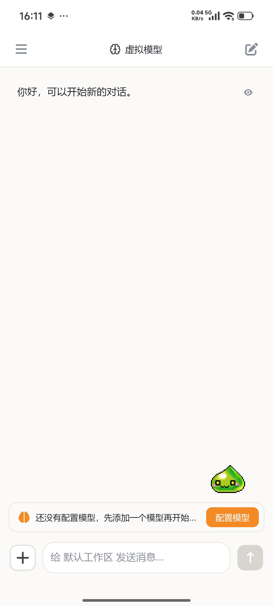
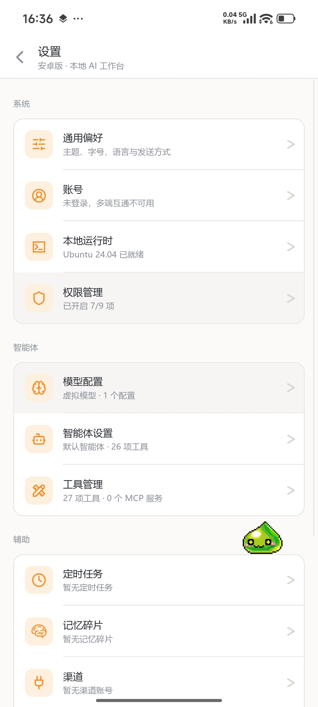

# 安卓版界面

桌面版的 Android 形态：装在自己手机上，同进程直调同一套引擎，数据保存在手机上，不依赖服务端，也不需要连电脑。

## 界面

  <figure>
    

      
      
    

    <figcaption><strong>安卓版</strong>：桌面版的手机形态，左为对话，右为设置与权限管理。</figcaption>
  </figure>

- **单列排布**：顶部是会话抽屉与模型入口，中间是时间线，底部是输入区与加号面板，复用桌面版的同一套界面组件。
- **设置页**：模型、外观、归档、本地运行环境、权限管理、在线更新与帮助。
- **权限管理**：集中展示通知、麦克风、悬浮窗、无障碍服务、电池优化与安装应用的状态，点按即跳到对应的系统设置，返回后自动刷新。
- 屏幕窄，复杂能力按需展开，与桌面版保持同一套交互习惯。
