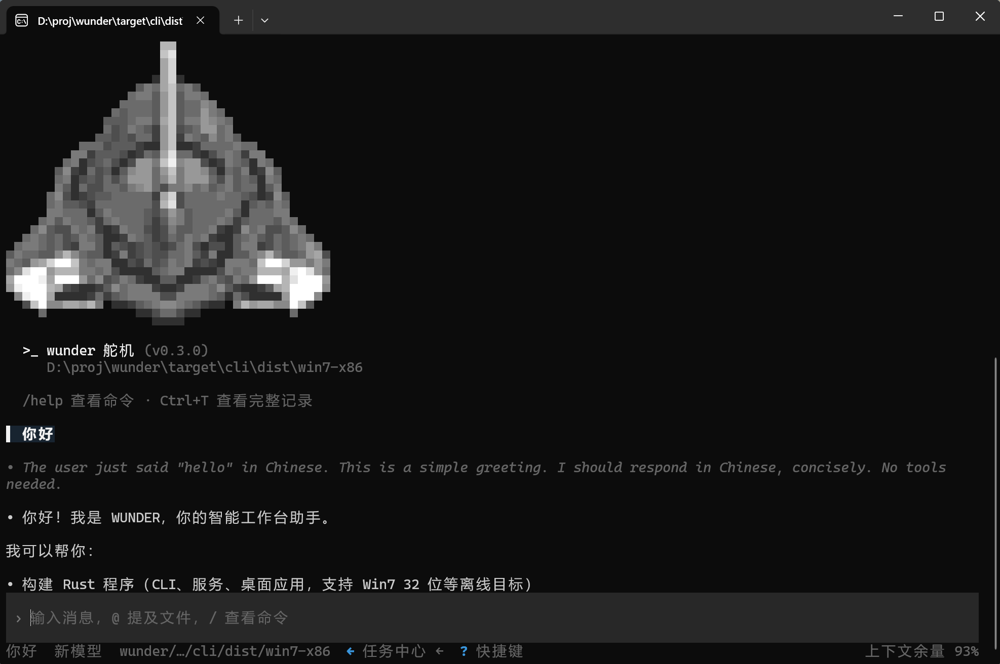

# 命令行界面

手工本地操作入口：终端驱动、可脚本化、可进流水线。它同进程调用引擎，复用同一套配置、工具与存储，不另起一套执行链路。

## 界面

<figure class="docs-preview-hero">
  
  <figcaption><strong>命令行</strong>：上方对话区、下方输入区，斜杠命令操作。</figcaption>
</figure>

- **布局**：上方对话区滚动显示模型思考、工具批次与结果，下方输入区；`/` 打开命令面板，`!` 前缀直接执行 shell。
- **状态与提示**：卡片式工具输出可折叠；`Esc` 中断当前轮次，`F2` 运行提醒，`F3` 查看输出。
- **轨迹视图**：`/trajectory`（别名 `/trace`）打开泳道式线程轨迹，顶部管顺序 / 耗时、轮次与工具折叠、缩放；中间是输入、模型、工具三条泳道；下方是按用户轮次 / 模型轮次排列的台账。宽终端并排显示台账与详情，窄终端按 `i` 切换详情页。
- **脚本输出**：`exec --json` 每行一个 JSON 对象，事件名 `thread` / `turn` / `item.*`。
