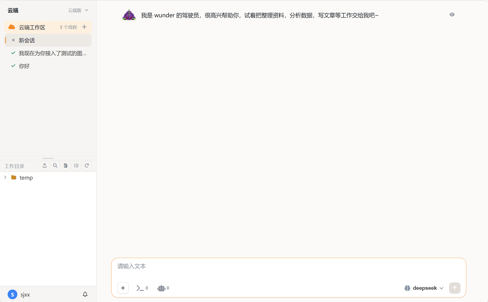

# 云端版界面

云端 AI 工作台，随服务端提供：部署好服务端之后，成员用浏览器打开就能用。它本身没有独立进程，构建产物由网页服务容器下发；数据存在服务端。

## 界面

<figure class="docs-preview-hero">
  
  <figcaption><strong>云端版</strong>：浏览器里的单页应用，左栏 + 时间线 + 输入区。</figcaption>
</figure>

- **主区三栏**：左栏是新任务、搜索、工作区与线程树、工作目录、设置入口；右栏是聊天顶栏 + 时间线 + 输入区；浮层放文件预览、在线编辑与形象。
- **设置 10 个分类**：常规、账号、工具管理、智能体设置、伙伴、定时任务、记忆碎片、渠道设置、我的设备、归档线程。工具管理分内置 / MCP / 技能 / 知识库四个标签页；「我的设备」是设备互通入口，命令审批在时间线里内联弹出。
- **输入区**：消息输入（也可以输入斜杠命令）、附件、发送 / 停止、模型切换、审批模式（建议 / 自动编辑 / 完全自动，默认完全自动）、思考等级（灰色跟随模型，空 / 半满 / 全满）。
- **时间线**：每轮回复下方的「工作过程」折叠中间思考、工具批次与中间打印，最近一轮默认展开；状态为运行中 / 等待（需要你输入或审批）/ 已完成。
- **斜杠命令**：`/new` 新建线程、`/stop` 停止、`/compact` 压缩对话、`/help` 帮助、`/goal` 目标管理。
- **语音**：输入与 TTS 双向可用；没有交互式终端。
