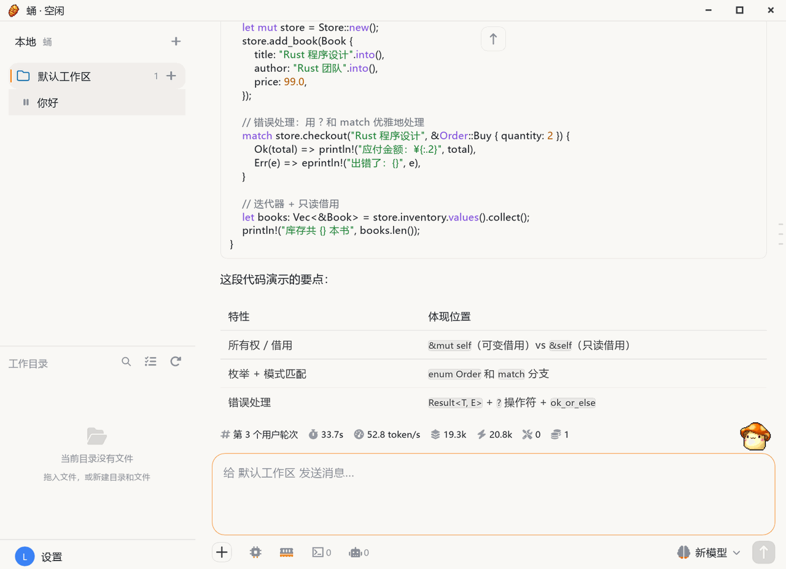

# 桌面版界面

本地 AI 工作台，个人用户的默认入口：装在自己的电脑上，同进程原生调用引擎，不占端口、不经本机 HTTP/WebSocket 中转，也不需要先部署服务端。

## 界面

<figure class="docs-preview-hero">
  
  <figcaption><strong>桌面版</strong>：主窗只有「对话」与「设置」两页，其余能力以面板和对话框展开。</figcaption>
</figure>

主窗只有**对话页**和**设置页**两个可切换页面，其余能力都挂在两页之内。

- **对话页**：左栏是任务与线程树、工作目录（本地文件树 + 用量条 + 云端工作区）、底部设置入口；右栏是顶栏（工作区 / 线程名）、时间线、输入区。没选中线程时显示欢迎页。
- **输入区**：模型切换、思考等级、附件、语音输入、截图、发送 / 停止。
- **设置页 11 个分类**：常规、本地运行时、账号、模型设置、工具管理、智能体设置、伙伴、定时任务、记忆碎片、渠道设置、归档线程；帮助入口在「常规」页内，分类导航支持搜索过滤。
- **面板与对话框**：交互式终端、工具管理、形象、工作区、工作目录、线程轨迹、子智能体详情、渠道页、定时页、专家数据、补丁差异卡、截图遮罩、托盘与系统通知、远端命令审批弹窗。
