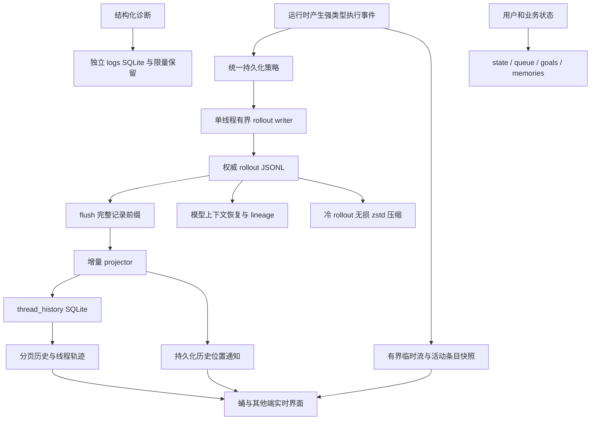

# 对齐 Codex 存储设计方案

> 状态：本地形态采用 canonical JSONL + 分角色 SQLite；舰体服务形态采用 PostgreSQL canonical 记录、控制状态与可重建展示索引。两种实现共享持久化策略、线程身份、分页、恢复和流式契约。2026-10-25 已完成本轮单节点服务验收：本机 13/13、Docker 14/14、浏览器 20/20，十分钟历史零写入/零查询；构建范围及原始证据见[服务存储验收报告](性能基线/2026-10-25-服务存储验收.md)。除当前格式本地历史库的定向瘦身外，不修复、导入或清理旧架构数据库。
>
> 依据：2026-10-27 重新核对的本地 Codex 参考源码快照。下文涉及 Codex 源码的路径均相对于参考工程的 `codex-rs/`；以 `crates/`、`frontend-slint/` 等开头的路径相对于 Wunder 仓库。参考快照未提供可确认的 Git 提交号，因此不标注虚构版本。
>
> 2026-10-27 本地磁盘优化：保留 canonical JSONL 权威与分页语义，但不再照搬参考工程完整 `item_json` 投影，改为日志位置、校验值和有界预览。仅当前格式本地历史库支持核验后自动瘦身与空间回收；本文旧版“不迁移”约束仍适用于更早的单体库及其他旧架构。舰体 PostgreSQL 不受本轮改造影响。

## 1. 目标与重构边界

蛹是本地 AI 工作台。用户应当能够打开历史线程、继续对话、查看已完成的工作过程，同时让空闲线程停止写入，让长期历史通过合理分层和冷压缩降低占用。

本次目标是复刻 Codex 当前分页历史模式的存储架构及其行为：**canonical 执行记录是历史真相源，线程状态、可重建历史投影、诊断及独立业务状态各有职责；运行时流式事件与持久化历史分开。本地由 JSONL + SQLite 实现，舰体由 PostgreSQL 实现。** 不能只把现有大表搬到 JSONL 文件，也不能保留旧写入链后再增加一份 rollout。

重构遵循以下边界：

- 不兼容更早的旧数据库、旧历史格式、旧游标、旧接口及旧缓存。当前格式本地历史库仅执行核验后的轻量索引迁移，不删除原始记录；旧架构目录不自动读入、转换或删除，服务验收使用隔离的 PostgreSQL 数据库或 schema。
- 使用 Codex 的新分页历史模式作为唯一模式，不移植其 Legacy 历史模式、历史迁移器和已经移除的兼容分支。
- 后端契约、执行链、模型上下文恢复、历史查询、线程轨迹、各端订阅、监控和压测同步重构，最终删除旧实现。
- 用户消息、已完成回复、已完成中间条目与工具执行过程按持久化策略保留。**不采用“每个用户轮次固定两条记录”的方案。**
- 不为了节省空间修改已冻结的线程 system prompt，也不在后续轮次重新注入长期记忆。
- wunder-core 定义契约和策略，wunder-runtime 实现存储及执行；蛹、舵机复用本地实现，舰体通过 PostgreSQL 实现同一契约。
- 不复制 Codex 的产品专属账户字段、已移除功能或不适用的执行器。Wunder 必需的多租户、权限和调度能力以明确标注的扩展承接，不能伪称 Codex 已实现这些能力。

第 5–12 节中的 JSONL 文件、SQLite 配置、文件锁、跨库 saga 和冷 zstd 规则适用于蛹与舵机；canonical 类型、持久化策略、分页及在线事件契约适用于全部形态。舰体使用第 13 节的 PostgreSQL 实现，不在服务进程中创建本地历史、状态、队列或日志数据库。

“完全对齐”以事实边界、数据模型、写入顺序、分页语义、恢复方式、压缩与维护行为为准；不要求 Wunder 的文件能被 Codex 直接打开，也不把数据库文件名中的历史版本数字当作架构本身。所有必要差异集中列于第 19 节，禁止实施时悄悄变回旧架构。

## 2. 先校正对 Codex 的认识

| 已核实的事实 | 对 Wunder 的约束 |
| --- | --- |
| rollout JSONL 保存规范执行记录，是历史内容的权威来源 | 历史正文不能以 SQLite 中的另一套会话日志为准 |
| 参考快照的 `state/thread_history_migrations/0001_thread_history.sql` 保存完整 `item_json` | 不能宣称 Codex 只有轻量索引；Wunder 本地改用日志偏移、长度、校验值及预览，是明确的磁盘优化差异 |
| 同一 rollout 可以同时包含模型上下文用的 `ResponseItem` 与展示用的 `ItemCompleted` | 不能承诺“所有正文只保存一次”；应消除无用途的重复，保留上游明确需要的语义表示 |
| 文本、推理、命令输出等 delta 主要是临时事件，完成态才进入历史 | 不再把 token 变化持久化成块、补丁和可重放 changes 表 |
| command/MCP 的完成条目有特定 64 KiB 持久化限制 | 不等于所有工具结果、所有模型上下文和全部记录都有统一 64 KiB 上限 |
| writer 是有界命令队列，由接收命令驱动 | 不能靠高频计时器刷新空闲线程 |
| 当前 writer 实际对每行执行写入和 flush | 不能把“Codex 有后台 writer”描述成已经存在自动合批、延迟刷盘或每条 fsync |
| 冷 rollout 可转为 `.jsonl.zst`；该快照的开关默认关闭 | 压缩能力、压缩参数与默认启用状态必须分别说明 |
| 诊断日志有清理、低频维护和空闲回收 | 不能承诺整个应用绝对没有后台唤醒或任何空闲磁盘活动 |
| state、queue、goals、memories 包含独立状态 | 不能把所有 SQLite 都当成可以无损删除重建的缓存 |

本文中的“完整历史”指持久化策略选中的完整语义历史，包含已完成的中间内容；不包含每一帧流式动画、未完成的 token 尾部、被明确截断的超长展示输出以及模型供应商未提供的内部推理。重新打开线程与查看轨迹必须共享这一口径。

### 当前实施状态

本地实现已有定向测试记录，覆盖 canonical JSONL writer、有限写入队列、增量历史投影、稀疏 ordinal/keyset 分页、正文分段读取、lineage/fork/revert、共享前缀引用保护、冷 zstd 读取与物化、模型上下文恢复、admission 生命周期、控制状态订阅及 canonical cursor 接口。该记录不能作为服务全 PostgreSQL 实现的验收结果。本地删除和回退采用跨 `state_1.sqlite`、`queue_1.sqlite` 与 rollout 文件的持久意图 saga：删除会保留可重试的删除/回收记录，回退会记录新根及队列边界后分阶段发布。回退进程中断后的首次命中该线程访问只检查该线程的持久标记并定向恢复，不会启动全库扫描、空闲定时器或后台重试循环。压测入口复用各形态生产 admission、canonical 元数据创建、writer、projector 与读取链路；合成线程冻结带初始记忆标记的合成 system prompt，并将同一快照写入 `SessionMeta.initial_memory`，每轮模型项带有初始上下文 token breakdown。它仍是明确标记的合成 profile，不读取真实用户记忆库或运行时配置，因此不宣称等同真实用户内容分布。

舰体服务版的线程 canonical 记录、会话元数据、admission 与排队状态、replay 游标、展示索引、工具运行指标及产物资源元数据均写入 PostgreSQL；服务启动和文件工具执行均不得创建本地线程历史、状态、队列或日志 SQLite。工作区文件、附件和浏览器缓存仍按工作区目录保存。蛹与舵机继续使用本地 SQLite/JSONL。当前只验收单节点本机与 Docker 部署，不引入多节点共享存储或故障接管。压缩默认关闭，不能承诺固定压缩比例；Win7/Ubuntu 18.04 仅保留兼容性约束，本阶段不要求在对应真机上完成性能和空闲功耗验收。

此前 SQLite 集成回归记录为 runtime lib 2058 项通过、4 项显式 ignore，以及 runtime 集成测试、蛹 `prompt_preview`、gateway 和固定 seed 跨根重放回归；这些属于当时源码及本地后端测试范围，不能表示当前工作区或全 PostgreSQL 服务已通过。PostgreSQL 测试须使用隔离 DSN，覆盖真实数据库的 admission、canonical 事务、分页展示、重建及连接池释放；不使用“PostgreSQL 后端搭配本地 SQLite”作为服务回归。原本的本地 canonical 根标识绑定与对应测试已移除。上线前验收以本机单节点服务和 Docker 单节点服务为准：验证启动、持久卷重开、历史读取、空闲稳定性、CPU、内存和容量快照；不把 Win7/Ubuntu 18.04 真机性能或整机功耗作为本阶段门槛。本轮已经执行的服务验收及构建差异已归档于[2026-10-25 服务存储验收](性能基线/2026-10-25-服务存储验收.md)；第 16 节保留可复现的执行门槛，不将未运行项或 ignore 项记为通过。

压缩操作的业务结果（如 `done`、`fallback`、`skipped`）与完成条目的生命周期（`completed`、`failed`、`cancelled`）分别保存。可重开的聊天历史读取完成条目及其摘要元数据；模型上下文恢复则读取 `ResponseItem` 并应用 `Compacted` checkpoint。两者使用独立契约，避免摘要在重开时消失，或把工作过程事件误当成聊天正文。

## 3. 当前 Wunder 的结构问题与目标替换

以下为本次核对到的职责分布，不能将其解释成已经测量过每张表的体积贡献。

| 当前职责 | 当前主要入口 | 目标 |
| --- | --- | --- |
| 综合存储接口选择 SQLite/PostgreSQL | `storage_backend.rs`、`storage/factory.rs` | 拆成 ThreadStore 与独立状态仓库，取消“一种后端承接一切”的假设 |
| 会话正文、工具日志、过程块、变更补丁 | `orchestrator/event_stream.rs`、`execute.rs`、`tool_exec.rs`、`services/workspace.rs` | 所有执行历史统一经过 canonical 持久化入口：本地 rollout writer、服务 PostgreSQL writer |
| 持久化完成后通知界面 | `orchestrator/thread_log_committer.rs` | 由 ThreadStore 完成 flush、投影和发布；取消旧块日志提交器 |
| turn/item/block/change 与额外视图投影 | SQLite/PostgreSQL 的 `thread_log_store`、`thread_view_store` | 用 Codex 形态的已完成条目投影替换，不叠加第三套正文 |
| 线程实时观察与补水 | `thread_change_hub.rs`、`thread_change_feeder.rs` | 分离临时流序号与持久化历史位置，使用事件唤醒 |
| 监控、诊断与执行事实混存 | `monitor_store`、`tool_logs` 等 | 本地诊断进入独立 logs DB，服务指标使用 PostgreSQL；轻量监控指标独立于完整正文 |
| 压测直接插入旧日志和视图表 | `storage/*/stress_thread.rs` | 走生产 writer、持久化策略与 projector |

工作目录内容多寡可能影响其他扫描任务，但线程存储层不得依赖工作目录遍历维持自身状态。本文解决存储产生的无效写入和放大；整个应用空闲 CPU 仍需通过采样分解，不能仅凭数据库文件变化推断全部消耗来自 SQLite。

## 4. 总体架构



以上图示为本地实现。舰体中 canonical writer 将相同语义记录提交到 PostgreSQL，展示索引与提交水位由数据库事务维护，详细边界见第 13 节。

各层职责：

| 新组件 | 归属 | 唯一职责 |
| --- | --- | --- |
| `ThreadStore`、`ThreadHistoryReader`、`ThreadMetadataStore` 等窄契约 | wunder-core | 以 ThreadId 操作线程；不暴露文件路径和数据库连接 |
| canonical 类型、持久化分类和输出限制 | wunder-core | 定义哪些语义记录可保存，保证各端规则一致 |
| `LocalThreadStore` | wunder-runtime | 编排线程生命周期、writer、lineage、投影与查询 |
| `PostgresThreadStore` 与服务专用仓库 | wunder-runtime | canonical、admission 与展示索引在 PostgreSQL 中以事务协调，复用相同核心契约 |
| `RolloutRecorder`、reader、compression | wunder-runtime | 文件格式、顺序写入、读取及表示转换 |
| `ThreadHistoryProjector` | wunder-runtime | 从已 flush 的 rollout 增量生成 SQLite 投影 |
| `RuntimeState` 与专用仓库 | wunder-runtime | 线程元数据、目标、队列、记忆和诊断日志 |
| NativeDesktop façade、CLI/TUI、server API | 对应入口 | 调用上述契约，应用权限和传输投影，不另写历史 |

建议模块组织如下；初期可保持在现有 crate 中，不能为拆包引入反向依赖。

```text
crates/wunder-core/src/
  thread_store/            # IDs、契约、分页协议、错误和 canonical 类型
  storage_policy/          # 持久化分类、限制与状态仓库契约
crates/wunder-runtime/src/storage/
  thread_store/local/     # 生命周期、lineage、读写协调
  rollout/                # recorder、policy adapter、reader、compression
  thread_history/         # projector、SQLite schema、分页查询
  runtime_state/          # state、logs、queue、goals、memories
  postgres/               # 舰体 canonical、admission、展示索引及业务状态
```

## 5. 数据目录与事实归属

本地新目录用抽象的 `<storage_root>` 表示。实际路径由现有配置入口解析；配置不再只提供一个通用 `db_path`。

```text
<storage_root>/
  sessions/               # 本地 canonical JSONL / JSONL.zst
  state_1.sqlite          # 本地权威线程与业务状态
  thread_history_1.sqlite # 本地可重建历史投影
  logs_1.sqlite           # 本地限额诊断及轻量指标
  queue_1.sqlite          # 本地 admission / 排队控制状态
  attachments/             # 必须持久保存的独立资源，不塞入日志正文
  tool-results/            # 有配额和有效期的工具结果溢出资源
  .tmp/                    # 压缩、恢复等临时文件与维护标记
  locks/                   # 本地所有权锁，打开只读历史不需要写租约
  db-backups/              # 隔离损坏文件，不能视为正常历史索引
```

`state_1.sqlite`、`logs_1.sqlite` 使用 Wunder 新 schema 的初始版本；参考工程对应文件为 `state_5.sqlite`、`logs_2.sqlite`。数字记录各自 schema 演进，不复用上游旧迁移链。新设计不创建单体 `wunder.db`，也不从旧文件自动导入。

| 数据 | 权威来源 | 是否可重建 | 生命周期 |
| --- | --- | --- | --- |
| 模型执行历史、已完成内容、上下文检查点 | rollout 及其 lineage | 原件本身不可由投影保证还原 | 用户保留，冷压缩；显式删除 |
| 分页 turn/item、历史搜索所需字段 | thread_history | 可由完整 rollout 重放重建 | 与其来源 rollout 一致 |
| 当前 rollout 选择、名称、置顶、分组、工作区等用户状态 | state | 部分派生字段可重建，用户修改不可保证还原 | 用户保留 |
| 排队且已接受的用户提交 | queue | 不可视为历史投影重建 | 完成/取消后按策略回收 |
| 当前目标、长期记忆及其业务状态 | goals、memories | 不能假定只靠历史即可还原 | 按各自语义保留 |
| 诊断信息、重试细节、内部栈 | logs | 可丢弃但须报告损坏/清理 | 有容量与时间限制 |
| 图片、附件和需独立保存的产物 | attachments | 缺失不能伪称恢复完整 | 所有权与引用决定 |
| 临时流式尾部、进度和活动状态 | 进程内有界状态 | 进程崩溃可能丢失 | 活动执行期 |

舰体的 PostgreSQL 数据目录由数据库容器的独立持久卷管理，不属于服务应用的 `<storage_root>`。服务应用目录只保存工作区文件、独立附件/产物与运行缓存，不写入 `.sqlite`、会话 JSONL 或 canonical 根所有权标记。

舰体在 PostgreSQL 控制面和线程表之下为每个用户配置不透明的 namespace；不能使用用户输入拼接磁盘路径。所有 namespace、线程和资源解析先做权限校验。默认蛹仅使用自己的本地 namespace，不引入服务版账户依赖。

## 6. canonical rollout 数据模型

### 6.1 标识与位置

| 标识 | 含义及约束 |
| --- | --- |
| `ThreadId` | 用户可见的稳定任务线程；revert 不改变它；同一智能体可拥有多个 ThreadId |
| `RolloutId` | 一段物理历史的唯一身份；不能因路径搬移、压缩或重新打开而变化；revert 创建新的 RolloutId |
| `TurnId` | 引擎一次 turn 的身份；不能用“数据库行数”推算用户轮次 |
| `RootTurnId` | 将插话、恢复等引擎 turn 关联到同一用户轮次；按实际调度语义生成 |
| `ItemId` | 语义条目身份；流式开始、delta、完成和界面替换引用同一身份 |
| `ordinal` | rollout 记录序号；lineage 后缀从继承位置继续编号；不是 token 序号 |
| `byte_offset` | JSONL 未压缩字节空间的位置；必须指向完整记录边界，压缩前后含义相同 |
| `HistoryPosition` | `(rollout_id, end_ordinal_exclusive, end_byte_offset)`，精确表达继承与截断边界 |
| `history_revision` | 读取快照/当前 lineage 的校验凭据；不是另一个不断更新的正文版本表 |

第一个 rollout 可使用与 ThreadId 相同的标识，但类型必须区分。本地投影以 RolloutId 为分区键；不能因上游 schema 某列名叫 `thread_id`，就错误地把稳定 ThreadId 当成物理历史身份。服务当前记录按 `(ThreadId, ordinal)` 索引，`service_threads.rollout_id` 校验历史身份，`history_revision` 保存下一条 ordinal；服务 `HistoryPosition.end_byte_offset` 使用相同的逻辑 ordinal，不表示本地文件字节地址。

用户发送一条消息计一轮用户轮次；模型每发起一次模型调用计一轮模型轮次，一次调用可以包含一批工具调用，最终回复属于该调用的产物。统计器同时报告模型请求、工具调用和总执行动作，不把 Codex 的 turn、item、ResponseItem 行数直接当作 Wunder 的模型轮次。

### 6.2 记录封装与类型

本地采用与 Codex 相同的逐行 JSON 封装思路：时间戳、`ordinal`、`type`、`payload`，UTF-8，一条完整记录以换行结束。服务将相同 canonical JSON 保存在 PostgreSQL 记录行中，由事务保证完整记录边界，不附加文件换行或本地偏移。不为每个 token 附加一份公共元数据。

核心持久化变体对齐上游：

- `SessionMeta`：线程身份、rollout 身份、创建来源、初始指令、工具和工作区能力、父线程及 `history_base`。系统提示词和初始记忆一经确定即冻结。
- `TurnContext`：继续执行所需的 turn 级上下文、模型选择与执行策略。引用稳定初始状态，避免无意义地重复构造整套历史。
- `ResponseItem`：模型上下文实际需要的消息、推理条目、工具调用和结果、配置变化等。模型恢复必须读取这一语义层，不能把 UI 的 TurnItem 反向猜回模型上下文。
- `EventMsg`：按白名单持久化 `TurnStarted`、`TurnComplete`、`TurnAborted`、`ItemCompleted`、目标更新、回退、已应用设置和使用量等事件。
- `Compacted`、保留上下文和相关检查点：记录模型上下文的压缩结果及恢复边界，不删除用户可见的原始历史。
- 计量记录：保存上游口径对应的实际用量及来源，避免只保留一个无法核验的累计数字。

仅在 Wunder 存在对应能力时实现其 canonical 变体。临时子智能体以独立线程和必要父子关联表达；不借此次重构恢复已经移除的蜂群编排。

### 6.3 持久化选择矩阵

| 内容 | rollout | SQLite 历史投影 | 在线显示/说明 |
| --- | --- | --- | --- |
| 用户消息和已完成助手消息 | 按上下文/完成态语义保存 | 保存对应完整完成条目 | 重新打开后可查看和复制原始内容 |
| 已完成的助手中间消息、计划及供应商实际提供的推理条目 | 按 canonical 类型保存 | 对应展示条目可分页读取 | 不仅保留最终答案；没有提供的内部内容无法还原 |
| 工具调用参数、调用身份、完成状态 | 保存 | 对应完成条目保存 | 可还原调用过程；凭据不进入持久化参数 |
| 命令完成条目的展示输出 | 保存，按 64 KiB 策略截断 | 保存同一已截断表示 | 明示截断；不能显示成“完整输出” |
| MCP 完成条目的结果 | 保存，按上游专用 64 KiB 截断规则 | 保存同一已截断表示 | 不自行把结构化截断替换为不合法 JSON |
| 其他工具上下文结果、原始 ResponseItem | 按各自类型和上游上下文策略保存 | 仅生成对应展示条目 | 不套用上面两类的统一限制 |
| 文本、推理、计划与命令输出 delta | 不保存为历史行 | 不保存为 block/change | 有界在线通道与活动条目状态 |
| ItemStarted、进度、工具 begin、临时告警 | 不作为独立历史事实保存 | 不保存持续更新的运行态正文 | 活动快照显示；最终状态由完成/中止记录表达 |
| 失败的最终语义、用户中止 | 保存相应完成/中止状态 | 保存 turn/item 的失败或中止状态 | 调试栈进入 logs；不能因 Error 事件临时化而丢掉失败结果 |
| 原始 HTTP 请求/响应、每次重试栈和扫描细节 | 默认不保存历史 | 不进入历史投影 | 经脱敏进入限额诊断；不常驻完整 prompt 副本 |
| 图片和二进制资源 | 保存 canonical 引用及协议必需信息 | 保存展示引用 | 受权限控制的独立资源；不在诊断库反复编码 |

持久化策略必须只有一个入口，在线 writer、恢复、导出和压测使用同一实现。展示输出的截断不改变工具是否实际执行成功；模型上下文的截断在既有工具结果/上下文策略处显式完成，不能通过 UI 的截断倒推模型收到的内容。

### 6.4 “节省空间”与“完整”的明确边界

节省主要来自取消无效 delta/block/change 记录、清除多套无用途的正文投影、诊断限额和冷文件压缩。仍会保留 rollout、上下文表示与已完成条目投影之间的必要重复，这是对齐 Codex 分页设计的成本。

用户文本和助手完成文本不为凑固定体积而静默截断。命令/MCP 展示结果遵循既定截断规则。若工具必须允许查看更大结果，使用独立工具结果资源：有配额、有效期、分页读取与过期反馈；不能顺手新增一份永久无限增长的 raw-output 归档。必须长期保留的文件由附件/产物能力显式承接。

不承诺保留任意大的所有原始字节却使空间固定，也不承诺未经测量的压缩比例。

## 7. 写入与一致性协议

### 7.1 单 writer 与有界内存

每个活动线程由唯一 writer 持有 append 文件句柄。命令对齐 `AddItems`、`Persist`、`Flush`、`Shutdown`、`Discard`，队列容量采用上游的 **256 条命令**；无命令时等待 `recv()`，不设置周期 flush 定时器。

命令数上限不能代表内存上限。针对 32 位进程，增加 Wunder 的全局/线程字节预算：初始线程待写预算 8 MiB、进程待写预算 32 MiB，大记录独占写入配额，不能与 256 个同等大小记录同时堆积。数值作为实施基线，通过目标机测试收紧。生产者异步等待配额，不能在 UI 线程阻塞，也不能丢弃已接受的用户输入、完成事件或中止事件。

单条特别大的合法用户消息不复制进多层 `Vec`/JSON Value。请求入口、编码器、writer 交接缓冲区所有权；超过可处理资源边界时在接受前明确拒绝。不能先显示已持久保存，再静默裁掉尾部。

新建空线程可先保留待定元数据，首次有效持久化时再创建 rollout。关闭未使用线程不产生空文件和后台清理债务。writer 注册表、每线程锁、观察器和缓存随最后一个活动句柄释放，不保留无界 ThreadId 到锁的映射。

### 7.2 唯一提交顺序

对一次需要持久保存的追加，顺序固定为：

1. 线程写锁内确认 writer 所有权、当前 RolloutId 和生命周期状态。
2. 通过统一 policy 过滤与规范化记录，分配稳定 ItemId/ordinal。
3. append 完整 JSONL 记录并完成 recorder 的 flush barrier。
4. projector 只读取 barrier 覆盖的完整记录前缀，在一次 SQLite 事务内提交条目及投影水位。
5. 发布持久化历史位置/投影水位；界面按 ItemId 将临时条目替换为完成条目。

**投影可以落后 rollout，绝不允许领先 rollout。** 文件追加与 SQLite 提交不是跨介质事务，不能画成一个数据库事务后声称原子完成。

对齐源码时先保留“每行 write_all + flush”的行为；后台任务只负责所有权和异步调度，不虚构自动延迟合批。后续若改变刷写边界，须作为单独行为变更测量，不能混入本次对齐而不说明。

### 7.3 确认语义

| 返回状态 | 保证 | 不保证 |
| --- | --- | --- |
| 在线 delta 已发送 | 订阅者收到临时内容 | 不代表写盘或崩溃后可恢复 |
| 命令已入队 | 运行时持有有界待写命令 | 不代表 rollout 已完成 |
| rollout 已 flush | 完整记录已交给文件系统，能够按完整前缀恢复 | 不等同于 `sync_all`，不宣称抗突然断电 |
| 投影完成 | 对应历史内容可由 SQLite 分页读取 | 不使 SQLite 成为历史真相源 |
| `sync_all` 完成 | 达到所选平台可提供的更强同步边界 | 不等同于跨文件、跨设备原子事务 |

默认活跃记录同步强度对齐 Codex，不为每个 token 或每一条记录新增 `sync_all`。压缩临时文件发布等边界按上游执行必要的同步。任何“已经保存”的 API 字段必须说明它对应 flush 还是更强同步，不能混用。

### 7.4 故障处理

| 故障窗口 | 必须行为 |
| --- | --- |
| flush 前 writer 失败 | 当前提交失败；停止接受后续追加，报告可识别错误，不先生成成功投影 |
| rollout 成功，SQLite 失败 | 历史已保存；暴露 `projection_pending`，通知不得伪造已投影水位；后续打开/读取按需追赶 |
| SQLite 事务中崩溃 | 事务回滚；从旧 offset/ordinal 幂等重放，不产生重复条目 |
| 投影已提交、通知未发送 | 重新订阅以持久化游标补水，不重复执行工具 |
| JSONL 尾部没有换行 | 读取只承认完整前缀；重开 writer 前在独占锁内识别、隔离不完整尾部，不能直接接续出一行坏 JSON |
| 中间记录损坏或 ordinal 异常 | 报告异常位置并保护原件；不能把缺行历史当完整成功恢复，也不能悄悄用 UI 投影反写覆盖原件 |
| 磁盘满、权限变化、文件被替换 | 保持错误状态，释放/取消受影响执行；禁止无限重试并持续刷诊断 |

Codex 的写入失败有保留未写后缀及有限重试的处理，Wunder 对齐其“有界恢复、终态失败可见”的行为。投影失败后的重试使用请求触发或有次数上限的退避；没有新变化时不永久轮询损坏文件。

只读打开不会建立执行租约。运行中线程使用本地进程内锁和操作系统文件所有权锁，进程退出后由系统释放；不为了“用户正在看此线程”定时向 SQLite 写 heartbeat。

### 7.5 跨库删除与回退的持久 saga

`state_1.sqlite`、`queue_1.sqlite` 和 canonical 文件不能被一个 SQLite 事务覆盖。实现不把“依次写成功”伪称为原子提交；会先在能表达后续身份与边界的一侧写入持久意图，再在每个独立事务或文件发布边界完成一个可验证、可幂等的阶段。每个阶段都在同一 ThreadId 的生命周期 gate 与文件所有权锁内执行。

回退的顺序为：记录带有旧 rollout revision、目标完成 turn、新 rollout 身份、`history_base` 和相对文件路径的 state intent；在 queue 中冻结该线程并确认不存在活动执行；以临时文件和同步后的完整 `SessionMeta` 发布新 suffix；在 state 事务中切换当前 rollout、写入不再引用 rollout 的回收记录；按已确认的用户轮次裁剪 queue；最后移除 state intent 并确认 queue 的回退标记。各阶段重试会检查旧/新 revision、suffix 内容及队列边界，已经发布的新根不会被另一份内容覆盖。若只留下 queue 标记，后续恢复只完成其幂等确认。

删除的顺序为：在 state 写入删除 intent；在 queue 标记删除并移除已接受提交；在 state 事务中删除线程目录映射并把失去引用的 rollout 写入持久回收表；以每批最多 64 个 rollout 执行物理文件和对应历史投影回收；最后清除 state intent 与 queue 所有者记录。任何阶段失败时，线程保持从普通目录和新提交入口隐藏，但 intent、所有者或回收记录仍保留，显式重试删除或按用户的删除清理可以继续完成，不能把未完成删除当作成功。

回退恢复只在访问目标 ThreadId 时进行：先作两次短数据库标记查询，只有命中 state intent 或 queue 回退标记才取得 gate 和文件锁并续跑 saga。删除和 rollout 回收也只由显式生命周期操作触发。两者都没有启动扫描、空闲扫描、定时 wakeup 或“最终一致性”后台循环；连续故障保持可见的 pending 状态，等待下一次相关的显式操作。

## 8. SQLite 拆分与历史投影

### 8.1 数据库基本配置

各 DB 统一通过一处连接配置初始化，采用 WAL 和与上游一致的 `synchronous=NORMAL` 基线。使用有界连接池；蛹初始按每库 1 个写入者、最多 2 个只读连接配置，未用到的 queue/goals/memories 按需打开，避免多个库各建一套大线程池。

仅为 logs DB 启用经过审计的后台页回收，不能给所有 DB 统一启动 vacuum worker。新库在初始化时正确配置 vacuum 模式；禁止每次启动跑全库 VACUUM、全目录 rebuild 或全历史 JSON 解析。

数据库版本、连接池、busy timeout、checkpoint 和损坏处理归各 DB 统一管理。不得由 UI 点击、监控轮询和任意 DAO 自行执行维护 PRAGMA。

### 8.2 thread_history 最小 schema

以下是目标结构的核心约束，实施时补齐上游当前分页功能需要的字段及索引，不移植与 Wunder 无对应能力的表。

```sql
CREATE TABLE thread_turns (
    rollout_id TEXT NOT NULL,
    turn_id TEXT NOT NULL,
    root_turn_id TEXT,
    rollout_ordinal INTEGER NOT NULL,
    status TEXT NOT NULL,
    error_json TEXT,
    started_at_ms INTEGER,
    completed_at_ms INTEGER,
    duration_ms INTEGER,
    first_user_item_id TEXT,
    final_agent_item_id TEXT,
    start_byte_offset INTEGER,
    end_byte_offset INTEGER,
    end_ordinal INTEGER,
    updated_at_ordinal INTEGER NOT NULL,
    PRIMARY KEY (rollout_id, turn_id)
);
CREATE UNIQUE INDEX thread_turns_page
    ON thread_turns(rollout_id, rollout_ordinal);
CREATE INDEX thread_turns_changes
    ON thread_turns(rollout_id, updated_at_ordinal);

CREATE TABLE thread_items (
    rollout_id TEXT NOT NULL,
    turn_id TEXT NOT NULL,
    item_id TEXT NOT NULL,
    rollout_ordinal INTEGER NOT NULL,
    created_at_ms INTEGER NOT NULL,
    item_type TEXT NOT NULL,
    record_byte_offset INTEGER NOT NULL,
    record_byte_length INTEGER NOT NULL,
    item_bytes INTEGER NOT NULL,
    item_digest BLOB NOT NULL,
    preview_json TEXT NOT NULL,
    updated_at_ordinal INTEGER NOT NULL,
    PRIMARY KEY (rollout_id, turn_id, item_id)
);
CREATE UNIQUE INDEX thread_items_page
    ON thread_items(rollout_id, rollout_ordinal);
CREATE INDEX thread_items_turn_page
    ON thread_items(rollout_id, turn_id, rollout_ordinal);
CREATE INDEX thread_items_changes
    ON thread_items(rollout_id, updated_at_ordinal);

CREATE TABLE thread_history_projection_state (
    rollout_id TEXT PRIMARY KEY,
    next_rollout_byte_offset INTEGER NOT NULL,
    next_rollout_ordinal INTEGER NOT NULL,
    projector_version INTEGER NOT NULL
);
```

本地只保存记录定位、SHA-256 及有界预览，不保存完整正文。分页、可见性和模型消息分类在轻量索引中完成；需要完整条目时按位置读取 canonical 记录并校验身份、长度与摘要。fork 的临时视图同时携带真实来源 rollout，不能把子线程身份当作正文来源。SQLite 中不再并存 `item_json`、`payload_json`、`body_json`、block payload、change payload 和 trajectory payload 多套同义正文。

已有表也叫 `thread_items` 不代表可以保留其旧语义。本次采用全新 schema，不追加一层兼容视图把旧块日志继续伪装成新历史。

### 8.3 projector 规则

- 从 `(next_rollout_byte_offset, next_rollout_ordinal)` 继续解析，原始偏移以未压缩内容为准；只消费换行结束的记录。
- 以 rollout 身份及预期起点检查并发；插入/更新条目与前进水位在同一 DB 事务完成。
- 幂等键由稳定 ItemId、TurnId、RolloutId 决定，不按“收到事件次数”生成新条目。
- 对 `ItemCompleted` 物化完成条目，对 turn 状态与设置等应用规范投影。临时 delta 不进入投影。
- 投影算法版本变化可显式失效并重建所需分区，不修改原始 rollout。业务代码不能直接写该库。
- 重建采用流式解析与有界批次，初始每批不超过 512 条或 4 MiB，并主动让出执行权；禁止一次分配“文件末尾减起点”大小的缓冲。此处是为 32 位目标收紧资源边界的明确扩展。
- 普通启动不全量重建；打开线程先追赶其必要分区。全库维护任务独立、可取消、有进度，不能挂在每次获取线程列表之前。

### 8.4 state 与独立业务库

state 负责当前 rollout 映射、列表元信息、归档状态、名称、预览、工作区、分组、置顶等。显示预览使用有限长度字段，不保存另一份完整消息。用户编辑的名称和排序属于权威用户状态，不能声称删除 state 不会损失任何信息。

queue 保存已接受但未消费的用户提交，goals 保存当前目标状态，memories 保存长期记忆业务状态。历史中保存目标变化不代表 goals 当前状态可随意丢弃；记忆抽取来源和当前记忆也不是同一事实。

默认损坏策略按事实类型区分：日志可隔离重建，thread_history 显式修复投影，权威业务库保留原文件并标记不可用，提供恢复入口，不无声创建空库继续声称数据完整。参考工程多库采用 `BackupAndRebuild`、thread_history 采用 `Unavailable`；Wunder 对权威业务状态采用更保守的可见失败策略，差异见第 19 节。

## 9. 历史读取、流式输出与恢复

### 9.1 统一接口

对外只接受 ThreadId 和不透明游标，不接受任意 rollout 路径。建议核心操作如下，Rust façade 和 HTTP/RPC 使用相同语义：

| 操作 | 输入重点 | 结果与约束 |
| --- | --- | --- |
| `create_thread` / `resume_thread` | 初始化配置、ThreadId | 返回元数据和活动句柄，不附带全部历史 |
| `append_items` / `flush` / `shutdown` | 强类型 canonical 条目 | 返回 rollout 与 projection 水位，错误可区分 |
| `list_threads` | workspace、归档筛选、keyset cursor | 仅元信息，默认 50、最大 200 条 |
| `list_turns` | ThreadId、方向、cursor | 默认 20、最大 100 轮，返回条目计数/摘要 |
| `list_items` / `read_item` | turn 范围、类型、cursor、ItemId | 默认 100、最大 500 条；受序列化响应预算限制 |
| `read_item_content` | ItemId、内容位置 | 大正文按 UTF-8 安全边界分段读取，不静默损坏原文 |
| `subscribe_thread` | 持久化位置、临时订阅位置 | 先历史补水与活动快照，再接收增量 |
| `load_model_context` | 当前 rollout 与 HistoryPosition | 恢复模型所需上下文，与显示分页独立 |
| `fork` / `revert` / `archive` / `delete` | 显式边界与预期 revision | 生命周期内串行协调，返回新身份/状态 |

页面数量不足以控制大条目内存。分页响应初始预算 2 MiB；单条超大文本通过内容分段接口返回，保留稳定 ItemId 与内容位置，保证复制/导出可以取得完整保留文本。这是资源边界扩展，不新增持久化 block 表。

列表不使用不断增大的 OFFSET，不先加载所有 turn 再截取。只打开轨迹面板时加载对应页；不为了侧边栏未展开的线程预读全部历史。

### 9.2 游标与 lineage

游标绑定 namespace、ThreadId、当前 rollout/lineage、查询方向、筛选条件和位置。压缩改变物理表示时允许保守失效重试，但不能改写逻辑 ordinal/HistoryPosition；revert 或 lineage 变化使旧查询快照失效，返回明确的 `history_changed`，由界面重新补水。

上游 `history_revision` 包含路径及文件元信息等快照依据，不能把它误当成永久业务版本号。Wunder 读取前后检查一致性，活动历史的普通追加通过水位向前推进；不能因每追加一条记录就强迫用户重新加载全部已完成条目。

对继承历史按有界 lineage segment 查询并归并；每个 segment 带独立 RolloutId 和截止位置。分页读取不把祖先和子线程完整文件拼成一个巨大内存字符串。

### 9.3 在线事件与历史事件分开

保留两个位置体系：

1. 持久化历史位置：可用于进程重启后的历史补水。
2. 临时流位置：只在当前进程/活动执行内有效，用于文本连续性和去重。

订阅流程必须处理“建立订阅期间又有新事件”的竞态：先登记有界订阅，获取持久化水位与活动快照，在同一逻辑边界之后继续发事件。完成条目通过 ItemId 原位替换临时条目，不能复制出两条回复。

慢消费者落后时，不无限保留所有 token；返回 resync 标记并以活动条目当前内容快照续接。同一进程内的重连、切页及重新打开活动线程应能看到尚未完成的当前尾部。已完成内容从 canonical 历史恢复：本地使用 rollout/SQLite，服务使用 PostgreSQL；进程崩溃前尚未落到完成态的 token 不保证恢复，必须明确显示执行已中断。

临时尾部和输出环形缓冲均有字节上限。很长的单个未完成条目若超过在线快照预算，只能显式标识流式预览受限；完成态保留文本仍按 canonical 策略处理。不能一边说内存有界，一边为每个未完成条目无限增长快照。

蛹直接通过强类型 NativeDesktop façade 在同进程订阅；不为新方案增加本机 HTTP、WebSocket 或 bridge 子进程。蜂巢与远程客户端使用舰体传输层，舵机复用运行时事件。UI 按约 16–33 ms 合并显示更新，UI 内存分块不等于数据库永久保存分块。

### 9.4 模型上下文恢复

从 SessionMeta、TurnContext、ResponseItem、compaction/retained-context 检查点和 lineage 恢复模型上下文。恢复结果必须与执行前保留的上下文语义一致，不能从“聊天窗口最后两条消息”重新构造。

上下文 token 预算只决定发送给模型的内容；历史保留策略决定用户还能查看什么；zstd 压缩只改变物理表示。三者必须有独立类型、独立配置和独立指标，禁止用一次“压缩历史”同时隐含删记录、改提示词和压磁盘文件。

长期记忆只在线程初始化时注入。恢复原线程读取已冻结的初始指令；重新打开、切换前端或重建 SQLite/PostgreSQL 展示投影不得触发再次注入。

## 10. fork、revert 与线程生命周期

| 操作 | 对齐后的行为 |
| --- | --- |
| fork | 新 ThreadId、新 rollout，`history_base` 引用父 rollout 的不可变范围；不复制整段父历史 |
| revert | 保留 ThreadId，创建新 RolloutId，选择目标边界后接续；不原地截断仍被其他线程引用的文件 |
| archive | 完成必要 flush 后迁移到归档根并更新映射；打开归档只读，不续写执行租约 |
| unarchive | 在生命周期锁内恢复映射与路径；不重建另一套内容 |
| delete | 先阻止新写入、关闭 writer/订阅，清理所属状态并处理引用；不能先删文件再发现子线程依赖它 |
| shutdown | 停止接收新命令，排空已接受命令并等待 flush，释放资源；超时或失败反馈可见 |
| discard | 仅丢弃未持久化的创建/准备结果；不能借此删除已经确认保存的历史 |

引用索引以不可变 RolloutId 建边，包含活动和归档根。引用范围、环检测、最大解析深度和损坏引用都由一个 lineage resolver 处理，各调用方不能各自写一套“追父线程”逻辑。

删除某个线程的用户可见入口，不必然能够马上释放其全部底层历史：被存活分支引用的 rollout 必须保留，或由显式重物化流程解除引用后再删。禁止隐式级联删除其他用户线程。孤立 rollout 的回收按生命周期变更触发，必要的全根引用核对是显式维护，不能放入空闲高频扫描。

归档、压缩、revert、删除和 resume 都参与同一所有权协调。读取只持有短暂快照，Windows 上需要替换/删除文件时正确释放句柄，不能依赖 Unix 下删除已打开文件的语义。

## 11. 冷历史压缩、备份和空间回收

### 11.1 rollout 压缩

对齐参考实现的物理格式和安全发布协议：

| 项目 | 基线 |
| --- | --- |
| 压缩格式 | `zstd` level 3，后缀 `.jsonl.zst` |
| 热度门槛 | 文件修改时间至少 7 天 |
| 最大并发 | 2 个压缩任务 |
| 单次 worker 上限 | 5 小时 |
| 并发运行标记 | `<storage_root>/.tmp/rollout-compression.lock`，6 小时视为过期 |
| 覆盖范围 | 活动与归档 rollout；包含共享 lineage 所需的祖先 |
| 发布 | 写临时文件，校验源文件 identity/大小/时间未变，以无覆盖方式发布，再删除源文件 |
| 读取 | `.jsonl` 与 `.jsonl.zst` 透明读取；切换时有限次数重试 |
| 恢复写入 | 需要 append 的压缩 rollout 在独占所有权下物化为普通 JSONL 后继续，不直接追加压缩流 |

新实现默认关闭自动压缩，与参考工程 `LocalThreadStoreCompression` 的默认状态一致。启用时在启动或显式维护请求触发一次有运行标记保护的扫描；它不是常驻循环。用户设置自动压缩后，界面显示最近一次扫描、候选数、压缩前后字节数、失败数和下次可扫描时间；不要用估算比例承诺节省量。

压缩仅改变磁盘表示，逻辑 `ordinal`、未压缩 byte offset、Lineage 和 SQLite 索引均不变。预览分页只读轻量索引；完整条目、正文分段、搜索、模型上下文和显式重建按需读取原件。冷文件在单次读取操作中复用临时解码快照，不向持久目录发布额外正文副本，也不把全部历史放进内存；冷压缩的随机读取代价高于普通 JSONL，不默认开启自动压缩。

压缩实现须保留目标文件权限与时间属性，失败清理临时文件。Windows 7 不使用需要较新系统 API 的文件锁捷径；在支持范围内使用 Rust/Win32 可用的原子创建、重命名和句柄关闭顺序。目标机实测后才可对替换语义作更强承诺。

### 11.2 SQLite 与附件空间

thread_history 的删除/重建通过删除对应分区或重建新投影库完成，不执行每次删除后的全库 VACUUM。SQLite 自由页会复用，逻辑删除不保证文件立刻变小；需要物理收缩时使用显式、可取消、仅空闲期执行的维护任务，并报告实际前后大小。

附件和工具结果资源按 owner、引用、配额和到期时间清理。历史条目只保留资源句柄和完整性信息；资源被清理时返回“资源已按保留规则回收”，而不是把句柄解析成空文本。所有清理均先验证引用和 namespace，不根据展示页面是否打开决定删除。

### 11.3 备份与导出

本地备份按一致性边界打包：先对相关活动 rollout 执行显式 flush，记录各 SQLite 的备份快照及 WAL 一致边界，再收集 sessions、archived_sessions、独立资源和必要数据库。不能简单复制运行中的 `.sqlite` 主文件而忽略 `-wal`。

导出包含历史 policy 之后的完整语义内容及截断说明，不能从诊断日志拼接。导入旧格式不属于本方案；如后续需要，可作为新 ThreadStore 的单独一次性导入器，输出新 rollout，而不是恢复双写兼容层。

## 12. 诊断日志、监控与空闲行为

执行历史不再借 `thread_log_changes` 充当诊断。本地诊断写入 `logs_1.sqlite`，采用参考工程的可审计基线；服务端指标与资源元数据使用第 13 节的 PostgreSQL 表，不启动以下 SQLite 维护器：

| 策略 | 值与限制 |
| --- | --- |
| 每分区可见内容 | 10 MiB |
| 每分区行数 | 1,000 |
| 分区 | 有 ThreadId 时按线程；否则按进程运行身份 |
| 生命周期保留 | 10 天 |
| 诊断数据库占用预算 | 64 MiB 已占用页；不是承诺物理文件严格不超过 64 MiB |
| 清理触发 | 启动立即一次、之后每 30 分钟；错过 tick 不补跑 |
| checkpoint | 首次维护使用不等待的 passive WAL checkpoint |
| 页回收 | 仅 logs DB；空闲 60 秒、活跃 50 ms、争用 500 ms 的退避基线；合作式短时批次、单维护所有者 |

日志写入按事务中的受影响分区裁剪，而不是先无限插入再全表扫描。监控存储仅保存聚合计数、耗时、失败类别和当前状态，不能把每轮完整 prompt、响应和工具原文再复制一次。日志内容先结构化和脱敏，禁止把凭据、授权头或本地绝对路径写入诊断。

“静静空闲”的可验收定义是：所有线程 writer 队列为空且没有活动任务时，线程历史层没有定时 append、投影、轮询查询、租约续写或压缩写入。仍允许用户明确触发的动作、操作系统 I/O、日志库首次/半小时维护及其他产品已启用的定时服务；它们必须各自有可观测归属，不能伪装为线程历史写入。

应给每种后台唤醒记录原因与持续时间的轻量指标：`rollout_append`、`projection`、`history_rebuild`、`logs_maintenance`、`compression`、`queue`、`workspace_scan` 等。空闲采样报告按原因归类，不能只给总 CPU 百分比后猜测。

## 13. 蛹、舵机、舰体与 PostgreSQL 边界

蛹和舵机默认本地 ThreadStore + 独立 SQLite 根目录，离线时可用。两者不能各维护一套 JSONL 格式、投影 schema 或 context 恢复器。蛹的 NativeDesktop façade 暴露分页读取、内容分段、活动快照和订阅；Slint 使用虚拟列表/限量加载，已完成块稳定，活动尾部按帧合并。

### 13.1 舰体的数据库边界

蜂巢是随舰体提供的云端 AI 工作台。服务进程通过 `RuntimeThreadStore::Postgres` 复用引擎的 canonical 类型、持久化策略和前端事件协议；所有数据库职责都由 PostgreSQL 承载。服务构建默认启用 `postgres-storage`，启动要求 PostgreSQL 可用；`auto` 在服务运行形态中仍表示 PostgreSQL，初始化失败直接报错，不切换到 SQLite。

| 职责 | PostgreSQL 持久化位置 | 权威性与边界 |
| --- | --- | --- |
| 线程目录与冻结配置 | `service_threads`、`service_thread_sessions` | 线程身份、当前 rollout、冻结 system prompt/初始记忆；不依赖文件根目录 |
| canonical 完成历史与模型上下文 | `service_thread_records` | 每条记录保存 canonical JSON、ordinal、类型与必要索引字段；是服务历史真相源 |
| 用户所有权与 admission 生命周期 | `service_thread_owners`、`service_thread_admissions` | 用户轮次、幂等消息身份、排队/执行/终态和待接纳输入；非可丢弃展示缓存 |
| 展示分页与工作过程 | `service_thread_items`、`service_thread_chat_heads`、`service_thread_display_state` | 有界预览、稳定 ItemId 和增量投影水位；全文从 canonical 读取；允许按 canonical 重建 |
| 用户反馈与展示控制 | 专用反馈/控制字段 | 点赞/点踩不改写已完成的 canonical 正文 |
| 工具运行指标与产物索引 | `runtime_tool_metrics`、`runtime_artifact_resources` | 仅保存有界统计和资源元数据；完整工具结果属于 canonical，文件字节属于工作区/资源服务 |
| 身份、权限、配额、智能体及其他业务状态 | 对应 PostgreSQL 业务表 | 各表遵守所属能力的权限与生命周期，不混入线程正文 |

主服务、独立 sandbox 文件工具和压测生成器必须连接同一配置的 PostgreSQL 后端。`PostgresStorage` 不持有本地存储根、`LocalThreadStore` 或 `RuntimeLogs`，不会创建 `state_1.sqlite`、`queue_1.sqlite`、`thread_history_1.sqlite`、`logs_1.sqlite`、会话 JSONL 或根标识文件。数据库连接和初始化状态共享有界连接池，线程 store 的缓存使用弱引用，避免循环强引用导致连接池退出后不能释放。后端直接调用也可按需初始化，无需依赖某个 API 的特殊调用顺序。

### 13.2 提交、回放与恢复

按 ThreadId 串行追加 canonical 记录。单个 PostgreSQL 事务锁定目标线程、确认当前 revision、分配连续 ordinal，写入规范记录、必要展示索引和投影水位后提交。提交成功才发布 durable cursor；在线 token tail 只经过有界内存通道，不写入永久 delta/block/change 表。PostgreSQL commit 是服务端的持久确认边界，本地文件 flush/sync 与跨 SQLite saga 规则不用于服务事务。

服务端 fork 在一个 PostgreSQL 事务中按稳定身份顺序锁定源、目标线程，检查所有者、目标不存在及已结束的用户轮次边界。选中用户轮次的所有续接执行也必须结束，缺失终止事实或混入后续轮次的边界直接拒绝。通过数据库内 `INSERT SELECT` 独立复制 admission、canonical 前缀及展示索引，客户端不读取整段历史；目标获得新 ThreadId、新 rollout 和指向源线程的 parent 元数据，冻结 system prompt、初始记忆和能力快照原样继承。已提交的队列输入不复制，应用信封中的线程身份按结构重绑，正文保持完整。服务端的 prefix 属于目标自身，删除源线程不影响目标，不建立本地 `history_base` 文件引用。

断线恢复按 canonical ordinal 和稳定 ItemId 分页，跳过模型上下文记录时允许游标稀疏。聊天正文、思考、工具过程、额度/上下文用量和轨迹都从同一批 canonical 完成记录投影；不同 API 不能各生成一个随机助手条目。展开工作过程按用户根轮次与执行轮次读取；完成态替换相同 ItemId 的在线尾部，不能把同一轮思考显示两遍。后续计量和用户反馈属于独立控制状态，不重复追加完整回复正文。

服务重启直接从 PostgreSQL 读取 session/admission/canonical 状态，并按请求追赶该线程缺失的展示投影。重建使用有界批次和水位，不扫描全库，不为恢复在本地生成 JSONL。空闲线程不定时写入 heartbeat、正文或游标。数据库自身的 WAL、checkpoint、autovacuum 与连接维护需单独归因，不将数据库物理文件永不变化作为线程层的验收条件。

### 13.3 单节点部署和运维

本阶段只验收一个服务执行节点及一个 PostgreSQL 实例，可在本机或隔离 Docker Compose 中运行。PostgreSQL 数据卷负责数据库持久化，工作区/附件卷负责文件字节持久化；两者分别备份，引用与权限信息保存在数据库。JSONL 导出是用户显式触发的输出格式，不能反向成为服务运行的第二份权威历史；服务不启动本地 rollout 冷压缩任务。

不设置本地 canonical 根标识与 PostgreSQL schema 的绑定，不维护文件 writer 租约。多节点调度、共享工作区、分布式执行所有权和故障接管不属于本阶段交付，也不能仅因改用 PostgreSQL 就宣称已支持。容量报告分别记录数据库总字节、相关表及索引字节、逻辑 canonical 字节和资源文件字节，不把本地 SQLite/WAL 字节填入 PostgreSQL 结果。

远程 API 必须进行 tenant/owner/thread 权限校验后再取得 ThreadId 的 metadata、投影或资源。内部 RolloutId、文件位置、锁状态与 SQLite 错误不得直接作为外部 API 返回值。

## 14. 需要删除或整体替换的实现面

本节是实施清单，目的是防止新旧机制并存。具体文件名以实施前的当前树为准，其他开发者同期改动不改变此依赖顺序。

| 现有区域 | 处理 | 原因与替代 |
| --- | --- | --- |
| `crates/wunder-core/src/storage_backend.rs` 的巨型 `StorageBackend`、`ConversationLogStore`、`ThreadLogStore` | 删除/拆分 | 以 `ThreadStore`、`RuntimeState`、业务专用契约替代，避免所有形态被同一巨大后端绑死 |
| `crates/wunder-runtime/src/storage/{mod,backend,factory,sqlite,postgres}.rs` 的单 DB 装配 | 重建 | 按第 5、8、13 节分库与分角色装配 |
| `storage/sqlite/schema.rs` 和 PostgreSQL 中的 `thread_logs`、`thread_items`、`thread_item_blocks`、`thread_log_changes`、旧 metrics/trajectory 表 | 移除 | 新 `thread_history` 是完整完成 item 投影，不复用旧字段或双写 |
| `terminal_transcript_blocks` | 移除 | 终端正文不再另建永久块历史；完成工具条目/独立资源承接 |
| `tool_logs`、`artifact_logs` 中与 canonical 执行历史同义的正文 | 移除或迁为资源元数据 | 工具调用和完成结果归 canonical；附件/产物只保留独立资源职责 |
| `orchestrator/event_stream.rs` 的 TextTails/blocks/change 持久化 | 替换 | delta 只走临时有界通道；完成态交 canonical writer |
| `execute.rs`、`tool_exec.rs` 分散的 append_chat/append_tool_log | 收敛 | 仅生成强类型 item，由统一 policy/writer 落盘 |
| `orchestrator/thread_log_committer.rs` 与无界 per-session gate | 删除 | writer 生命周期和有界锁表管理串行性，完成后发布投影水位 |
| `services/thread_log.rs` 及 diagnostics patch/replay 逻辑 | 删除/改接 | 历史读取来自 projector；诊断走独立 logs |
| `services/thread_change_feeder.rs`、`thread_change_hub.rs` | 重写 | 采用活动流 + 持久化位置补水，不查 change 表轮询 |
| `thread_view_{source,projection,store}`、`services/thread_view_rebuild.rs` | 移除正文投影；保留必要轻量 metadata | 轨迹由 turn/item projection 导出，禁止再保存全量 tile/body |
| SQLite/PG `session_lock_store`、`thread_open_leases` 的查看续约语义 | 重构 | 只读查看不写 lease；执行所有权使用生命周期协调 |
| `services/workspace.rs` 的 Chat/ToolLog/ArtifactLog 写队列 | 拆除/改为资源服务 | 不再做第二份历史写队列 |
| `native_chat_turns.rs`、`frontend-slint/src/native_chat*`、`thread_trajectory.rs` | 改造 | 调用新分页/订阅 façade，保持长历史虚拟化和稳定已完成块 |
| CLI/TUI 的线程注册、patch log | 改造 | 复用 ThreadStore cursor 与临时订阅，不维护平行日志 |
| chat/core/ws、云线程观察、管理监控 API | 同步改造 | 所有调用方使用同一 cursor、权限与错误语义 |
| `storage/stress_model.rs`、SQLite/PG `stress_thread.rs`、`services/stress_thread.rs`、压测 API/桌面入口 | 重写 | 生成真实 canonical 事件并走生产 write/project/read 链路 |

删除旧 schema 前，先删除所有消费者、测试辅助和诊断 SQL；编译期不得保留“临时兼容 adapter”。新系统上线判定为旧写入路径、旧 changes/block 查询、旧视图 rebuild 和旧压测直插均不存在，而非两套都能运行。

## 15. 分阶段实施与切换门槛

没有历史兼容要求不等于可无序修改。以下阶段可以在原型主线连续完成，但每阶段必须可编译、测试，不建立生产双写或回退旧库的常态路径。

| 阶段 | 交付 | 完成门槛 |
| --- | --- | --- |
| 0. 定义 | core IDs、canonical item、policy、窄存储契约、错误/游标类型 | 对照本方案的序列化、policy、ID 不变量单测通过 |
| 1. 本地事实层 | recorder、文件布局、single writer、有界配额、完整前缀 reader | 断电窗口模拟、并发追加、空线程不建文件、无空闲定时 append |
| 2. 投影 | thread_history schema、projector、分页/内容分段、重建工具 | 投影可落后不可领先；删投影重建后内容/顺序/状态一致 |
| 3. 执行迁移 | orchestrator 只生成 canonical item；context/fork/revert/归档生命周期接入 | 一条真实工具执行从流式到重开历史只走新链路 |
| 4. 前端和 API | Desktop/Slint、CLI、服务 API、蜂巢观察与权限接入 | 大历史分页、重连和活动尾部测试通过；无前端全量加载 |
| 5. 辅助状态 | queue/goals/memories/logs 拆分、维护、备份、压缩 | 空闲维护归因可见；损坏策略和压缩恢复测试通过 |
| 6. 删除旧系统 | 删除旧 tables、DAO、view、changes/blocks、直插压测、兼容分支 | `rg` 和构建证明没有旧链路；干净新根端到端通过 |
| 7. 性能验收 | 本机与 Docker 单节点服务基准、容量报告 | 达到第 16 节门槛并记录运行方式、版本、样本 |

每个阶段使用独立测试数据：本地为全新临时根，服务为隔离 PostgreSQL 数据库/schema 与工作区卷。测试只清理自己创建的资源。因为不兼容旧格式，切换发生在新的存储根或服务数据库；不写“自动迁移成功”文案，也不在用户现有数据上试验 schema。

## 16. 压测、验证与验收标准

### 16.1 用真实链路生成样本

旧压测的直接 bulk insert 会绕开 policy、writer、JSON 序列化、投影、读取、WAL 和 UI 页大小，无法代表用户。当前生成器已复用生产存储链，API、任务服务与生成器支持可选 `seed`；任务状态返回原请求的用户轮次、每轮模型请求数、请求 seed，以及实际用户轮次、模型请求数、模型动作数、工具调用数、完成条目数、rollout 记录数和最终 seed。同一 seed 用于复现语义负载，线程身份、轮次标识和时间戳仍独立生成。任务采用原子准入，最多一个运行作业、八条任务记录，只有实际 writer 返回后才结算终态，避免显示失败后仍在后台写入。

容量报告按后端分别采集。本地压测任务的有界快照读取当前 revision rollout 的 raw/zstd 文件，以及固定的 `state`、`queue`、`thread_history` SQLite 文件与各自 WAL。当前服务生成器返回 `storage_bytes=None`，由隔离验收驱动的 `storage_audit` 查询 PostgreSQL canonical 逻辑字节和相关关系物理字节，不能将未测量字段解释为 0，也不能拿本地文件大小填入服务结果。线程逻辑字节与共享库/表物理占用分别标注，不能错误相加为单线程独占增量。快照不递归扫描根目录，读取失败只使 `storage_bytes` 缺席，不会把已经提交的生成任务改记为失败。生成器现已提供 `typical`、`complex`、`adversarial` 三种确定性场景，并由 API（`scenario` 字段，兼容 `profile` 别名）、CLI（`--profile`）和设置页选择；任务状态、CLI 报告和线程 capabilities/message_stats 同时记录场景。三种场景共享固定 seed 和总 item 上限：typical 使用较短上下文、较少工具和较短输出，complex 保持 `storage-stress-v1` 历史分布，adversarial 使用更密集工具、更大上下文及有界工具结果。当前实现不伪装成真实用户内容，也不把取消/断线等控制故障混入确定性负载；这些仍由独立生命周期测试覆盖。固定 seed 的本地跨根重放回归不能替代服务数据库验证；默认 profile 会把冻结 system prompt、初始记忆快照和每轮 token breakdown 纳入存储样本。token breakdown 的分项相加等于 `estimated_input_tokens`；`message_tokens` 与 `estimated_input_tokens` 是总计字段，不重复参与分项求和。

配置必须明确区分：用户轮次、每用户轮次的模型动作分布、工具类型、工具结果大小、文本长度、错误/中止比例和并发线程数。调用方输入“1000 用户轮次 × 1000 模型轮次”时不得暗中改成总次数；极端规模可因资源预算被明确拒绝或分批执行，但报告原请求和实际执行值。

预置三类确定性 profile，且允许覆盖轮次、seed 和场景：

| profile | 目的 |
| --- | --- |
| typical | 短消息、少量工具、符合日常用户轮次/模型轮次比例 |
| complex | 多个模型动作、工具和中间完成消息，验证完整轨迹与恢复 |
| adversarial | 高上下文、高工具密度和有界大结果；取消、断开重连、fork/revert、压缩与投影滞后由生命周期测试覆盖 |

测试数据使用中性合成文本、虚构标识和相对资源名，不能把真实工作目录、身份或密钥写入日志、报告或文档。

本地存储层可运行 `cargo run -p wunder-runtime --features sqlite-storage --example storage_idle_probe -- 600`：在隔离临时根内固定 seed 生成 2×2 样本，重开并以有界分页核对完成历史和模型上下文，再保持恢复后的 writer 与运行时存活十分钟。服务版验收在本机进程和 Docker 单节点服务各执行一次，Docker 的 PostgreSQL 必须挂载持久卷，并在应用容器重启后重新打开同一线程。本地记录 canonical rollout、thread_history/state/queue 与 WAL 的文件集合、长度和修改时间；服务记录 PostgreSQL canonical/admission/投影水位、关系字节、CPU、常驻内存及工作区文件快照，并断言服务数据目录没有创建 SQLite/会话 JSONL。SHM、锁文件与 PostgreSQL 自身维护活动单列。该检查用于确认单节点服务的部署、重开和空闲行为，不要求 Win7/Ubuntu 18.04 真机或多节点环境。

### 16.2 必测场景

- policy：每个持久化/临时分类、64 KiB command/MCP 规则、截断标记、秘密清理。
- writer：本地容量 256、字节预算、背压、关闭、错误；本地和服务均验证并发同线程顺序和不同线程隔离。
- 本地文件：UTF-8、完整换行前缀、空线程延迟创建、尾部截断、错误位置报告、压缩/物化。
- projection：重放幂等、offset/ordinal、投影落后、SQLite/PostgreSQL 事务失败、删除投影后重建、分页和内容分段。
- 服务数据库：真实 PostgreSQL 下的 admission 幂等、排队/撤回、模型上下文、反馈、工具指标、会话重开、canonical replay、投影水位与连接池释放；fork 必须验证冻结初始上下文、续接边界、源删除后的独立性、投影重建及并发目标冲突；主服务和 sandbox 均不创建本地 SQLite/会话 JSONL。
- 读取：正反向 keyset pagination、筛选、轨迹、历史 revision、压缩读取、超长正文内存上限。
- 流式：慢订阅者、订阅竞态、完成替换、进程内重连、崩溃前未完成尾部。
- 生命周期：archive/unarchive、fork、revert、共享祖先删除保护、引用环/损坏引用、并发 close/resume。
- 状态：冻结 system prompt、初始记忆只注入一次、模型上下文和显示历史分别恢复。
- 运维：logs 限额/保留、维护锁、损坏库隔离、备份一致性、压缩中断和临时文件恢复。
- 平台：本机单节点服务与 Docker 单节点服务的大历史打开、持久卷重启、路径/权限、内存峰值、启动时延；Docker 使用与服务部署一致的 PostgreSQL 持久卷和工作区卷。

### 16.3 定量验收

不预先捏造“10 GB 会变成多少 MB”。本地基准报告列出 raw rollout、压缩 rollout、thread_history、state、logs、附件/工具资源与 WAL 的实际字节；服务报告列出 PostgreSQL canonical 逻辑字节、数据库/表/索引物理字节及独立资源字节。重点门槛：

- writer 队列排空后的 10 分钟内，线程历史层追加数、投影事务数、历史轮询 SQL 数均为 0；日志维护等独立活动单独计数。
- 任意历史页不扫描/反序列化整个线程；读取工作量随请求页大小和 lineage segment 数有界。
- 典型/复杂样本重新打开后，用户消息、完成回复、完成中间条目、工具参数/已保留结果、turn 状态、轨迹顺序与 canonical 历史一致。
- 删除本地 `thread_history` 分区或服务 `service_thread_items`/`service_thread_chat_heads`/`service_thread_display_state` 的目标线程投影后，重建不改变 canonical 内容，完成后的逻辑结果一致；任何不可恢复的权威业务状态不会被假装恢复。
- 压测使用生产 writer 与 projector；报告“生成请求”与“实际用户轮次/模型轮次/行动数”，不只报告插入行数。
- 在本机与 Docker 服务环境中，典型和复杂 profile 的 CPU、常驻内存、容量快照、页面加载等待、活动流丢失/重同步次数记录首轮基线；后续回归不得明显超过基线。门槛按本机和容器规格分别记录，不把 Win7/Ubuntu 18.04 真机性能或多节点故障接管混入本阶段验收。

### 16.4 服务验收执行与证据

以下为可复现的执行要求，命令本身不构成通过证据。本轮实际结果见[服务存储验收报告](性能基线/2026-10-25-服务存储验收.md)，其中分别列明构建、场景和限制。测试只连接单独配置的合成 PostgreSQL 数据库，不接触已有用户数据：

| 验收层次 | 执行方式 | 通过证据 |
| --- | --- | --- |
| PostgreSQL 存储契约 | 设置进程级 `WUNDER_TEST_POSTGRES_DSN` 后运行 `cargo test -p wunder-runtime --no-default-features --features postgres-storage --lib postgres_ -- --ignored --skip postgres_capacity_startup_preserves_business_rows_without_history_tables --test-threads=1`；DSN 不写入报告 | 输出实际执行的测试名与数量，覆盖 admission、canonical、分页、重建、fork、连接池释放；禁止把 ignore 数量计作通过 |
| 本机服务 | 使用本轮构建二进制、隔离 PostgreSQL 和临时工作区启动服务，登录合成用户走 HTTP/WebSocket 会话、文件工具及重启恢复 | 记录源码/二进制标识、启动方式、数据库版本、请求结果、重启前后 canonical 指纹和应用目录审计 |
| Docker 单节点服务 | 使用 `scripts/experience-bench/measure-hive.py` 的独立 Compose 项目及下列命令，数据库使用本次创建的持久卷 | 驱动退出 0，报告的每个场景有正确性证据；`storage_audit` 与 `restart_recovery` 均成功 |
| 浏览器实际聊天 | 登录合成用户，新开线程并发送至少两轮消息；响应过程中展开聊天区域的工作过程，然后重开线程 | 思考在完成前连续增长，同一模型轮次只显示一条思考；完成后耗时、速度、上下文占用及额度字段按后端事实显示，重开后保持一致；零用量和不可用状态区分 |
| 空闲与容量 | 任务结束、订阅断开后采样十分钟，并保存 canonical/admission/投影计数和水位、逻辑字节、关系字节、CPU/RSS；PostgreSQL 维护单独归因 | 历史追加与投影写入为 0，无历史轮询与本地历史文件；报告保留原始采样和环境规格，不用单次峰值或短 smoke 宣称稳定性能 |

```powershell
python scripts/experience-bench/measure-hive.py --server-binary target/x86/release/wunder-server --output temp_dir/hive-storage-smoke --profile smoke --user-rounds 30 --model-rounds 30 --idle-seconds 600
```

该命令读取已构建的 Linux 二进制及预先准备的运行镜像，不编译或重启已有服务。默认执行 14 个场景，包括真实沙箱文件工具和空闲观测；省略 `--idle-seconds` 时仅做 12 秒 smoke，不能充作十分钟验收。`storage_audit` 要求每个线程 `history_revision=count(*)=max(ordinal)+1`、最小 ordinal 为 0，展示水位不领先 canonical，并检查十个服务存储关系及应用目录中不存在 SQLite/会话 JSONL/本地根标识。重启前后 canonical 数量、序号和内容摘要须相同，且重开后可继续一轮。空闲场景在独立测试数据库启用 `pg_stat_statements`，用独立审计角色检查服务历史查询次数、统计重置与淘汰；只把计数写入报告，不要求生产部署开启该扩展。HTTP/WebSocket 驱动不能代替浏览器的流式绘制和工作过程去重验证。完整报告说明哪些项实际运行、失败或尚未验证，不把本地 SQLite 测试结果转记为服务结果。

上述常规存储命令显式跳过百万行容量测试；容量测试须另行在隔离库中以可记录的 `WUNDER_CAPACITY_ROWS` 执行，不能让默认大负载混入日常正确性回归或把跳过结果记作容量通过。

## 17. 可观测性与运行手册

每个线程提供只读的健康摘要：当前 RolloutId、最后 flush ordinal、最后 projection ordinal、是否投影滞后、当前 lineage 深度、压缩状态、当前 writer 状态和最后可识别错误类别。面向用户的蛹只呈现可理解的“已保存/正在保存/历史索引待恢复/存储错误”；详细路径、内部错误和诊断 ID 限授权管理面。

服务健康摘要以 PostgreSQL 已提交 canonical cursor、展示水位、admission 状态及错误类别为准，不制造文件 flush、lineage 深度或 zstd 状态。服务指标增加数据库事务耗时、连接池等待、canonical 逻辑字节和关系物理字节；数据库连接和工作区文件活动分别归因。

关键指标包括：rollout 写入字节和耗时、flush 到 projection 延迟、投影批次数/条目数、重建耗时、分页查询行数/字节、临时订阅丢弃后重同步次数、压缩前后字节、logs 裁剪/回收与 SQLite busy 重试。指标标签不能使用无限基数的 ThreadId 或原始路径；单线程诊断通过按权限查询实现。

运行手册明确区分四类操作：

1. 重建 `thread_history`：不影响 rollout，重建期间历史查询显示索引恢复状态。
2. 隔离 logs：可丢弃诊断，保留备份供排障。
3. 权威 state/queue/goals/memories 损坏：停止受影响能力、保留证据并提示恢复，而非自动空库继续。
4. 历史原件损坏：保护原件、定位损坏范围、提供只读可恢复前缀和导出；不从投影反向伪造为原始 rollout。

上述文件和独立 SQLite 操作仅用于本地形态。服务展示索引只按目标 ThreadId 从 PostgreSQL canonical 记录重建；权威 canonical/admission/业务表损坏时使用 PostgreSQL 备份恢复并停止受影响写入，不启动本地 SQLite fallback，也不从展示预览补造完整正文。服务数据库备份与资源文件备份分别执行并验证引用一致性。

## 18. 参考源码与可追溯依据

以下路径是设计核对依据，实施前如参考快照更新，应重新比对行为而不是仅复制常量：

| 主题 | 参考位置 |
| --- | --- |
| 存储中立 ThreadStore 与类型 | `codex-rs/thread-store/src/lib.rs`、`store.rs`、`types.rs` |
| 默认分页历史、local 组织 | `codex-rs/thread-store/src/local/mod.rs` |
| writer 先 durable 再投影的屏障 | `codex-rs/thread-store/src/local/live_writer.rs` 的 `write_and_project` |
| 增量物化、完整换行前缀 | `codex-rs/thread-store/src/local/thread_history_materialization.rs` |
| history projection schema 与后续迁移 | `codex-rs/state/thread_history_migrations/` |
| metadata 与 state schema | `codex-rs/state/migrations/` |
| JSONL 写入、256 容量、延迟创建、flush/recovery | `codex-rs/rollout/src/recorder.rs` |
| persistence policy、64 KiB 规则、临时事件 | `codex-rs/rollout/src/policy.rs` |
| rollout / metadata 协议 | `codex-rs/protocol/src/protocol.rs` |
| fork、revert、lineage、revision | `codex-rs/thread-store/src/local/paginated_fork.rs`、`revert_thread.rs`、`rollout_lineage.rs`、`history_revision.rs` |
| 共享历史引用索引 | `codex-rs/rollout/src/rollout_reference_index.rs` |
| zstd、热度、锁、并发和发布 | `codex-rs/rollout/src/compression.rs` |
| SQLite 分库、恢复与连接配置 | `codex-rs/state/src/sqlite.rs`、`runtime/recovery.rs` |
| 日志保留与低频维护 | `codex-rs/state/src/runtime.rs`、`runtime/logs_maintenance.rs`、`runtime/reclamation.rs` |
| 压缩 feature 默认关闭 | `codex-rs/features/src/lib.rs` |

## 19. 对齐结论与有意差异

| 项目 | 决策 | 原因 |
| --- | --- | --- |
| 本地 canonical JSONL、offset/ordinal、lineage、冷 zstd、诊断限额 | 对齐 | 蛹与舵机共享事实和生命周期边界 |
| 本地 completed-item SQLite 投影 | Wunder 磁盘优化 | 不保存参考工程的完整 `item_json`，只留日志位置、校验值及预览；完整正文按需读取 |
| 当前格式本地历史库瘦身 | 定向迁移 | 核验全部已有正文后切换轻量表并回收文件空间；失败保留旧正文，不导入更早单体库 |
| 旧历史兼容、Legacy history、迁移器 | 不实现 | 用户已授权不考虑兼容；保留会让新架构长期背负双路径 |
| 新库版本名 | 语义对齐、编号独立 | 不能把 Codex 的 `state_5` 等迁移历史当作 Wunder 新 schema 的版本 |
| 32 位进程的全局/线程字节预算、投影流式批次、内容分段 | Wunder 收紧 | 参考的某些读取实现可按剩余字节一次分配；Wunder 的目标平台要求明确防止地址空间耗尽 |
| 舰体全 PostgreSQL 存储 | Wunder 扩展 | canonical、admission、replay、展示索引、指标和业务状态均由 PostgreSQL 承载，复用相同语义契约；不声称 Codex 上游提供了此服务实现 |
| 舰体 fork 的独立历史前缀 | Wunder 扩展 | PostgreSQL 事务内复制已结束用户轮次及其展示索引，继承冻结初始上下文，目标不依赖源线程寿命；本地仍对齐上游共享文件 lineage |
| 多节点共享存储、owner 路由与故障接管 | 后续扩展 | 当前单节点交付不需要分布式租约、共享 rollout 或跨节点恢复协议 |
| 权威业务 DB 的损坏处理 | Wunder 更保守 | 不能把当前目标、队列或记忆误当可由历史无损重建的缓存 |
| 自动压缩 | 默认关闭 | 与参考 feature 默认值一致，避免在未知负载下制造后台 I/O；启用后遵循相同门槛和安全发布 |

完成本方案后，Wunder 的历史不会靠“少记内容”压缩成两行，也不会靠持续 SQLite block/change 写入维持流式效果。它会以可追溯的 canonical 执行记录保存真实完成历史，以可重建投影提供快速分页，以有界临时事件提供流式连续性，并将诊断、业务状态、附件和压缩各放在自己的生命周期中。
