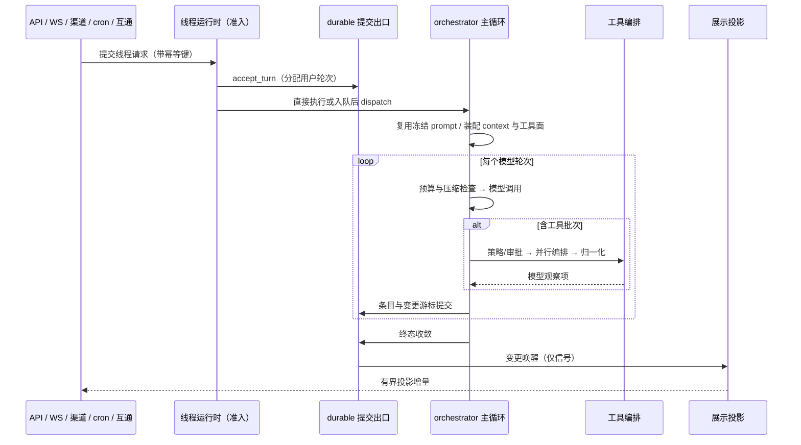

# 智能体核心设计

> 本册约束一类改动：**单个任务线程的执行语义**——轮次如何计量、prompt 与记忆何时确定、压缩/审批/预算/配额在线程生命周期里的位置，以及新增执行逻辑该落在 orchestrator 还是线程运行时。任何要改「线程怎么跑、跑几轮、什么算结束」的改动先读本册。函数级时序、常量数值与落库字段在 [`../技术说明书/03-运行时与执行链路.md`](../技术说明书/03-运行时与执行链路.md)。

## 1. 线程是什么

线程是智能体的**连续执行单元**，也是唯一被允许定义「这一轮模型在想什么、能调哪些工具、什么时候算完」的对象。一个智能体可同时拥有多个相互独立的任务线程；调度、锁与实时状态都按线程隔离，线程之间不共享认知态。

一个线程运行时单元同时包含四个层面，缺一层就不是完整的线程语义：

| 层面 | 内容 | 主要落点 |
| --- | --- | --- |
| 线程状态 | 状态登记、活跃轮次、订阅者数、lease 与准入 | `orchestrator/thread_runtime.rs`（登记表）、`services/runtime/thread/`（准入与调度） |
| 认知上下文 | 冻结的 system prompt、历史条目、模型观察项、压缩状态 | `orchestrator/prompt.rs`、`orchestrator/memory.rs`、`orchestrator/microcompaction.rs` |
| 执行治理 | 工具面、审批、执行策略、超时、重试、预算、配额、轮次上限 | `orchestrator/execute_tools.rs`、`orchestrator/limiter.rs`、`orchestrator/quota.rs`、`core/approval_registry.rs` |
| 现实外壳 | 工作区文件、durable 变更游标、展示投影、记忆库、运行指标 | `services/workspace.rs`、`orchestrator/thread_log_committer.rs`（提交侧见 [03 册](./03-实时投影系统设计.md)） |

## 2. 不可破坏的约束（不变量）

1. 线程首次确定后的 `system prompt` **冻结**，后续轮次只复用不改写。
2. 长期记忆只在线程初始化时随 prompt **注入一次**；此后记忆只经工具检索，不回写认知态。
3. 历史**只追加不重写**；一个模型轮次恰好对应一个可见输出项，其身份稳定可重放。
4. 用户轮次与模型轮次**独立计量**，不合并成「一次消息交互」。
5. 执行准入是「会话锁 + 全局活跃上限 + 持久队列 + 协作让位」，不是用户级互斥。
6. waiting、queued、cancelling、崩溃恢复都是**显式状态**，不由消费者推导。
7. 工具治理由程序结构保证（解析→策略→审批→执行→归一化→提交），不退化为 prompt 约定。
8. 终态只由执行侧宣布；展示层与前端只消费游标。

## 3. 轮次的权威定义

### 3.1 定义

| 概念 | 权威定义 | 由谁分配 | 落点 |
| --- | --- | --- | --- |
| 用户轮次 | 用户每提交一次输入分配一个递增用户轮次；同一 `client_message_id` 重放不重复分配 | queue admission 短事务分配并保留幂等事实 | `orchestrator/thread_log_committer.rs`、`storage/thread_admission.rs` |
| 模型轮次 | 引擎主循环**每发起一次模型调用**自增一次；一个模型轮次内可以包含一批工具调用，工具调用不单独计模型轮次 | 执行主循环 `orchestrator/execute.rs` | `orchestrator/types.rs` 的 `RoundInfo{user_round, model_round, thread_turn_id, is_goal_round}` |
| 可见输出项 | 每个模型轮次恰好对应一个用户可见的 durable 输出条目，身份由「轮次 + 模型轮次」编码 | 模型调用准入时注册；最终回复与统计回写同一条目 | `orchestrator/event_stream.rs`、`orchestrator/tool_exec.rs` |
| 目标轮次 | 由目标驱动器发起、而非人类直接发消息的轮次，用 `is_goal_round` 标记，用于避免重复发出需要人类权限的目标管理调用 | 目标驱动器准入 | `services/goal/driver.rs`、`services/goal/authority.rs` |

时间线结构：

```
任务线程
 └─ 用户轮次 N
     ├─ 模型轮次 1：一次模型调用（可含一批工具调用）→ 一个可见输出项
     ├─ 模型轮次 2：…
     └─ 模型轮次 k：最终回复
 └─ 用户轮次 N+1
```

工具批次在时间线上是独立条目，但**不是**独立模型轮次；「工作过程」（思考 + 工具批次 + 中间打印）是一个用户轮次内最终回复之前的全部中间内容的折叠视图。

### 3.2 为什么这样切

- **KV 前缀稳定**：模型轮次与调用一一对应，历史只在其后追加，system prompt 与既有轮次前缀不变，模型侧提示词缓存才能命中。若在工具调用后再补一次「虚拟轮次」计数，前缀与轮次号就会与实际调用序列错位。
- **补水可幂等**：条目身份由 `(turn_id, model_round)` 决定，重放、断线补拉或多次落库都指向同一条目；随机 id 会让补水产生重复气泡或覆盖正文。
- **可见输出项与轮次一一对应**：前端一行对应一个模型轮次，行 key 稳定，展开/折叠等本地状态不会随流式更新漂移。
- **治理可计量**：轮次上限、预算、配额与熔断都以「模型调用次数」为分母，计量点唯一；混入工具调用会让上限既虚高又不可解释。

### 3.3 反例（错误口径）

| 说法 | 为什么不对 |
| --- | --- |
| 「模型每执行一次动作（模型调用、工具调用或最终回复）记 1 轮模型轮次」 | 与代码不符：工具调用不自增模型轮次，最终回复是当轮模型调用的产物。按此实现会把一次含十个工具批次的调用算成多轮，轮次上限、压缩阈值与缓存前缀全部失真。权威以 `RoundInfo` 与主循环的自增点为准 |
| 「一轮用户输入 = 一次问答」 | 一轮用户轮次可包含任意多轮模型轮次；把两者混同会让排队、取消与补水无法定位到具体中间态 |
| 「把子智能体的轮次折算进父线程轮次」 | 子线程是独立任务线程，有自己的轮次序列；父轮引用只编码来源 `(user_round, model_round)` |

## 4. 线程生命周期与准入

### 4.1 状态登记

线程状态由 `orchestrator/thread_runtime.rs` 的枚举定义并登记：`NotLoaded / Idle / Running / Queued / WaitingApproval / WaitingUserInput`（`SystemError` 当前是未接线的历史位，不作为运行态书写）。**该文件只是登记表**，租约、排队与 dispatch 在 `services/runtime/thread/runtime.rs`。

准入顺序（提交 → 执行）：

1. 接入层构造线程请求并归一化幂等键（`client_message_id`）。
2. `services/runtime/thread/runtime.rs` 受理：先经 durable 提交出口分配用户轮次（幂等），再决定**直接执行**或**入队**；结果区分「立即运行」与「已入队」。
3. 执行前获取会话锁并检查全局活跃上限；繁忙时按退避重试或让新轮次留在持久队列，而不是把错误抛回客户端。
4. 进入 orchestrator：准备请求 → 复用冻结 prompt → 装配 context 与工具面 → 主循环。
5. 终态收敛：写终态条目、发布游标、释放锁、唤醒队列。

### 4.2 排队与协作让位

- **引擎级排队**：线程忙时新轮次进入持久队列（同一张任务账本承载用户轮次、子智能体信箱投递与目标轮次），用户可见排队条只展示人类发起的那部分。队列操作是运行时能力：列队、插话（提升）、撤下、重排。
- **协作让位**：运行中的轮次可在动作边界被要求让出槽位——先停在自己的安全点，把会话锁挂起为 suspended，状态回到 `Queued`，再由下一个被提升的轮次接手；不重放工具、不额外分配用户轮次。
- **人类优先**：自动续跑（目标轮次）只在会话空闲时准入，不与人类消息抢槽位。
- 排队开关是接入层配置：关闭后第二条消息不再入队而是撞锁判「用户忙」，表现为功能缺失。**设计口径**：任何形态都不得依赖关闭开关来简化实现；本地形态默认强制打开。

### 4.3 取消与收敛

取消入口统一处理监视器、调度器、目标续跑与排队任务；运行登记保留祖先链，使根线程的取消能级联到后台后代。取消是 durable 账本上的事实，通知只是加速——这与 [03 册](./03-实时投影系统设计.md) 的「唤醒信号不是真相」同源。

## 5. 执行主链



要点：提交与唤醒的边界、事件身份与游标语义属于 [03 册](./03-实时投影系统设计.md)，本册不重复定义。

## 6. 认知态：prompt 冻结与记忆注入

### 6.1 位置

冻结发生在 `orchestrator/prompt.rs`，仅在**线程首次确定 system prompt 时**执行一次：

1. 读取该线程已存的 prompt；若有效（工作区呈现口径与本地路径都匹配）则**原样复用**，直接返回。
2. 首次确定时把线程的项目约定文件（AGENTS.md 一类）**快照**进 prompt，此后文件变更不影响已确定线程。
3. 在同一冻结点拼接基础指令、开发者与用户上下文、工具面说明、技能与能力说明，并注入一次长期记忆快照与目标工具策略文本。
4. 冻结结果作为隐藏条目经 durable 提交出口持久化，供后续轮次与恢复复用。

### 6.2 不变量与反例

| 不变量 | 理由 | 破坏它的写法 |
| --- | --- | --- |
| 已确定线程的 prompt 不再改写 | 模型侧按稳定前缀复用缓存；改写等于让每轮重新付费，且线程认知态不可复现 | 每轮重新拼装、把最新记忆或最新配置写进 system prompt |
| 记忆只注入一次 | 记忆库变化不应导致线程认知漂移，也不破坏缓存 | 在后续轮次再次调用注入路径；把召回结果写回 prompt |
| 冻结的输入是「首次确定时的世界」 | 让一个线程的行为可解释、可回放 | 用运行态快照（`orchestrator/runtime_snapshot.rs`）或上下文装配（`orchestrator/context.rs`）当冻结依据——这两处都没有冻结逻辑 |
| 工作区呈现口径变更要让旧 prompt 失效 | prompt 里含工作区路径口径，口径变了旧文本就是错的 | 无条件复用已存 prompt |

记忆之后的正确通路：召回与写入都经记忆管理工具；工具结果只作为模型观察项进入历史，不回写 system prompt。细节见 [记忆系统设计](./记忆系统设计.md)。

## 7. 上下文压缩与预算

压缩属于**认知上下文的容量治理**，位置在每个模型轮次装配 context 之前与模型返回之后，由 `orchestrator/compaction_policy.rs` 决策：

| 触发面 | 何时生效 | 设计约束 |
| --- | --- | --- |
| history（历史压缩） | 上下文占用接近模型窗口阈值 | 摘要替换历史，受保护窗口不得吞掉当前用户消息 |
| overflow（溢出恢复） | 模型报上下文超限 | 必须先压缩再重试，不允许静默丢上下文 |
| pre-sampling（采样前压缩） | 采样前预留输出空间 | 预留量来自观测到的容量，不来自估算 |

不变量：

- **只信任 provider 观测到的 token**，估算不参与阈值判定（`orchestrator/usage_accounting.rs`）。
- 压缩**不改写 system prompt**，不删除用户可见条目；被替换的历史以隐藏标记行持久化，可见时间线保持完整（细节见 [上下文压缩设计](./上下文压缩设计.md)）。
- 微压缩只处理**旧的、可复现的**工具观察项，保留最近若干组，且只有在确实省出预算时才替换（`orchestrator/microcompaction.rs`）。
- 压缩窗口的预算再平衡与当前消息保护是同一模块的职责，不散落到服务层（`orchestrator/memory_compaction_budget.rs`、`orchestrator/memory_compaction_window.rs`）。
- 上下文压缩 ≠ UI 分页。历史压缩服务的是 LLM 输入，展示分页服务的是读模型，两者不得共用阈值（[03 册 §6](./03-实时投影系统设计.md)）。

## 8. 工具面与执行治理

三层职责，互不越界：

| 层 | 职责 | 落点 |
| --- | --- | --- |
| 工具面 | 哪些工具对模型可见、可调用；中文名与别名归一；按形态与能力过滤 | `services/default_tool_profile.rs`、`services/tools/catalog.rs` |
| 工具编排 | 解析模型输出 → 策略与审批 → 并行/独占打包 → 超时与预算 → 结果归一化 | `orchestrator/tool_calls.rs`、`orchestrator/execute_tools.rs`、`orchestrator/tool_parallel.rs`、`orchestrator/result_normalizer.rs` |
| 工具实现 | 具体执行体 | `services/tools/`、`services/skills.rs`、MCP 客户端、`services/abilities/` |

不变量：

- 执行主链在 `execute_tools.rs`；`orchestrator/tool_pipeline.rs` 只是四阶段模型与默认关闭的钩子位，不是主链。
- 并行工具取读锁、独占工具取写锁；并行度有上限，可并行名单是显式白名单。
- 工具结果有**两条独立裁剪通道**：展示通道只影响客户端呈现，模型输入通道影响模型看到的观察项。两者必须分开描述，混用会让「前端看到的不全」被误判成「模型没拿到」。
- 工具治理（审批、执行策略、沙盒）由编排层裁决，不由 prompt 描述实现。

能力面划分（工具 = 执行体、技能 = 可调用知识与脚本、能力 = 治理面选择单元）见 [05 册](./05-工具、技能与%20MCP%20系统设计.md)。

## 9. 治理与限额在线程生命周期中的位置

| 机制 | 位置 | 不变量 | 落点 |
| --- | --- | --- | --- |
| 会话锁与全局活跃上限 | 准入阶段，每次执行前 | 锁有 TTL 与心跳，崩溃后由启动扫描收敛；管理员可豁免上限以保证治理通道不被业务流量挤死 | `orchestrator/limiter.rs`、会话锁存储 |
| 持久队列 | 受理阶段 | 队列条目 durable，通知只是加速；子智能体信箱与目标轮次共用同一账本 | `services/runtime/thread/queue_tasks.rs`、`queue_admin.rs` |
| 协作让位 | 模型轮次与工具批次之间的安全点 | 只在动作边界让位，不重放工具、不新增用户轮次 | `orchestrator/queue_handoff.rs`、`services/runtime/thread/scheduling.rs` |
| 轮次上限 | 主循环每轮开始前 | 非管理员有上限，触达时给用户可读提示而非静默停止 | `orchestrator/execute_support.rs` |
| 日配额 | **每次模型请求前**扣减 | 配额判定与计量同源，不按 UI 事件扣减 | `orchestrator/quota.rs` |
| 工具预算 | 每个用户轮次内累计 | 按工具族分档，超预算返回可读拒绝而不是失败整轮 | `orchestrator/execute_support.rs` |
| 审批 | 工具编排阶段，按读/写/执行/控制分档 | 审批等待是显式状态；批准缓存有时效；高危名单与执行策略共同裁决；互通远端的 L3 审批不可记忆 | `orchestrator/execute_tools.rs`、`core/approval_registry.rs`、`crates/wunder-core/src/exec_policy.rs` |
| 重试治理 | 工具失败与模型调用失败处 | 同指纹失败熔断，避免无限重试烧预算 | `orchestrator/retry_governor.rs` |
| 流式看门狗 | 模型流与工具执行 | 空闲超时明确报错并收敛终态，不挂死订阅 | `orchestrator/stream_timeout.rs` |
| 空输出保护 | 模型返回空正文时 | 一次性重试，不循环 | `orchestrator/empty_output_guard.rs` |
| 用量与上下文占用 | 每轮结束后 | 上下文占用只取观测输入量；统计回写同一可见条目 | `orchestrator/usage_accounting.rs`、`orchestrator/tool_exec.rs` |
| 后台任务 | 所有长循环 | 必须带监控标识并有界，禁止无界 spawn | `core/long_task.rs`、`core/bounded_queue.rs` |

具体数值（TTL、并行度、预算、上限）属事实层，见 [`../技术说明书/03-运行时与执行链路.md`](../技术说明书/03-运行时与执行链路.md)。

## 10. 子智能体与协作形态

- 子智能体是主智能体**临时创建的工作单元**：派生、隔离执行、结果回传、任务结束即回收；同一父线程可复用既有子会话继续投递。
- 控制面能力是有限集合：列、取历史、投递、汇报、派生、批量派生、查状态、等待、打断、关闭、恢复（`services/tools/subagent_control.rs`）。父轮引用只编码来源轮次。
- 投递语义：信箱是**轮次内临时态**，容量与单条大小都有上界；模型执行链在下一次模型调用前与正常结束前消费，工具执行途中不插入消息，不改写冻结 prompt，不额外注入记忆。未应用的消息以显式「未应用」收敛，accepted 不等于 durable。
- 运行时侧维护有界活动登记、取消令牌与祖先链（`services/runtime/thread/child_runs.rs`），登记容量与深度都有上界，遍历按页；持久父子关系与执行账本在 `services/subagents/` 与 `chat_sessions` / `session_runs`。
- 子智能体不是线程运行态：父线程不进入「等待子智能体」状态，等待由 `wait` 控制的版本通知 + durable 账本补查实现。
- **蜂群编排（多智能体群、房间、编排态、任务运行账本、资产封装、广场）已从引擎与协议层移除**，当前唯一协作形态是子智能体；个别前端标签与兼容垫片残留属工程缺口，不是设计依据。

## 11. 目标态在线程生命周期中的位置

目标是**会话级持久目标**，它不改变轮次定义，只是改变准入来源：目标驱动器在「phase 为 active + 进程内已武装 + 未达轮次上限」且会话空闲时提交目标轮次（`is_goal_round`）。

- 武装状态是进程内态，恢复或分叉后需要显式重新武装。
- 目标只有轮次上限与连续受阻判定，**没有 token 预算、没有冷却**。
- 目标管理工具是三个独立工具，由宿主盖章区分人类授权，桌面端不作为可选项暴露。
- 入队失败要把目标置为 blocked 并给出原因码，而不是静默重试。

详见 [目标态系统设计](./目标态系统设计.md)。

## 12. 模块边界

```
crates/wunder-core/            核心：配置、鉴权原语、存储契约与记录、路径围栏、执行策略、互通契约、展示分页常量
crates/wunder-runtime/src/
├── orchestrator/              智能体执行主链
│   ├── request.rs             请求准备与幂等键归一
│   ├── execute.rs             主循环（用户轮次 / 模型轮次自增）
│   ├── types.rs               RoundInfo 权威定义
│   ├── prompt.rs              prompt 组装与冻结、记忆一次注入
│   ├── context.rs             上下文装配（不含冻结逻辑）
│   ├── compaction_policy.rs / microcompaction.rs / memory_compaction_*.rs   压缩决策与执行
│   ├── llm.rs                 模型调用与协议差异
│   ├── tool_calls.rs / execute_tools.rs / tool_parallel.rs / result_normalizer.rs   工具编排
│   ├── tool_exec.rs           可见输出项与统计落库
│   ├── event_stream.rs        执行快照与事件发射
│   ├── thread_log_committer.rs durable 提交唯一出口
│   ├── thread_change_hub.rs   变更唤醒信号
│   ├── thread_runtime.rs      状态登记表（非运行时本体）
│   ├── limiter.rs / quota.rs / retry_governor.rs / stream_timeout.rs / empty_output_guard.rs   治理
│   └── queue_handoff.rs       协作让位
├── services/runtime/thread/   线程运行时：受理、排队、调度、取消、子运行登记、信箱
├── services/                  工具、技能、记忆、知识、工作区、渠道、互通、goal、cron、投影重建…
├── api/                       HTTP/WS 接线（只鉴权、校验、转发）
├── storage/                   存储契约实现与展示投影
└── core/                      AppState 装配、审批登记、日志、指标、有界队列
```

边界原则：

- 新增执行语义优先进 orchestrator；线程「怎么被调度」进 `services/runtime/thread/`；「怎么对外可见」进 [03 册](./03-实时投影系统设计.md) 的四层。
- 工具业务实现不进 orchestrator；API 层不承担执行逻辑。
- 前端与本地 façade 不新增轮次、状态或终态概念。

## 13. 反例（曾经的设计错误）

| 错误做法 | 症状 | 正确口径 |
| --- | --- | --- |
| 每轮重新拼 system prompt 或再次注入记忆 | 提示词缓存失效、成本随轮次上涨、同一线程行为不可复现 | 首次确定后冻结，记忆只在该点注入一次 |
| 把工具调用也算模型轮次 | 轮次上限、压缩阈值、重试统计全部失真 | 模型轮次 = 一次模型调用（可含一批工具） |
| 用随机 id 落最终回复 | 补水产生重复气泡或覆盖正文、流式与刷新结果不一致 | 条目身份 = 轮次 + 模型轮次，注册于模型调用准入 |
| 把会话锁当全局互斥、按「一人一会话」设计准入 | 并发任务线程被串行化，排队条形同虚设 | 锁按线程，容量按全局活跃上限，超出走持久队列 |
| 让前端等待完整回复后再做打字动画 | 丢失真实流式连续性 | 连续性优先，按帧合并增量，终态及时落地 |
| 把 `context.rs` / `runtime_snapshot.rs` 当冻结依据 | 改了没用的地方，冻结问题依旧 | 冻结只发生在 `prompt.rs` 的首次确定分支 |
| 用展示分页阈值倒推压缩阈值 | 长会话提前压缩或溢出 | 两套预算彼此独立，各有唯一归属 |
| 把线程状态登记表当运行时本体 | 在枚举里塞调度与执行逻辑 | 登记与调度分文件分职责 |

## 14. 验收标准

- 新线程、续跑线程、恢复线程、渠道触发的线程都走同一主链。
- prompt 冻结与记忆一次性注入有结构性保证（复用路径 + 首次确定路径可在代码里指认）。
- 轮次号在两端一致：蜂巢与蛹读到的用户轮次、模型轮次与条目身份相同。
- 排队、让位、取消、崩溃恢复都能被观测与回放，且不需要消费者侧推断。
- 工具面、审批、执行策略、重试、预算、配额都有明确运行时落点。
- 压缩只影响模型输入，不破坏可见时间线与冻结 prompt。

## 15. 事实细节去向

| 想知道 | 去哪册 |
| --- | --- |
| 主循环函数顺序、提交点、事件名 | [`../技术说明书/03-运行时与执行链路.md`](../技术说明书/03-运行时与执行链路.md) |
| 常量数值（锁 TTL、并行度、预算、上限、超时） | 同上；工具与能力清单见 [`../技术说明书/05-工具、技能、MCP与外部能力.md`](../技术说明书/05-工具、技能、MCP与外部能力.md) |
| 游标、补水与投影机制 | [`../技术说明书/04-实时投影与通信链路.md`](../技术说明书/04-实时投影与通信链路.md) 与本目录 [03 册](./03-实时投影系统设计.md) |
| 记录类型与表域 | [`../技术说明书/06-数据存储、工作区与配置.md`](../技术说明书/06-数据存储、工作区与配置.md) 与 [08 册](./08-数据存储与状态模型设计.md) |
| 接口与事件契约 | [`../API文档.md`](../API文档.md) |
