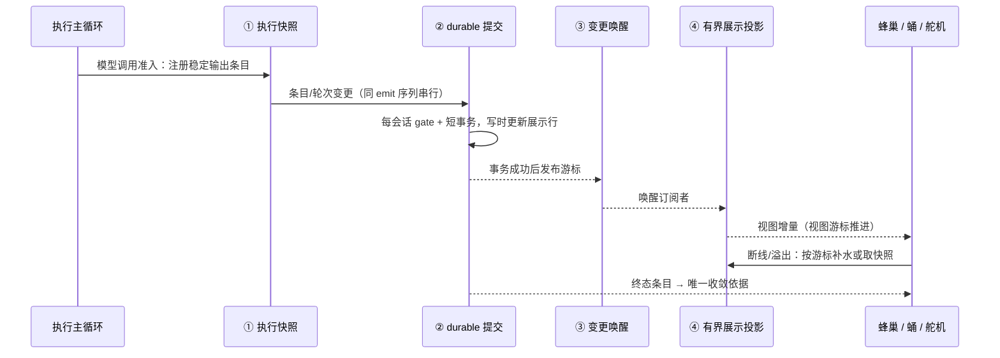

# 实时投影系统设计

> 本册约束一类改动：**谁能宣布线程的状态**。新增实时事件、展示分页、补水路径、订阅通道或前端状态推导时先读本册。事件名清单、游标字段、端点路径与常量数值在 [`../技术说明书/04-实时投影与通信链路.md`](../技术说明书/04-实时投影与通信链路.md) 与 [`../API文档.md`](../API文档.md)，本册不复制。

## 1. 设计目标

实时系统把内部运行态稳定地发布给蜂巢、蛹、舵机、渠道与外部观察者。它不是聊天房间系统，也不是「前端订阅到什么就算什么」的松散推送，而是 wunder 的**公开状态发布层**。

一句话目标：**执行侧决定发生了什么，展示侧决定用户多久能看到，两者之间只靠 durable 游标连接。**

## 2. 核心定义

- 运行时内部状态先成为**追加式的 durable 事实**（条目、轮次、状态变更），再成为对外事件。
- 一个内部对象可以产生多种事件，但只能有一个真相源与一个发布路径（单写者）。
- 列表、时间线、轨迹、摘要、侧栏都是事件的**消费视图**，不是领域对象本身。
- 展示投影是可选、可丢弃、可重建的派生物：它的缺失只影响新鲜度，永远不影响正确性。

## 3. 长期不变量

1. **Snapshot + Delta + Replay** 是所有实时目标的契约；此外必须有 `watch`（明确在看什么）与「要求重同步」的显式控制帧。
2. **提交先于唤醒**：durable 事务成功之后才发布游标；失败或幂等空操作不发布任何变更。
3. **唤醒信号不是真相**：进程内唤醒只是加速，跨实例与异常路径必须靠轮询/补水兜底收敛。
4. **展示游标与执行游标是两个空间**：展示层有独立的视图游标与纪元（epoch），纪元变化即要求整体重同步；两者的数值不得互相解释。
5. **有界**：订阅队列、每页大小、响应字节预算、正文分块、后台重建占空比、慢客户端水位都必须有上界；页面打开不得触发全量重建。
6. **终态由执行侧宣布**：消费者不得用状态帧、超时或本地推断代替终态条目。
7. **流式连续性优先于富文本完整性**：按帧合并增量，不逐 token 重建列表；降级只影响展示，原始消息与复制内容必须完整。
8. **旧口径「一人一会话」已废弃**：并发单位是任务线程，同一用户可有多个线程各自订阅、各自收敛。

## 4. 四层划分

### 4.1 分层与落点

| 层 | 职责 | 关键落点 | 边界（不许做的事） |
| --- | --- | --- | --- |
| ① 执行快照层 | 把模型调用、工具批次、正文增量、轮次与状态变更变成带稳定身份的事件与条目；按帧合并增量 | `orchestrator/event_stream.rs`（发射器）、`services/thread_log.rs`（条目构造、尾部增量合并、回放与导出助手） | 不发展示分页请求、不读展示表；不得在这里做 UI 取舍 |
| ② durable 提交层 | 线程日志唯一写出口：每会话 gate 串行化，短事务落库，成功后才发布游标；重放与空操作幂等 | `orchestrator/thread_log_committer.rs` → `storage/{sqlite,postgres}/thread_log_store.rs`（durable 变更表）；写时同事务更新展示行 | 调用方不得自行拼游标、不得先通知再提交；不得把展示投影当提交前置条件 |
| ③ 变更唤醒层 | 会话级唤醒信号 + 有界帧供给：订阅者立即被叫醒，轮询与补水路径始终保留 | `orchestrator/thread_change_hub.rs`（仅进程内加速，无订阅者即回收）、`services/thread_change_feeder.rs`（durable 帧分页、快照失效与溢出控制帧） | 唤醒层不判定内容、不排序业务语义；hub 丢消息不得影响正确性 |
| ④ 有界展示投影层 | 面向大数据量时间线/轨迹的读模型：分页、字节预算、正文分块、行级增量、后台重建 | 常量与视图模型 `crates/wunder-core/src/thread_view.rs`；写时投影 `storage/thread_view_projection.rs`；投影表与视图游标 `storage/thread_view_store.rs`；未就绪时的源表有界窗口读 `storage/thread_view_source.rs`；重建调度 `services/thread_view_rebuild.rs`；展示读端点 `api/chat/view.rs`；展示增量推送 `api/ws_helpers.rs` | 只读执行侧已提交的事实；不得改写条目内容、不得决定轮次与终态、不得反推执行阈值 |

传输与消费：

| 面 | 角色 | 落点 |
| --- | --- | --- |
| WS 接线 | 线程运行时主通道：连接、订阅、提交、补水、审批、目标命令；ephemeral 与 durable 分流 | `api/chat_ws.rs`、`api/core_ws.rs`、`api/ws_helpers.rs` |
| HTTP 补水 | 快照、变更分页、正文分块、轨迹分页 | `api/chat/events.rs`、`api/chat/view.rs` |
| 蜂巢 | 单一 WS 多路复用 + 本地 reducer/selector，切走即卸载渲染子树但投影继续消费 | `frontend/src/realtime/chat/`、`frontend/src/stores/`、`frontend/src/workers/` |
| 蛹 | 同进程消费 durable 帧与增量，不经本机 WS | `crates/wunder-desktop/` 强类型 façade |
| 舵机 | 同一 feeder 语义；脚本模式输出结构化事件契约 | `crates/wunder-cli/` |
| 舰桥 | 治理与调试面，按线程轨迹读同一投影 | `web/modules/` |

### 4.2 ephemeral 与 durable 的分界

| 类别 | 内容 | 语义 |
| --- | --- | --- |
| durable | 条目、轮次、状态与终态变更，带单调游标 | 真相，可回放，重连按游标补齐 |
| ephemeral | 正文尾部打字增量、命令会话实时输出等尾帧 | 只为即时感，错过可由 durable 补水补回；不参与去重与排序 |

设计含义：**任何只走 ephemeral 的信息都不是事实**，需要持久展示的内容必须先成为 durable 条目；任何为 ephemeral 建回放路径的做法都是在制造第二真相源。

### 4.3 展示投影的游标空间

- 展示层有自己的视图游标与纪元；纪元变化（表被清空重建、投影逻辑升级）即要求消费者整体重同步。
- 源表（执行游标空间）在投影未就绪时提供**有界窗口读**：分页上限、字节预算、clamp 都在读侧执行，读操作不得触发迁移或整行大负载解码。
- 后台重建有占空比与失败退避上限，且**页面打开永远不触发重建**。
- 展示层的增量帧（视图变更、需要重同步）与执行层的 durable 帧不共用游标；转换点在接线层，且转换是显式的。

## 5. 主链时序

关键约束：发射路径上的 durable 提交与队列投递被同一发射序列串行化，保证「游标顺序 == 队列顺序 == 线路顺序」；正文条目在模型调用准入时注册一次，不按 token 注册。

## 6. 为什么展示读模型不能反噬执行语义

这一条是本册的核心边界，也是最近一系列故障的根因：**旧设计只有「thread_log + WS」两层，展示投影被当成执行层的一部分实现**。展示读模型一旦参与执行语义，会出现四类反复复发的错误：

| 反噬形态 | 症状 | 正确边界 |
| --- | --- | --- |
| 在投影里「补」执行字段 | 投影按不存在的键名兜底取值，取不到就用条目类型字符串顶上，整条时间线信息量塌成裸 kind | 执行字段必须在持久化必经点补齐；投影只挑选与截断已有字段，缺失就降级为可读文本，不编造 |
| 多写入者共同决定同一展示行 | 同一身份条目被两条写入路径覆盖，最后写入者的字段集合成为最终形态，同批工具里有的有详情有的没有 | 单写者：必经提交点负责字段完整；其他路径只写自己拥有语义的字段 |
| 把投影行当历史存档 | 投影逻辑修复后对已投影数据不生效（幂等 revision 检查跳过旧行），必须清表并把投影状态置回复建才能重投影 | 投影是可丢弃派生物：允许重建、要求有界重建，禁止把它当唯一真相读 |
| 用展示阈值倒推执行阈值 | 展示分页/字节预算被当作 LLM 上下文预算，长会话提前压缩或溢出 | 两套预算各有唯一归属：上下文见 [02 册 §7](./02-智能体核心设计.md)，展示见本册 §4.3 |

判据（可当作评审问题）：

1. 这个字段/判定能否在 durable 提交层找到唯一写入者？找不到 → 属于执行侧缺口，先补执行侧。
2. 展示层能否被清空重建而不改变任何行为？不能 → 展示层已成为事实源，越界。
3. 前端能否在只读展示投影的情况下正确收敛终态？不能 → 缺 durable 终态，而不是缺前端推断。
4. 展示读路径有没有分页、字节预算与失败退避？没有 → 大数据量下必然反噬执行吞吐与内存。

## 7. 其他实时目标

同一个分层思想适用，但真相源各自独立：

| 目标 | 真相 | 消费面 | 注意 |
| --- | --- | --- | --- |
| 用户世界（站内会话/联系人） | 领域服务与自有事件语义 | 蜂巢、渠道 | 属 `projection` 平面，不参与线程认知态 |
| 对外流事件（外部工作流、目标与子智能体的旁路事件） | 事件服务按流单调递增游标、按流加锁、尾部缓存 | 外部集成、旁路查询 | 与聊天时间线的 durable 游标不是同一空间，不得互相补水 |
| 连接在线态（presence）与观看统计 | 控制面内存态 + 租约 | 舰桥、用户列表 | 只回答「谁在线、在看哪」，不回答「线程是否结束」 |
| 渠道出入站 | 渠道自身 outbox 与运行日志 | 渠道管理面 | 运行日志必须有界（环形 + 去重窗），不得无限增长 |

## 8. 与其他系统的边界

- **与智能体核心**：实时层消费执行侧事件，不决定轮次与认知态；轮次与条目身份的定义权在 [02 册](./02-智能体核心设计.md)。
- **与接入层**：WS/SSE 只做鉴权、订阅、转发与补水调度；不在接线里推导业务终态。
- **与存储**：durable 变更属于线程日志域；展示投影属于同一存储里的派生表，可重建；两者与事件缓存、临时目录、运行时内存态必须区分清楚。
- **与前端**：前端可持有 optimistic 与本地 UI 状态（展开/折叠/滚动位置按稳定 key 记忆），但最终必须被 durable 游标回压校正；切走视图不等于停止投影消费。

## 9. 背压与容量

- 队列与缓冲都有界；水位越限先发「建议重连/重同步」控制帧，再断开该订阅，而不是无界堆积。
- 慢客户端保护：单连接落后不得拖累其他订阅者与执行主链。
- 消息大小、每页行数、响应字节、正文分块大小都有显式上限；超限走分块或降级，不放大请求。
- 输入规模限制在执行入口按字符计量，附件不计入该预算。
- 消费侧刷新节奏按帧合并（约每帧一次），不得逐 token 重建消息列表或整段复制历史。

数值属于事实层，见 [`../技术说明书/04-实时投影与通信链路.md`](../技术说明书/04-实时投影与通信链路.md)。

## 10. 反例（曾经的设计错误与为什么不对）

| 旧说法/旧做法 | 为什么不对 |
| --- | --- |
| 「实时事件系统的关键代码域是 `services/thread_log.rs` + `api/*_ws.rs`」 | 漏掉 durable 提交出口、唤醒层与展示投影三层，等于把四层压成两层；后果是在 WS 接线里做投影、在投影里补执行字段 |
| 「发布边界固定为一人一会话、各自分散聊天」 | 并发单位早已是任务线程；按用户级会话钉边界会让多订阅、多补水与锁收敛设计全部错位 |
| 「durable 提交后可以顺带通知，先通知更及时」 | 事务失败或幂等空操作也会产生变更，前端出现从未存在过的状态；顺序错位无法自愈 |
| 「进程内唤醒可靠，可以去掉轮询兜底」 | 多实例与异常路径下丢信号即永久落后；唤醒只能是加速，正确性靠补水 |
| 「投影未就绪就先不显示，等重建完」 | 新鲜度问题被做成可用性问题的反例；源表有界窗口读就是为这段窗口存在的 |
| 「页面打开时顺手重建投影」 | 重建成本转移到用户请求路径，直接反噬执行吞吐与尾延迟 |
| 「前端按状态帧/超时判定回复已结束」 | 状态帧不是终态；缺终止帧时永久挂死，有多路到达时又互相覆盖 |
| 「收到完整回复后再做打字动画」 | 丢掉真实流式连续性；违反连续性优先 |
| 「让新实时入口自带 replay，不复用统一补水」 | 每个入口一套恢复语义，最终没人能证明一致性；补水路径必须共享 |

## 11. 验收标准

- 每个关键实时目标都能指出它的四层落点，并证明「清空展示投影不改变任何行为」。
- 断线重连、慢客户端、投影未就绪、纪元变更四条路径都能恢复到一致状态。
- 提交与唤醒的顺序性有结构保证：无「未提交却被通知」的变更，也无「提交成功却无游标」。
- 同一线程在蜂巢与蛹读到的轮次号、条目身份与终态一致。
- 所有分页/列表/日志面有行数与字节上界；后台重建有占空比与退避。
- 事件名与游标语义只在一处定义，新增事件不需要在消费者里造新判定。

## 12. 事实细节去向

| 想知道 | 去哪册 |
| --- | --- |
| 事件名、游标字段、WS 帧与端点清单 | [`../技术说明书/04-实时投影与通信链路.md`](../技术说明书/04-实时投影与通信链路.md)、[`../API文档.md`](../API文档.md) |
| 分页/预算/队列的具体数值与出处 | 同上，以及 [`../技术说明书/06-数据存储、工作区与配置.md`](../技术说明书/06-数据存储、工作区与配置.md) |
| 前端消费与状态恢复的实现约束 | [09 册](./09-用户侧前端设计.md)、[11 册](./11-Desktop-CLI本地形态设计.md) |
| 排障：时间线停更、投影错字段、补水失效 | [`../技术说明书/10-运维、排障与验收.md`](../技术说明书/10-运维、排障与验收.md)、[`../经验教训.md`](../经验教训.md) |
