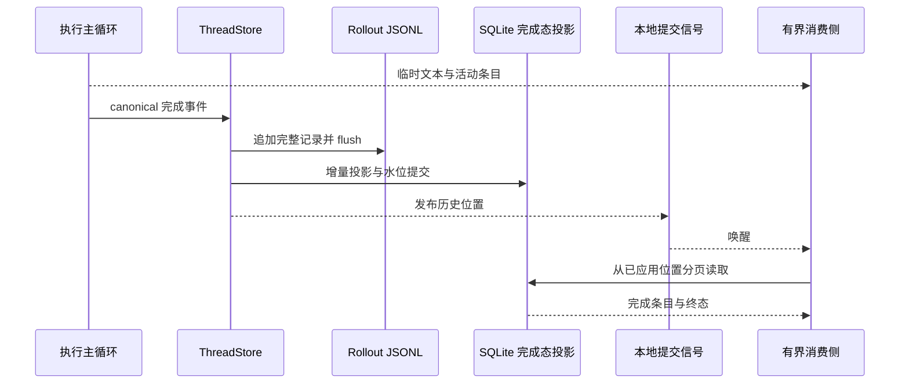

# 实时投影系统设计

> 本册约束谁决定线程事实，以及执行、持久化、唤醒和展示之间的边界。传输端点见 [实时投影与通信链路](../技术说明书/04-实时投影与通信链路.md)，存储职责见 [数据存储与状态模型设计](./08-数据存储与状态模型设计.md)。

## 1. 目标

蛹在执行期间连续显示文本、工具进度和活动条目，重新打开线程后从 canonical 历史读取完成内容。蜂巢、舵机和舰桥共享后端事实，不各自维护一套执行历史。

执行侧决定条目身份、轮次和终态。展示侧决定分页、预览和刷新节奏，不能用超时、气泡数量或实时尾帧推断执行结果。

## 2. 长期不变量

1. rollout 是执行历史真相源；SQLite 完成条目与轮次是可重建投影。
2. 持久化顺序固定为完整 JSONL 追加、flush、投影提交、发布历史位置。
3. 临时 delta 与持久历史位置分开；transport event id 不参与历史恢复、去重或排序。
4. 完成态、终态和中止结果由 canonical 记录表达；逐 token tail 不产生持久化 block/change 表。
5. 一个任务线程只有一个执行写入者。锁、订阅与活动状态按线程隔离。
6. 页大小、字节预算、订阅缓冲、活动条目和待写内存均有上限。
7. 空闲订阅等待提交信号，不定时查历史库；启动和页面打开不扫描全部历史。
8. 原始保留内容与显示降级分开。明确采用输出限制的完成条目须标记截断。

## 3. 分层

| 层 | 职责 | 落点 |
| --- | --- | --- |
| 执行与实时层 | 生成稳定条目身份、实时 delta 和最终 canonical 记录 | `orchestrator/event_stream.rs`、`orchestrator/thread_log_committer.rs` |
| canonical 提交层 | policy、线程写入协调、JSONL flush 与增量投影 | `storage/thread_store.rs`、`storage/rollout.rs` |
| 历史读取层 | 从完成态投影读取快照、分页、正文和增量事件 | `storage/thread_history.rs`、`storage/canonical_thread_log.rs` |
| 唤醒层 | 提交后通知本地订阅者，不携带历史正文 | `orchestrator/thread_change_hub.rs` |
| 消费与传输层 | 有界 feeder、补水、慢客户端和重同步控制 | `services/thread_change_feeder.rs`、`api/chat/view.rs`、`api/ws_helpers.rs`、蛹强类型 façade |

`ThreadLogCommitter` 和旧命名的查询 trait 是应用适配入口，底层统一转为 canonical 记录与读取，不再对应旧 SQL 日志和第二套展示正文库。

## 4. 提交与订阅

feeder 先订阅 hub，再读当前历史，避免初始读取期间的提交信号丢失。读满一页立即续页，追平后等待提交、取消或消费端关闭。慢客户端触及水位后发出恢复控制并结束订阅，客户端从最后已应用位置补水。

hub 是唤醒信号，事实始终由持久化读取确认。它只负责同一执行所有者内的提交通知。服务多节点必须路由或转发到线程所有者；不依靠空闲轮询把互不共享的本地数据库伪装成跨节点一致存储。

## 5. 历史位置与重同步

canonical 历史位置包含 RolloutId、排他的 ordinal 与未压缩 byte offset。ordinal 可以有空洞，因为模型上下文记录不一定生成展示事件。不能把“收到的帧数”当作下一条历史位置。

应用传输仍可以用 `change_seq`、`epoch`、`view_seq` 等 DTO 字段，但它们来自当前 rollout 身份、投影 revision 与 canonical 位置；没有独立的 SQL changes 台账。lineage 切换、游标越界或 revision 不匹配时要求重新获取有界快照，不能继续套用旧游标。

快照和同页条目在只读事务中读取。客户端只推进已经成功应用的游标；重连、队列溢出与历史切换都共享同一补水路径。

## 6. 展示与完整性

聊天和轨迹使用 `wunder-core/src/thread_view.rs` 的页大小、字节预算和正文块上限。列表读预览列，展开后按需读取完整完成条目并分页返回，不永久存储另一份 body chunks。

保留的完成内容、复制文本与模型上下文各有明确来源。用户与助手文本按原文保留；命令和 MCP 的展示输出按专用策略限制并标记截断；超长原始工具输出不能通过诊断副本偷偷永久保存。

LLM 上下文压缩只影响后续模型输入和恢复检查点，不删除用户可见的已完成历史。UI 分页、摘要和文本显示降级不得修改冻结的 system prompt。

活动条目在有界内存中维护。UI 按帧合并 delta，只更新活动尾块，历史列表虚拟化且限量加载；消费者不能逐 token 重建全部历史。纯实时尾部允许在崩溃时丢失，完成记录承担重新打开后的恢复。

## 7. 投影恢复与空闲行为

projector 从已确认的完整行边界推进，只处理有界记录批次。水位、条目和轮次在同一 SQLite 事务内更新，失败后可以重试。半行文件尾部不产生展示条目。

投影推进由追加、明确恢复和显式重建触发。没有后台 discovery/rebuild 定时器；`thread_view_rebuild` 只报告 `on_demand` 状态。打开页面不能触发全量重放，索引损坏或投影需要恢复时应给出明确状态，通过有界恢复流程解决。

空闲完成态线程不保留 writer 句柄、执行租约和定期 history polling。用户停留在已完成线程中观看，不是保持执行租约的理由。

## 8. 其他实时域

| 域 | 真相与边界 |
| --- | --- |
| 站内用户世界 | 自身领域状态与事件，不参与线程上下文 |
| 对外工作流事件 | 自身流游标，不与 canonical 历史位置互换 |
| presence | 有界连接观测态，只回答在线和观看情况，不决定线程活性 |
| 渠道运行日志 | 有界环形与去重窗，不承担线程历史归档 |
| 监控和用量 | 有界事实与统计；不复制完整请求、工具结果和实时事件队列 |

## 9. 验收

- 先 flush、再投影、最后唤醒；失败和幂等空操作不会宣布不存在的历史。
- 断线、消费过慢、游标失效与 lineage 切换均能通过统一补水恢复。
- 新增实时入口不自建历史表或恢复协议，蛹与蜂巢看到同一条目身份和终态。
- 大线程打开与翻页只访问有界索引窗口，实时 delta 不增加持久化行数。
- 空闲订阅不查库、不写库，恢复和重建不通过周期任务持续占用资源。
