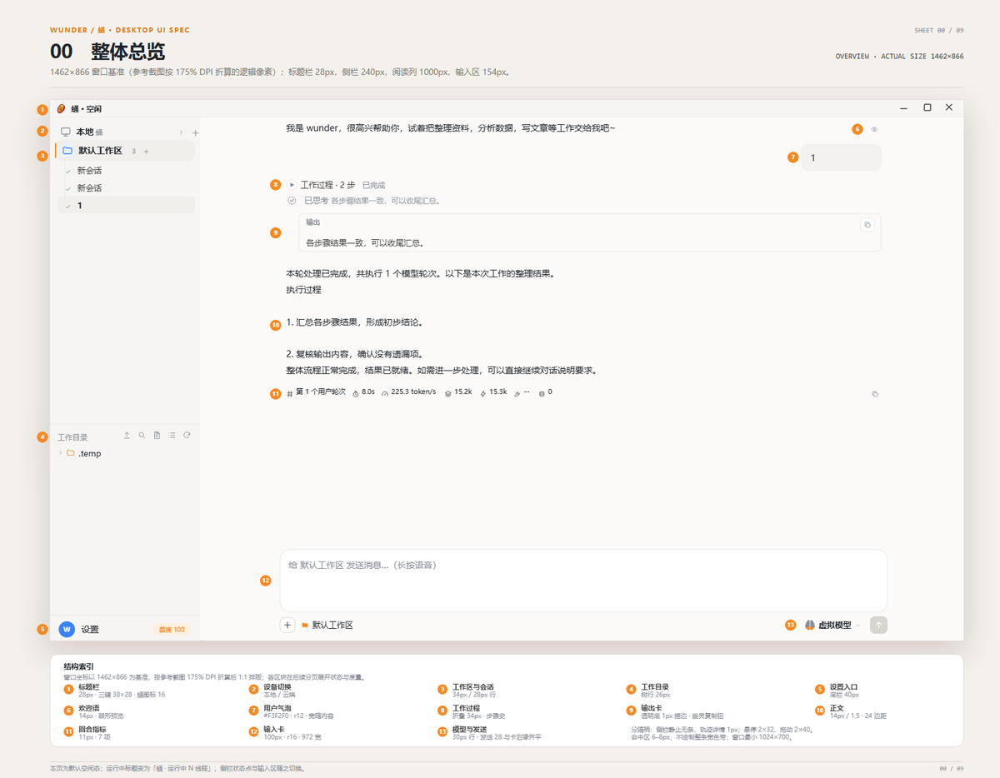
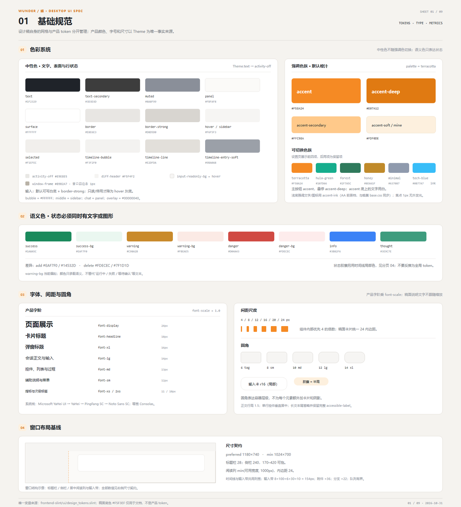
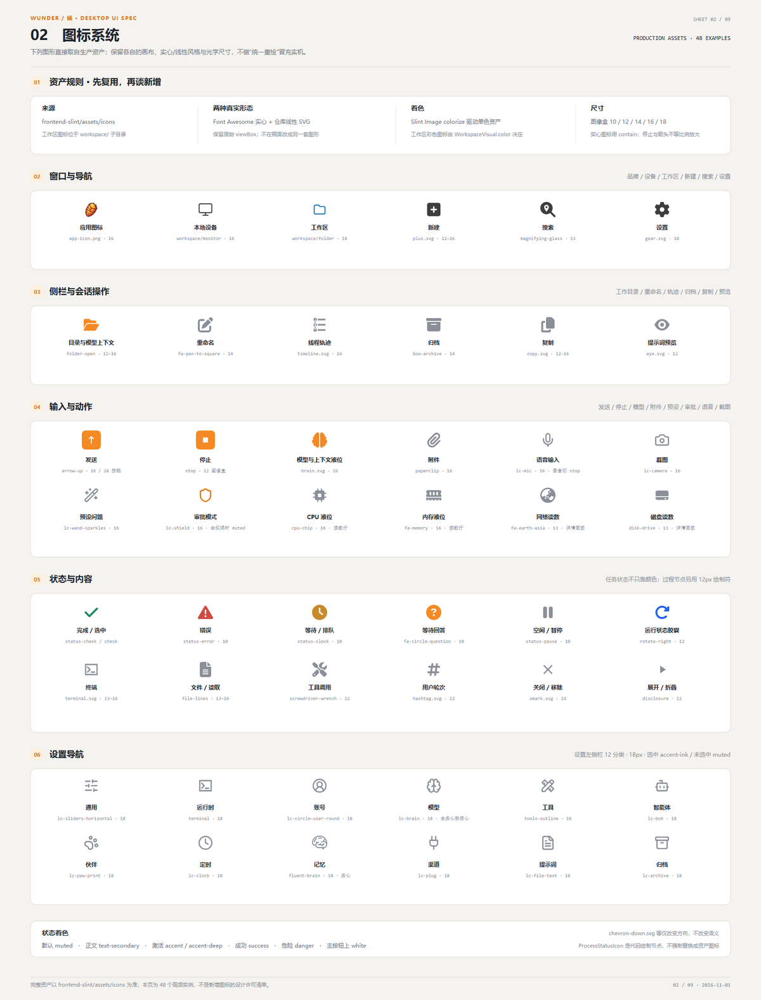
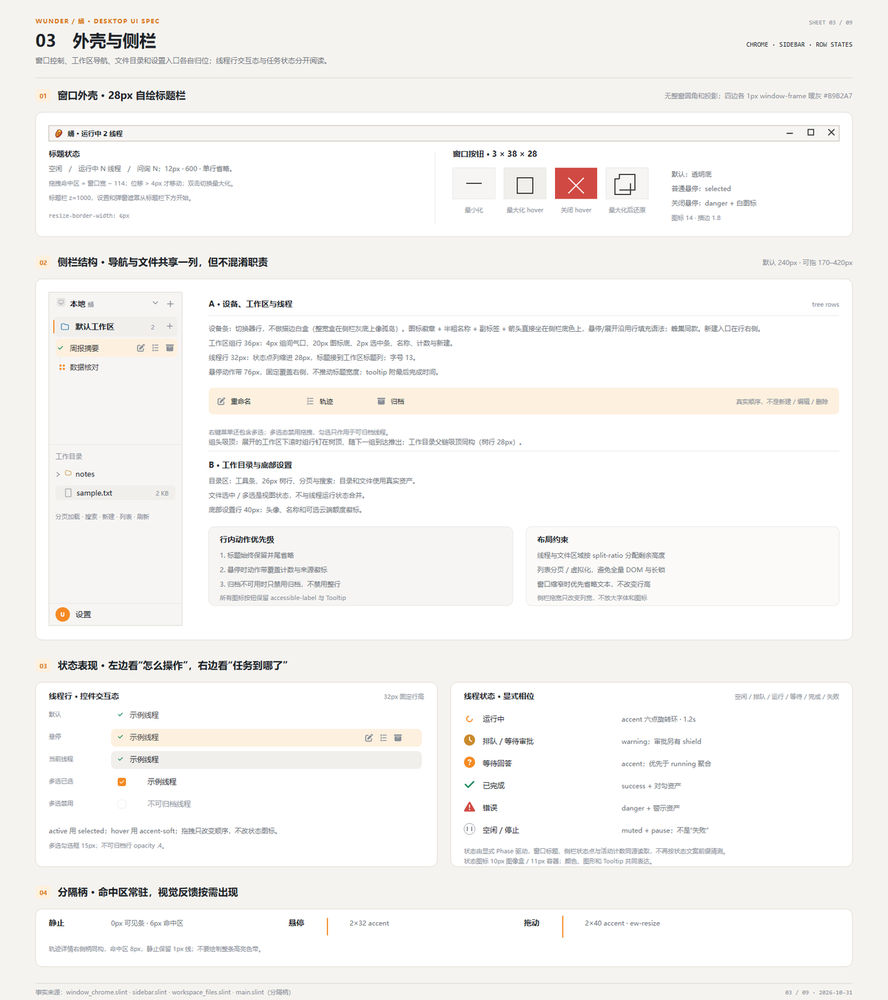
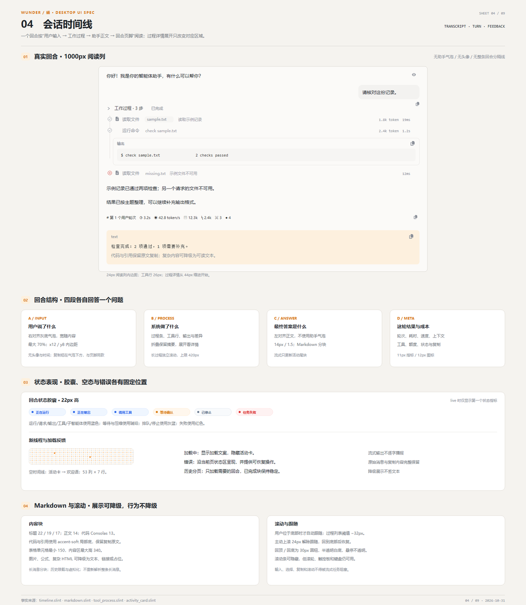
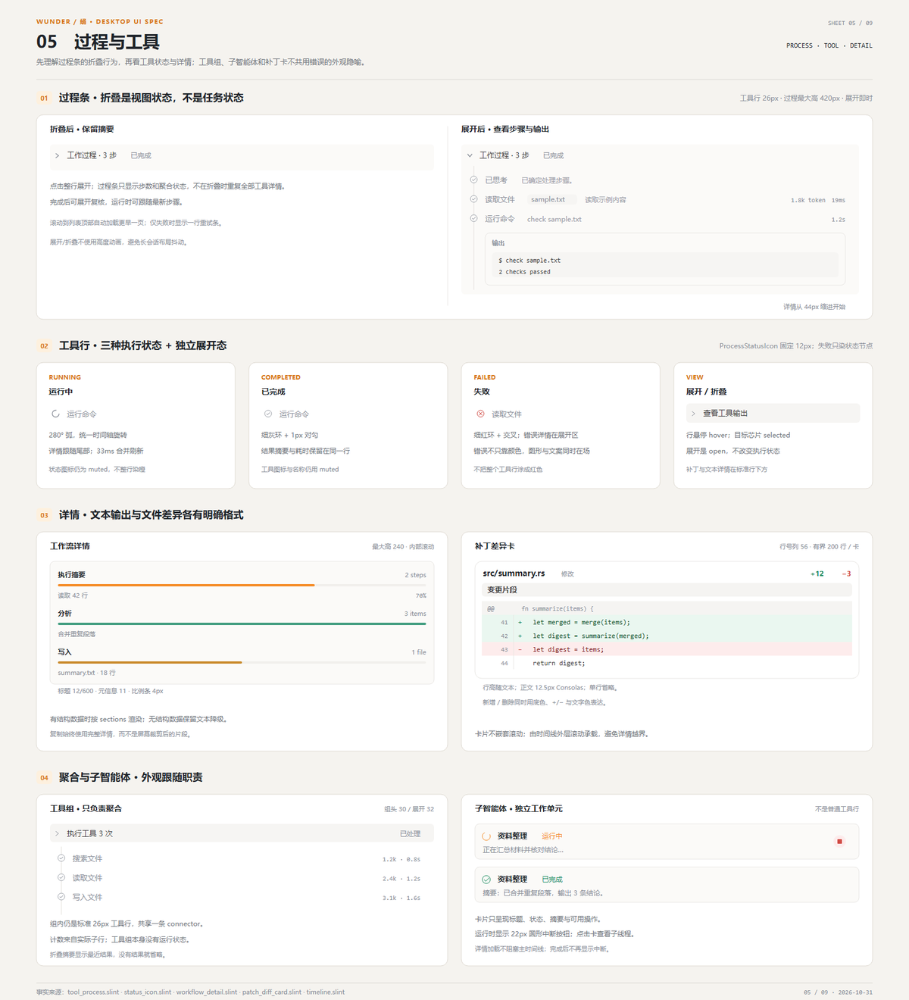
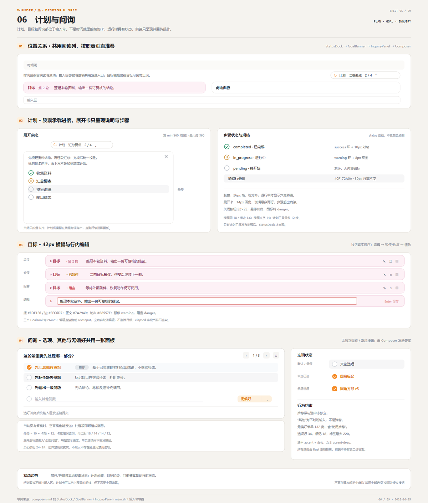
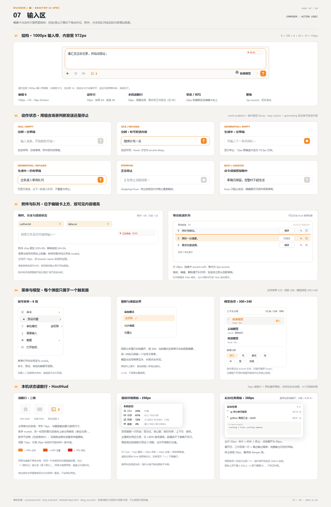
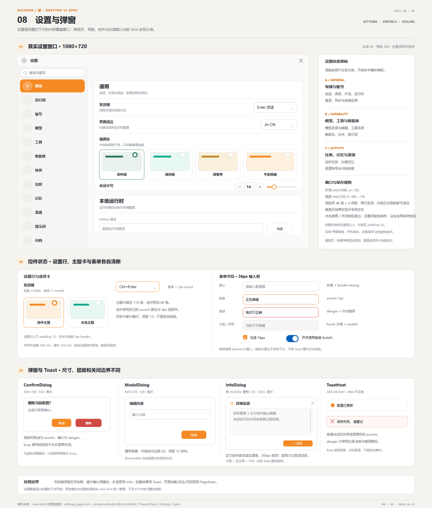
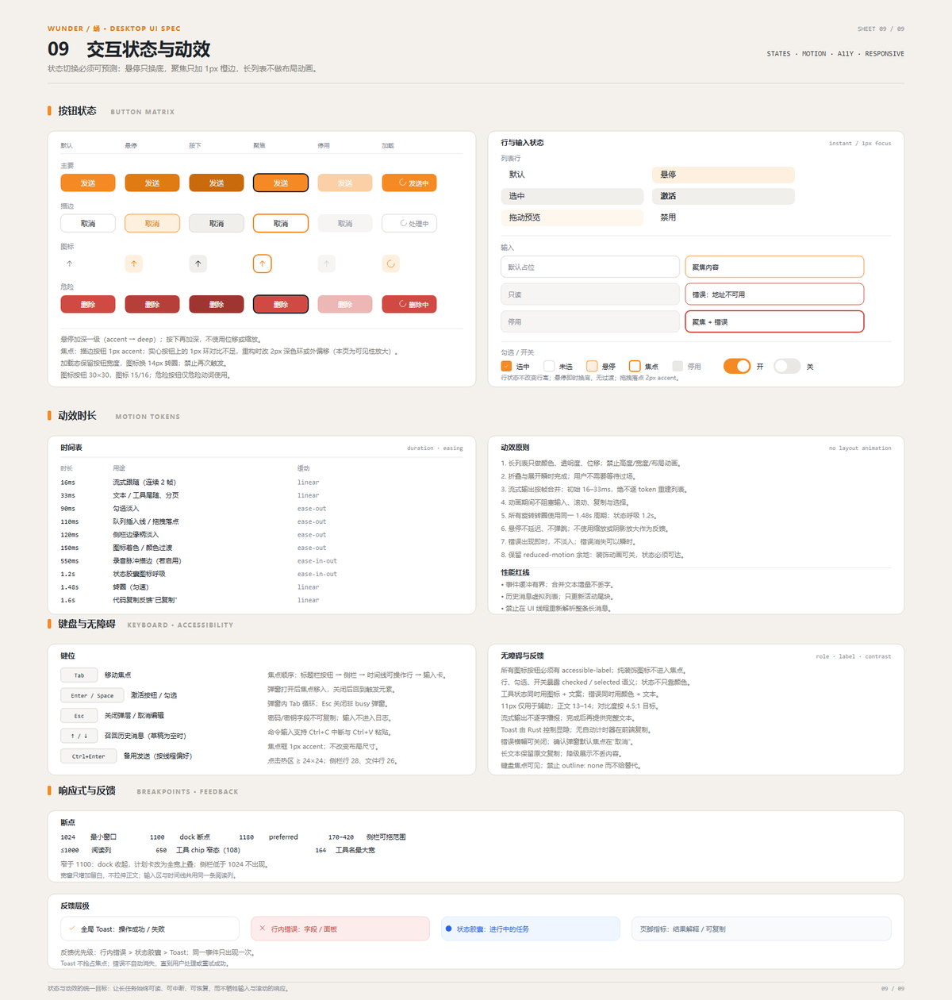

<!-- help-manual: en -->
<!-- 正文是标准 Markdown；topic: 链接指向站内主题，art/*.png 指向内嵌图册。 -->
<!-- topic id="welcome" title="Welcome" group="Getting Started" keywords="getting started,welcome,manual,help" -->

# Pupa User Manual

Pupa is a local AI workbench: hand a goal to the agent, and it breaks the task down, calls tools, and delivers results. Files and threads stay on this machine.

This manual introduces Pupa's core capabilities and day-to-day operations. On the left, the **Contents** pane organizes topics, the **Index** looks entries up by keyword, and **Search** matches full text. Green links in the body jump to the related topic.

- [**Quick Start**](topic:quickstart)：Create a thread, send a message, switch models — your first conversation in a few minutes.
- [**Diverse, Fast, Superior, Efficient**](topic:core-overview)：The four cores: multi-platform and multi-form, instant startup and lag-free response, 24/7 stability and high intelligence, extremely low CPU, memory, and context cost with a ready-made runtime.
- [**Goal**](topic:core-goal)：Put the agent into a goal state and let it keep working the task.
- [**Tools Overview**](topic:tools-overview)：The built-in tool matrix, grouped into eight categories.
- [**Interface Tour**](topic:interface)：Get to know the sidebar, thread list, working process, and trajectory view.
- [**Settings Overview**](topic:settings)：Entry point for general preferences, model configuration, cloud account, and Devices & interlink.
- [**FAQ**](topic:faq)：Common answers on registration, memory loading, subagents, and tool visibility.
- [**Diagnostics &amp; Troubleshooting**](topic:troubleshooting)：Health checks, symptom-based checklists, and diagnostics export.

> **Tip:** Type a keyword into the search box at the top of the settings category list to jump straight to that category.

<!-- topic id="quickstart" title="Quick Start" group="Getting Started" keywords="new thread,send message,switch model,conversation,first time" -->

# Quick Start

## Create a thread

Click **New thread** in the sidebar to begin. Each thread keeps its own history, tool call records, and model selection, independent of the others.

## Send a message

- Type in the input box and press the send key (Enter by default; can be changed to Ctrl+Enter in settings).

- The agent streams its reply; tool calls appear in the **working process** collapsible bar above the reply — click to expand it in place.

- Screenshots, recordings, and other multimodal inputs are supported and are sent to the agent along with the message.

## Choose a model for the thread

The model switcher beside the input box affects only the **current thread**; the default configuration is left untouched. Once a thread is created, its system prompt and model stay fixed within that thread.

> All conversation data is stored in a local SQLite database; you can browse past threads while offline.

<!-- topic id="forms" title="Form matrix" group="Getting Started" keywords="form,Pupa,Beehive,Helm,Hull" -->

# Form matrix

wunder is a multi-form agent workbench. One engine is shipped as several program forms; the difference is only in the access layer.

| Icon | Form | Tech stack | Purpose | Run model | OS support |
| --- | --- | --- | --- | --- | --- |
| 🚀 | Hull server | Rust + axum 0.8; PostgreSQL | User and agent management platform (multi-tenancy, users and org units, agent app build and publish, gateway access and scheduling) | Long-running server process, Docker deployment, HTTP / WebSocket access | Linux / Docker |
| 🐉 | Bridge web | Plain HTML + CSS + JavaScript (` web/ `, no build step) | Hull's admin console (four panel groups: system, agents, debug, docs) | Browser access, statically mounted by Hull at ` / ` | Any browser |
| 🐝 | Beehive web | Vue 3 + TypeScript (Vite build, ` frontend/ `) | Cloud AI workbench (Hull's user side) | Browser access; build output ` frontend/dist ` is served read-only by the nginx container (default port 18001) and is **not hosted by Hull** | Any browser |
| 🍯 | Pupa desktop | Rust + Slint 1.18 (default frontend ` frontend-slint/ `, native UI, software rendering); SQLite | Local AI workbench (the flagship form, works out of the box) | Local desktop process, native in-process calls to the engine (no local network hop); Electron / Tauri shells are no longer maintained | Windows 7 x86 and up; Linux (ubuntu 18.04 baseline) x64 / arm64 AppImage |
| ⚙ | Helm cli | Rust terminal TUI (ratatui + crossterm); SQLite | Manual local entry point (terminal, scriptable, automation) | Local terminal process, direct in-process engine calls, JSONL output supported | Windows 7 and up (GNU toolchain); Linux amd64 / arm64 (ubuntu 18.04 sysroot) |

All forms share the same engine (wunder-runtime) and core (wunder-core): threads, tools, storage abstractions, realtime events and permission semantics are one body of code, and the difference is only in the access layer. Pupa and Helm do not depend on Hull and can be installed and run on their own.

## Choosing a form

- **Individual users** → Pupa (desktop). The local AI workbench, the default entry point for personal use, ready to run after install.

- **Teams, or anyone working in a browser** → Beehive (web). Hull's user side, provided with Hull; once Hull is deployed, members reach it in a browser.

- **Terminal and scripting** → Helm (cli). The manual local entry point, terminal-driven, scriptable, automation-friendly.

- **Multi-user management and governance** → Hull (server). Multi-tenancy, user and org-unit management, agent app build and publish, unified gateway access and scheduling. The admin console is the Bridge (web), which starts with Hull and is aimed at administrators.

<!-- topic id="install" title="Starting with the Pupa (Desktop)" group="Getting Started" keywords="install,launch,download,desktop" -->

# Starting with the Pupa (Desktop)

It calls the engine natively in-process, has no port of its own, and routes through no HTTP/WebSocket relay. Individual users install just this — there is no Hull (server) to deploy first.

## Prerequisites

| Scenario | Choose the Pupa |
| --- | --- |
| Want to start right away, without deploying a service first | ✅ |
| Need to work with local files, windows, and browsers | ✅ |
| Prefer a graphical interface | ✅ |
| Need an interactive terminal and screenshot capture | ✅ |
| Need a tray, system notifications, and global hotkeys | ✅ |
| May connect to a remote later, but want to get running now | ✅ |
| Need multi-user governance and an admin backend | ❌ Choose the Hull (server) |
| Need to access it in a browser | ❌ Choose the Beehive (web, ships with the Hull) |

The Pupa covers single-user local scenarios; sharing among several people runs through the Hull and the Beehive.

## Install and launch

Download and run the installer for your system. It installs the Pupa and Helm (CLI) by default; optional Python/Git/rg/ffmpeg/browser components are opt-in. The install directory defaults to ` ~/.wunder ` and can be changed to any writable directory. The installer writes ` .wunder-home ` at the install root, and both local forms use that root as ` WUNDER\_HOME `; an explicit non-empty ` WUNDER\_HOME ` still wins.

- **Executable**: ` bin/wunder-desktop.exe ` (Windows) or ` bin/wunder-desktop ` (Linux) after installation; development builds use ` wunder-frontend-slint `

- **Terminal commands**: the installer adds the install root's ` bin ` to the user PATH (Windows) or creates command links under ` ~/.local/bin ` (Linux); after opening a new terminal, ` wunder-cli ` (Helm) and ` desktop ` / ` wunder-desktop ` (Pupa) run directly

- **Menu and desktop entry**: Windows names the Start Menu and optional desktop shortcuts Pupa and Helm; Linux registers a Pupa application-menu entry and creates a Pupa launcher in the XDG desktop directory by default

- **Development launch**: on Windows, use the project's bundled ` run.bat `

- **Platforms**: primarily targets 32-bit Win7 and Ubuntu 18.04; modern Windows / Linux also run

- **No port, no required arguments**: it calls the engine in-process right after launch

- There's also a compatibility bridge port (default 18123) that serves only legacy-compatible clients; day-to-day use doesn't go through it

- The Electron / Tauri frontend shells are **no longer maintained day-to-day and get no new features** (this doesn't mean the Pupa backend stops being maintained)

## Local data

| Content | Location |
| --- | --- |
| Root directory | The directory chosen at install time (` WUNDER\_HOME `; defaults to ` ~/.wunder `, recorded by ` .wunder-home `) |
| Workspace | ` /workspace ` |
| Temporary directory | ` WUNDER\_DESKTOP\_TEMP\_ROOT ` |
| Desktop settings | ` /config/desktop.settings.json ` |
| Sessions and tool logs | local SQLite |

To move to a new machine, copy the whole install root (default ` ~/.wunder `) across. "Local first" means data stays on your machine; it doesn't affect reaching remote models or web pages.

On startup it scans the work tree (up to 4096 items), restores the state of unfinished tasks from last time, and clears session locks and leftover tasks.

## Interface layout

The main window has two switchable pages, Chat and Settings; everything else hangs off them as panels and dialogs.

## Chat page

- **Left column**: the task and thread tree, the **working-directory area** (local file tree + usage bar + **cloud workspaces**), and the settings entry at the bottom

- **Right column**: the top bar (workspace / thread name) + timeline + composer

- With no thread selected, a welcome page shows; file preview and online editing pop out as overlays without changing the two-column structure

- One agent can run several **independent task threads** in parallel, and workspaces can be **multiple**: local + cloud + remote device workspaces reached through device interlink

## Settings page

**11 categories**: General, Account, Model, Tools, Agents, Personas, Scheduled, Memory, Channels, Archive, Help.

The category navigation supports search filtering. There is **no "device interlink" category**.

## First run

## Launch preparation

On launch, a lightweight splash screen appears first while local working directories, configuration, and sessions are prepared. The window appearing doesn't mean sessions are ready; you can start working once the workbench opens. First launches or slower devices may take longer to prepare.

## Model configuration

Settings → Model → Add:

- API Key

- Endpoint URL (a neutral endpoint such as ` https://example.com/v1 `)

- Model name and parameters (temperature, context length, and so on)

Confirm with "Test connection" before saving. This is also where you hook up TTS, image, and video models; **TTS can currently only be configured — there is no playback implementation**.

## Account profile

Settings → Account: username, email, avatar; set a login password if you plan to use it long-term.

## First conversation

Back on the chat page, type:

```
List the files in the current working directory
```

When you see the model think → a batch of tools → the final reply landing in the chat area, you're up and running.

## Capabilities unique to the Pupa

None of these exist on the Beehive, the Bridge, or the Helm:

- **Interactive terminal** (winpty on Windows, PTY on Linux)

- **Screenshot capture** (X11 on Linux, Win32 APIs on Windows)

- **Tray and system notifications**

- **Global hotkeys**

- **Voice input**

## Device interlink surfaces

Only **two** interlink surfaces are available in the Pupa:

- The **cloud workspaces** in the sidebar's working-directory area: when the network is unavailable they clearly show "offline" alongside a "connect" button

- The **remote command approval dialog**: high-risk commands (L3) in device interlink pop up for confirmation with a red border, showing the command level, risk, and source, plus a "don't remember" hint

The Settings page still holds a set of device-interlink options, but they aren't wired to any interface; **that entry point is not open yet**.

## Resetting the working state

When sessions, subagents, or workspaces get into a bad state, use "Settings → General → Reset workspace state":

- **It does**: stop running sessions, clear queued tasks, clean up session locks

- **It keeps**: skills, knowledge bases, long-term memory, user configuration, workspace files, session history

It **clears working state**; it is not a factory reset.

## Interaction constraints

Two default behaviors are worth separating:

- **The session queue is on by default**: sending another message during a run queues it instead of rejecting it as "user busy." Turn it off and messages sent during a run are bounced outright without entering the queue bar.

- **The subagent activity indicator**: when a task has spawned subagents, the chat area shows the child runs that are still working; subagents are temporary work units the main agent creates, reclaimed once the task ends.

<!-- topic id="core-overview" title="Core Concepts" group="Core Capabilities" keywords="Diverse,Fast,Superior,Efficient,multi-platform,multi-form,startup speed,response speed,stability,intelligence,CPU usage,memory usage,context consumption" -->

# Core Concepts

wunder is a multi-form agent workbench: hand it a goal and the agent breaks the task down, calls tools, and delivers results. The feature list lives in Tools and the Capability Quick Reference.

## Diverse, Fast, Superior, Efficient

Diversity and strength set the capability surface; speed and efficiency constrain how it is built: a thin access layer, a short execution path, and bounded queues, caches, views, and context.

| Core | Meaning |
| --- | --- |
| **Diverse** | Multi-platform, multi-form. One core and engine back the Pupa, Beehive, Helm, and Hull across 32-bit Windows 7, Ubuntu 18.04, and modern Windows / Linux / Docker, in both web and local usage; models, channels, and workspaces extend through the same access layer |
| **Fast** | Instant startup and a response that never lags. Local forms call the engine in-process without local HTTP; threads and history restore directly from local storage; streaming events are frame-coalesced and projected incrementally, and tools run in parallel where allowed |
| **Superior** | Strong stability for 24/7 operation and a high degree of intelligence. Queues, caches, views, and context are bounded, with session locks, round caps, quotas, and retry circuit breaking for long runs; goal mode, subagents, the tool chain, long-term memory, and knowledge bases carry complex tasks from decomposition to delivery |
| **Efficient** | Extremely low CPU and memory use, minimal context consumption. A native Rust process with local SQLite needs no browser runtime, and supplement packages ship a ready-made agent runtime so nothing has to be assembled by hand; tool-result trimming, frozen prompts that reuse cache, one-time memory-index injection, and micro-compaction and history compaction keep token consumption down |

The eleven capabilities expanded page by page — goal, compatibility, context compression, subagents, scheduled tasks, channels, memory, multithreading, streaming and realtime state, stability, and multi-tenancy — live under Capabilities › Core Capabilities.

<!-- topic id="core-goal" title="Goal" group="Core Capabilities" keywords="goal,goal state,phase,round cap" -->

# Goal

A goal is attached to a session; the agent keeps working on it until the goal completes, becomes blocked, or exhausts the round budget.

## Driver tools

| Tool | Role|
| --- | --- |
| ` goal ` | Uses \`action=get / create / edit / pause / resume / complete / blocked\` to read, create, edit, pause, resume, complete, or report blocked |

## Phases

Four values: ` active `, ` paused `, ` blocked `, ` complete `.

Updates use CAS-on-revision: an update must carry the goal's current revision, and a mismatch is rejected. Started rounds only ever increase.

## Defaults

| Item | Value |
| --- | --- |
| Goal round cap | 256 |
| Automatic blocking after no progress | 3 rounds |

## Entry points

| Entry | Location |
| --- | --- |
| Interface | ` /wunder/chat/sessions/{id}/goal ` |
| Slash command | ` /goal ` |

## Limits

- There is no token budget and no cooldown between rounds. Whether a goal stops depends on three things only: the round budget, the phase, and whether it is armed.

- The **armed** state is **not persisted**: after a process restart or a session resume, even if the phase is still ` active `, an explicit ` goal action=resume ` is needed to arm it again. When a goal stops moving, check armed first.

- The desktop form does not expose goal selection; the runtime injects it per session.

- The Bridge has no goal UI; goal operations happen in the Beehive, the Pupa, and the Helm.

<!-- topic id="core-compatibility" title="Compatibility" group="Core Capabilities" keywords="compatibility,Windows 7,Ubuntu,offline" -->

# Compatibility

## Supported systems

| System | Approach |
| --- | --- |
| Windows 7, 32-bit | A dedicated ` i686-win7-windows-gnu ` Tier 3 target plus a build-std offline toolchain |
| Ubuntu 18.04 x64 / arm64 | An offline build chain and sysroot |

## Runtime constraints

- **The interface does not depend on a GPU**: Slint uses software rendering.

- **Building does not depend on network access**: both the Windows 7 32-bit and the Ubuntu 18.04 chains are offline toolchains, and the Ubuntu side carries a sysroot as well.

- **Command sessions adapt to old terminals**: command sessions are carried over winpty, and output is decoded as GBK.

- **Startup checks**: a recovery scan and self-check run at startup.

Both chains work offline, the interface needs no GPU, and command sessions adapt to legacy terminals — Windows 7 32-bit and Ubuntu 18.04 (x64 / arm64) can run the Pupa and the Helm directly.

## Limits

- Build scripts still carry dead Tauri links, pointing at directories that no longer exist. That is an engineering gap, not a capability.

- win7 interlink nodes do not declare ` tool.exec `, so the capability surface on legacy devices is narrower.

<!-- topic id="core-context-compression" title="Context Compression" group="Core Capabilities" keywords="context compaction,compaction,context" -->

# Context Compression

How much history a single conversation can carry is set by the model's context window. As a conversation grows, the total of history plus tool results can exceed the ceiling, and compression trims the history without interrupting the conversation so it keeps running.

Compression is not deletion. Deletion cuts content outright, regardless of importance; compression reorganizes content, keeping the key facts and trimming the redundant parts.

## Triggers

These situations tend to trigger compression: a very long conversation (dozens of rounds or more), a tool returning a large amount of content (reading a large file, many search results), and complex multi-step tasks.

To trigger it less often, open a new thread once a topic is done rather than keeping an old thread alive, keep prompts concise, and avoid pasting large repeated blocks; the ` /compact ` command triggers compression deliberately.

## Levels

Compression escalates from gentle to aggressive only when necessary:

| Level | Strategy | Degree of loss |
| --- | --- | --- |
| Level 1 | Remove intermediate tool results | Very low; tool results can be fetched again |
| Level 2 | Summarize historical messages | Medium; keeps semantics, loses detail |
| Level 3 | Remove earlier conversation rounds | Higher; keeps only the most recent content |
| Level 4 | Keep only the core setup and the current request | Very high; emergency degradation |

## What is protected

Without compression, a long conversation ends in one of three ways: an outright error, a brute-force truncation, or manual control of conversation length. Compression is a system capability, so conversation length needs no manual management.

Compression protects three things first: the continuity of the conversation, so it is not interrupted for being too long; the facts genuinely needed, favoring information useful to the current task; and traceability, so every compression leaves a record of what it compressed and what it kept for administrators to inspect.

There are two bottom lines. First, compression can only trim and reorganize existing content; it never invents. Second, a thread's core setup (the system prompt) is frozen at creation, and compression acts only on the conversation history and tool results, so an agent never "forgets who it is" because of compression.

## Compression records

Every compression leaves a record that includes the strategy used, the context size before and after, and a rough assessment of the information lost. Administrators use it to judge whether compression has affected task quality.

## Local reduction

When automatic compression triggers, the system first sees whether earlier file reads, searches, and listing results can be shortened. The last 5 groups of tool results, error information, media, and results that still need pagination are protected. A shortened old result still carries its location, a head/tail preview, and an explicit omission notice, so the agent can read it again when needed.

If the local reduction has already freed enough space, no extra model call is made to produce a summary; if not, the summary flow runs. Manual compression and overflow recovery go straight to summarization. A summary outputs at most 2048 tokens by default, and if the model itself is configured with a smaller output limit, the smaller one wins.

Administrators can see the estimated savings of the local reduction in the progress records. The estimate is for diagnosis only; actual token consumption follows the model provider's report.

## Limits

After compression, the system favors what the current task needs. Only in extreme cases (a very long conversation stacked with a large amount of tool output) might the agent recall early details less precisely, and then a new conversation thread is the fix.

<!-- topic id="core-subagent" title="Subagents" group="Core Capabilities" keywords="subagent,spawn,collaboration" -->

# Subagents

The parent thread hands one subtask to an independent executor, which runs it and passes the result back to the parent thread.

## Control actions

` 子智能体控制 ` (Subagent Control) provides 11 actions:

| Action | Action | Action |
| --- | --- | --- |
| ` spawn ` | ` batch\_spawn ` | ` wait ` |
| ` interrupt ` | ` close ` | ` resume ` |
| ` report ` | ` send ` | ` status ` |
| ` list ` | ` history `|

Parent–child round references are encoded as ` user\_round ` + ` model\_round `, and an executor's rounds hang under that pair of parent round references. The sub-session's user message is hidden, and it wakes with auto-wake.

## Limits

- The only collaborative form is the **subagent**. Swarm orchestration (swarm tools, hives, orchestration mode, team runs, swarm packs) has been removed from the engine and the protocol layer; it is not waiting to be implemented, nor hidden behind a switch.

- Swarm leftovers remain in TUI prompts, front-end i18n labels, and compatibility shims, and empty directories await cleanup. Those leftovers do not mean the capability exists.

<!-- topic id="core-scheduled-tasks" title="Scheduled Tasks" group="Core Capabilities" keywords="scheduled task,schedule,cron" -->

# Scheduled Tasks

The task definition is persisted in storage, and a background loop claims work by due time, independent of which session you happen to be viewing. Every run is recorded (` /wunder/cron/runs `): whether it ran, whether it succeeded, and when it will run next; failures come with backoff and auto-disable; and a process restart does not lose the task definitions.

This differs from waiting inside a session: yielding in a session only affects the current thread, whereas a scheduled task creates a new run in the future.

## Schedule kinds

The ` kind ` field is one of ` at `, ` every `, or ` cron `.

| Kind | Semantics | Input | Bounds |
| --- | --- | --- | --- |
| ` at ` | One-off point in time | An RFC3339 timestamp | At most 365 days ahead; auto-disabled once it runs (disabled with a reason if it fails) |
| ` every ` | Fixed interval | ` every\_ms ` (optional start time) | 1,000 ms ≤ interval ≤ 86,400,000 ms (24 hours) |
| ` cron ` | Recurring expression | A 5–7 field expression plus an optional timezone | Fields accept only digits and ` \* / - , ? `; the timezone is parsed as a named timezone, defaulting to the local timezone |

Natural language also works in tools and quick input, and the system converts it into the kinds above: ` every 5 minutes ` becomes a fixed interval, and ` daily at 9am ` and ` weekdays at 6pm ` become the corresponding cron expressions; when it cannot parse the input, it suggests the formats that are accepted.

Content limits: a task name is at most 128 characters, and a trigger message at most 16,384 characters.

## Result delivery

` session\_target ` has two values.

| Value | Behavior |
| --- | --- |
| ` main ` (default) | The result is delivered to the bound current session, continuing the same conversation |
| ` isolated ` | Each run creates a separate thread session and keeps a link back to the parent session |

Choose ` isolated ` for recurring tasks that need a trail and should not disturb the main conversation; choose ` main ` when you want the result appended directly to the existing context.

## Execution guarantees

In multi-instance deployments a **lease** prevents duplicate execution: when a task is claimed, the runner's identity, a run token, and a lease expiry are written, and the lease is renewed with a heartbeat while the run lasts; if the process crashes, the lease expires and another instance can claim the task. Each record also carries a deduplication key and a consecutive-failure count, and writes down why it was disabled.

Default scheduling parameters:

| Parameter | Default |
| --- | --- |
| Max concurrent runs | 1 |
| Poll interval | 1000 ms |
| Max idle sleep | 5000 ms |
| Lease lifetime / heartbeat | 300 seconds / 60 seconds |
| Consecutive-failure auto-disable threshold | 5 |

After a failure, backoff steps up with the consecutive-failure count: **30 seconds → 60 seconds → 5 minutes → 15 minutes → 1 hour**, then stays at the last step. Once the failure limit is reached, the task is auto-disabled with a written reason; re-enabling it resets the failure count.

## Master switch

With the master switch off (` cron.enabled=false `), four kinds of write operation are rejected: ` add `, ` update `, ` enable `, and ` run `, each with a clear message. Status, list, a single detail, run records, delete, and disable all remain available, so existing tasks can still be reviewed and cleaned up.

## Entry points and support by form

| Surface | Status |
| --- | --- |
| API | ` /wunder/cron/\* `, 11 endpoints in all (status / list / runs / add / update / remove / enable / disable / get / run / action), on the **user side**, isolated by user ownership |
| Tool | The built-in scheduled-tasks tool (canonical name ` 定时任务 `, alias ` schedule\_task `), sharing the same handler as the API, so the model can create tasks on its own |
| Beehive | A scheduled-tasks category page under settings |
| Pupa | A scheduled-tasks page plus a native entry point, calling the same handler in-process |
| Helm | **No scheduled tasks**: the local engine explicitly disables the scheduler at startup, and there is no related slash command |
| Bridge | No user-level task management page; it exists only as a template configuration under preset agents |

When you need something to run on a schedule, configure it on the Beehive, the Pupa, or the Hull side.

<!-- topic id="core-channels" title="Channels" group="Core Capabilities" keywords="channel,Feishu,QQ,WeChat,IM" -->

# Channels

## Scope of responsibility

All execution happens in the engine. A channel does just two things: parse an external message into a unified inbound shape, and deliver the unified outbound shape back into an external protocol. Protocol adaptation stops at the entry; a channel does not copy business logic, does not keep its own storage, and does not change thread semantics. The same task thread can take a message from Beehive, continue it from Feishu, and finish it from Pupa; a channel never creates a second execution path.

A form (Pupa / Beehive / Helm / Hull) is the shape of running and access; a channel (Feishu / QQ / WeChat …) is an off-site platform. The two are not one layer. The statement that many entries share one engine holds; what tends to be written wrong is the support level.

## Support level

- **Feishu (feishu)**: a persistent connection plus a webhook, fully implemented, with a dedicated webhook entry point.

- **QQ Bot (qqbot)**: a persistent connection plus a webhook, fully implemented, with a dedicated webhook entry point.

- **WeChat (weixin)**: runs on a persistent connection (iLink long polling), fully implemented, and the largest in scale.

- **XMPP (xmpp)**: a persistent connection plus a webhook. It is disabled by default and is only a placeholder then, returning a "not enabled" notice for all send and receive; it becomes a real implementation only once explicitly turned on.

- **WeCom (wechat)**: webhook only, partially implemented (send, receive, and signature verification), with no persistent connection.

- **WeChat Official Account (wechat\_mp)**: webhook only, partially implemented, with no persistent connection.

- **WhatsApp Cloud (whatsapp\_cloud)**: webhook only, partially implemented, with no persistent connection.

Only four channels use a persistent connection: Feishu, QQ Bot, XMPP, and WeChat (weixin). WeCom, the Official Account, and WhatsApp Cloud are pure webhook callbacks.

The following platforms have no adapter at all: telegram, discord, slack, LINE, DingTalk. They exist only as generic-webhook directory entries, handled through the generic entry point and generic parsing — with no platform-specific signature verification, rich-text mapping, attachment download, or proactive push. The accurate statement is that they are visible in the directory and can send and receive text over a generic webhook, but they have no platform-specific adapter. Writing them up as "supported channels" is wrong.

## Binding resolution

An inbound message is first resolved by binding: candidates are scored by specificity, the single best one is taken, and priority breaks a tie.

| Dimension | Score | Notes |
| --- | --- | --- |
| Exact peer\_id match | 8 | Supports the \* wildcard, and a wildcard scores nothing |
| peer\_kind match | 4 | dm/direct/single/user are treated as the same kind |
| account\_id match | 2 | Empty means wildcard |
| channel match | 1 | Empty means wildcard |

A hit yields the target agent and any tool overrides, after which the workspace is decided: empty, as well as the default and \_\_default\_\_ aliases, all point to that user's default agent workspace. In the Hull form, workspaces are flattened per user into a single cloud directory, so files arriving from different channels for the same user land in the same place.

## Inbound, outbound, and rate limiting

Inbound uses a bounded queue: capacity 512, concurrency 8, enqueue timeout 80 ms. A full queue or an enqueue timeout counts as backpressure and reports "queue busy" rather than piling up without limit. The visible effect is that the platform redelivers or briefly delays; messages are not silently dropped.

Outbound runs on a persistent queue with exponential backoff, defaulting to a 500 ms polling interval, batches of 50, and at most 5 retries, with a backoff base of 2 s and a ceiling of 60 s.

Outbound delivery has a switch. When it is off, delivery is instead attempted once synchronously at enqueue time and is no longer redelivered by the polling loop. When troubleshooting a "received but no reply" case, check this switch first: once it is off and that one synchronous attempt fails, the message sits in the outbound queue waiting for manual handling.

Rate limiting is a token bucket of QPS plus a concurrency cap per channel account; both at 0 means no limiting. A rate-limited request does not consume a concurrency slot and is handed to the outbound queue for backoff redelivery.

## Attachments and media

Inbound media is downloaded, transcoded, and dropped into the workspace for that channel before being handed to the engine; platform-specific files have their own download entry points and likewise write into the workspace; and a further kind of pending file is reserved first and fetched on demand. Outbound attachments are extracted from the body, from Markdown, or from a workspace path and then uploaded. Channel clients usually do not understand internal paths, so attachments go out as an upload link rather than a path string thrown at the user.

## Webhook entry points and verification

The generic entry point is ` POST /wunder/channel/{provider}/webhook `; Feishu and QQ Bot have their own dedicated entry points at ` POST /wunder/channel/feishu/webhook ` and ` POST /wunder/channel/qqbot/webhook `.

Verification differs by platform: some loop back a verification token from configuration, some use a content signature, and WeCom additionally verifies the signature and decrypts the encrypted message. The generic webhook does no platform-specific verification, so platforms that use the generic entry point need to close this off themselves at a gateway or reverse proxy to guarantee a trustworthy source.

## Troubleshooting messages

- **Presence**: for a persistent-connection channel, check whether its connection process is running; a webhook-only channel has no notion of presence, so check only whether the callback arrives.

- **Whether the callback arrives**: check the platform-side push logs and the channel's runtime logs.

- **Whether it was routed**: check the binding score and the enabled state; a binding to a different agent looks exactly like no response at all.

- **Arrived but no reply**: check for records stuck in the outbound queue, whether the outbound delivery loop is off, and whether rate limiting was hit.

- **XMPP specifics**: confirm whether it is enabled — while disabled by default it is only a placeholder, and errors say so directly.

## Points not to mix up

- telegram / discord / slack / LINE / DingTalk have no adapter; they are only generic directory entries.

- WeCom and the Official Account have no persistent connection; only Feishu, QQ Bot, XMPP, and WeChat have one.

- XMPP is disabled by default, and while disabled it is a placeholder.

- A channel cannot be configured with business logic; it has only two layers, the target agent and tool overrides, and everything else lives in the engine and on the management side.

- The core capabilities are the same across channels; the differences are only in protocol expression (rich text, attachments, cards) and whether a persistent connection is supported.

- The inbound queue does not guarantee no loss by queuing forever; it is bounded at 512 with an 80 ms enqueue timeout, and anything beyond goes to backpressure and platform redelivery.

- A failed outbound delivery is not dropped outright; it uses a persistent queue with exponential backoff and at most 5 retries.

- Pupa and Helm do not go through the channel layer: Pupa is a native in-process call, and Helm uses its own access path.

<!-- topic id="core-memory" title="Memory" group="Core Capabilities" keywords="memory,long-term memory,knowledge base" -->

# Memory

An agent needs long-term information — who the user is, what they prefer, what policies an organization has, what background a project has. Such material is injected once when the thread is created and stays frozen afterwards, never rewritten dynamically on every round.

Three things follow: cognitive boundaries stay stable while the thread runs, so it does not drift as the conversation goes on; the system prompt stays stable, which helps cache acceleration; and it can clearly answer what background this thread started from. On the user side this shows up as personal preferences taking effect automatically in new conversations and the agent being able to use long-term material in the workspace and knowledge base. On the administrator side it shows up as controllable injection rules, sensitive information not leaking, conversations of the same kind starting from the same background, and a thread's initialization background being traceable.

## The two layers

The first layer is thread-initialization injection. When a thread is created, the system writes the key long-term material into the system prompt, where it becomes the thread's cognitive base.

The second layer is runtime supplementary retrieval. If more material is needed during execution, the system retrieves it dynamically through recall rather than rewriting the system prompt.

## Structure

Memory uses structured fragments rather than one long free-text block. Fragments are found by lookup, replaced individually without affecting the rest, marked invalid when outdated, and carry traceable version relationships.

## Freezing rules

Once the system prompt is set it stays frozen, and later conversation never modifies it dynamically, which keeps thread behavior stable. Long-term memory is injected only once at thread creation; even if recall fires during a run, its result is only supplementary reference and never rewrites the system prompt.

## Division of sources

Workspaces, knowledge bases, and memory can all supply material, but their responsibilities differ:

| Source | Character | Use |
| --- | --- | --- |
| Workspace | The scene of the current task | Holds the files being worked on |
| Knowledge base | A long-term document source | Retrieves policies, material, and reference documents |
| Memory | Structured accumulation | Remembers who the user is, their preferences, and past decisions |

## When updates take effect

When a memory update takes effect depends on the thread: a newly created thread applies the latest memory automatically, while an existing thread is unaffected and keeps the copy from when it was created. After a personal preference is updated, a new conversation is needed for it to take effect.

## Limits

Memory and context compression have different jobs: compression governs near-field information such as conversation history, while memory supplies far-field information such as long-term background. Compression does not touch the memory inside the system prompt.

More memory is not better. Injecting too much crowds the conversation's context space, introduces irrelevant information that disturbs judgment, and raises token consumption. The system therefore has selection and limiting mechanisms and does not inject without bound.

## Points not to mix up

Memory does not update automatically every round; it is injected only at initialization and does not change during a run. Recall is a dynamic supplement and does not rewrite the base. Workspace files are not the same as memory either — a workspace is the scene of the current task, while memory is long-term accumulation.

<!-- topic id="core-multithreading" title="Multi-threading" group="Core Capabilities" keywords="multi-threading,concurrency,thread,queue" -->

# Multi-threading

A single user can hold several task threads at once, and scheduling, locks, and realtime state are isolated per thread so the threads do not block one another.

## Concurrency control

- The **engine-level session queue** is enabled by default, with ` 会话让出 ` as the way to yield.

- A **session lock** has a TTL of 120 seconds with heartbeat renewal; when its holder exits abnormally, the TTL releases it.

- **Tool parallelism ≤ 4**: tools that run in parallel take a read lock, and tools that run exclusively take a write lock.

- **Round caps, active-session caps, daily quotas, and retry circuit breaking** form four hard constraints.

## Defaults

| Item | Value |
| --- | --- |
| Session lock TTL | 120 seconds (with heartbeat) |
| Tool parallelism | ≤ 4 |
| Round cap | 1000 by default |

## Limits

- With ` agent\_queue.enabled ` turned off, sending another message while a run is in progress is judged "user busy" and no longer enters the queue bar (the Hull warns about this at startup). This is a configuration choice, not a fault.

- Blocking category quotas and bounded queues are hard caps: when full, the system reports busy and does not wait in a queue.

<!-- topic id="core-realtime" title="Streaming and Realtime State" group="Core Capabilities" keywords="streaming,realtime state,increment,delta,terminal state,rehydration,disconnect" -->

# Streaming and Realtime State

Replies and execution progress both arrive **streaming**: the body appears character by character as increments, and tool calls and intermediate output enter the [working process](topic:interface) collapsible bar in real time. The Pupa calls the engine in-process by default, so events are delivered straight to the UI without touching the local network; only the compatibility bridge and [Devices &amp; interlink](topic:interlink) go over network channels.

## Truth and projection

The thread log is the single source of truth: every event is written to the local session record first, then pushed to the UI. The text the UI shows and the text you read after re-entering come from the same source — there is no intermediate state where "the stream has it but the log does not".

Three rules of judgment follow:

- Lost pushes can be rehydrated; the record is never lost.

- When the UI looks wrong, trust the actual execution state, not what the screen suggests about whether the task has ended.

- To decide whether a round has ended, look for the **round terminal state** (carrying status and stop reason), not "it seems quiet". While waiting for approval or input, the thread is still alive.

## Events and increments

- **Item events** (tool calls, model calls, visible replies, approvals, compaction, round terminal states) update in place by item id and enter the timeline.

- **Transport increments** (body tail blocks, command output) only keep the text continuous; they never become items on their own.

- **Usage statistics** (context usage, token usage) are display-only and stay out of the timeline.

Text increments and model rounds are two different granularities: a single round can contain thousands of increments — "seeing text come out" does not mean "many rounds have run".

## Common observations

| Observation | Explanation |
| --- | --- |
| Duplicate bubbles appear | The same item was appended instead of overwritten; locate it by "round + model round" |
| Content is longer after re-entering | Re-entering reads the persisted body, which can be more complete than the streaming tail block |
| Output suddenly stops | First check whether it is waiting for approval or input, then check the round terminal state; only if neither is the case is it a fault |
| UI and actual state disagree | Wait a few seconds, restart the app, and if it still disagrees use "Reset work state" |

## Limits

- Losing the observation does not mean the run was interrupted: an accepted round keeps executing; reopening the thread reconnects, rehydrates by cursor, and never replays the whole history.

- Streaming continuity takes priority over rich-text completeness; long messages are organized as stable blocks and only the active tail block updates.

<!-- topic id="core-stability" title="Stability and Recovery" group="Core Capabilities" keywords="stability,circuit breaking,recovery,queue,timeout,retry,bounded" -->

# Stability

The engine guarantees stability with four families of hard constraints: **bounded** (every queue has a fixed capacity; when full it reports busy rather than dropping silently), **budgeted** (rounds, tool calls, and timeouts all have caps), **circuit-broken** (the same failure repeating is temporarily halted), and **single-writer** (thread logs are written serially, in the same order the UI sees).

## Key defaults

| Item | Value |
| --- | --- |
| User input cap | 1,048,576 characters (image attachments not counted) |
| Model call default timeout | 120 seconds |
| Tool default timeout | 120 seconds (floor 1 second) |
| Tool parallelism | ≤ 4 |
| Round cap | 1000 by default |
| Session lock lifetime | 120 seconds (with heartbeat renewal) |

## Recovery mechanisms

| Scenario | What the system does |
| --- | --- |
| Streaming stalls | An idle watchdog judges by "duration without activity", not total duration |
| Model returns empty or unusable output | Retries once with thinking disabled; only then reports an output error |
| Context exceeds the limit | Progressive compaction (see [Context Compression](topic:core-context-compression)); overflow recovery up to 8 times |
| Network or subscription drops | Rehydration by cursor; the whole history is never replayed |

## Circuit breaking

When failures with the same fingerprint repeat, the circuit breaker trips: non-retryable failures after 5 times, parameter or structure failures after 2 times (deterministic errors — retrying cannot change the result), retryable failures or the same tool failing consecutively after 5 times, and success-without-progress after 4 times. **Circuit breaking counts "how often the same problem repeats", not "how many calls were made in total"**: a ten-thousand-call tool budget cannot be exhausted by one dead loop.

## Observations and responses

| Observation | What the system is doing | What to do |
| --- | --- | --- |
| Shows "compacting" or "queued" | Normal processing | Wait |
| Stopped after the same tool failed repeatedly | The circuit breaker has tripped | Change parameters or take another path; resubmitting unchanged is useless |
| Reports an output error | Automatic recovery is exhausted | Change the model configuration or rephrase |
| Judged "user busy" | That task thread is still executing | Send again later, or yield/cancel the thread |
| UI and backend state disagree | The projection lags behind | Refresh or restart; if it still disagrees, use [Reset](topic:desktop-ui) |

<!-- topic id="core-multi-user-management" title="Multi-user Management" group="Core Capabilities" keywords="multi-tenancy,account,quota,permission" -->

# Multi-user Management

Multi-user governance is a foundational capability of the Hull (server) form; the Pupa (desktop) and the Helm (cli) are local, single-machine forms with no account system. Concrete panel operations are covered in the reference section.

## Identity checks

- **Management gate**: management paths (such as ` /wunder/admin/\* `) require an API key or a Bearer token on the server side, and the account must be an administrator; a unit head is separately allowed on designated paths.

- **User ownership**: a user-facing request is first resolved to a user by Bearer, then its ownership is checked, ensuring it can touch only its own sessions, tools, and tasks.

- **Realtime channels**: a WebSocket connection carries a token in its handshake, and each of the six realtime channels authenticates on its own.

## Tokens

| Credential | Shape | Default lifetime |
| --- | --- | --- |
| Access token | A random string starting with ` wund\_ `, verified by looking it up in the database | 7 days |
| Refresh token | A random string starting with ` wundr\_ ` | 30 days |
| External-login one-time code | Starting with ` wundc\_ `, held in memory | Short-lived |

A token is not a self-contained JWT: it carries no claims and cannot be parsed offline. Validation is a database lookup, so revocation takes effect immediately.

A few key semantics:

- **Refresh is an OAuth-style family rotation**: one refresh issues a new access plus a new refresh, both in the same rotation family; presenting an already-revoked token to refresh again is judged to be a stolen token, and the whole family (including the access token in use) is revoked at once.

- **The session scope decides who can renew**: login reads the ` x-wunder-session-scope ` header, and only local scopes such as the Pupa and the Helm get a refresh chain that can renew; browser sessions do not take this path.

- **Logging in again from the same scope evicts the old session**: when the same user logs in again from the same scope, the old session receives a notice that it has been superseded and is disconnected. When troubleshooting a connection that dropped on another client, first check whether it was the same scope logging in again.

- Passwords are stored as Argon2 hashes; plaintext never reaches the database.

## Presence

Presence is recorded separately by client type, with the Beehive (web), the Pupa (desktop), and the Helm (cli) as three independent lines; roughly 90 seconds without a touch counts as offline, with a sweep interval of 30 seconds (minimum 10 seconds). As a result, presence in the user list is split into web, desktop, and cli columns — "online" is no longer a yes-or-no value, and to see who is online on which form you look at the matching column. The management exit is at ` /wunder/admin/gateway/presence `.

## Unit tree

At startup, if the unit table is empty, it is automatically seeded from a unit template. The unit tree is at most 4 levels deep.

The unit-head role is allowed only on the two paths ` /wunder/admin/org\_units ` and ` /wunder/admin/user\_accounts `; its data scope equals the units it heads plus their descendant units, and stepping outside that scope is a permission denial. The frontend's check is only a convenience; the unit-head boundary is ultimately enforced by the server.

## Levels and credits

**Levels** lean toward growth display: XP equals the integer number of seconds the session has run, the level cap is 200 (` MAX\_USER\_LEVEL `), and the XP needed to reach the next level increases as ` 240 + 28L + 0.9L² `. Levels unlock no resource; they only reflect time spent.

**Credits** lean toward governance: every user holds an integer Credits account with a balance, cumulative issuance, cumulative consumption, and a daily grant (1000 per day by default). It is an abstract allowance of issuance and deduction, **not a token count** — each request sent to the model service deducts exactly 1 Credit, independent of token metering. When the balance is short, a new request is rejected by quota and returns a snapshot of the remaining allowance; administrator accounts are exempt from deduction but still record request counts.

## Worker cards and threads

| Concept | What it is |
| --- | --- |
| worker card (` .worker-card.json `) | An agent's **portable definition document**, holding basic information (identifier, name, description, icon), prompts, capabilities, interaction, runtime settings, and preset publication status |
| Thread / session | The continuous unit of execution once an agent is invoked; one agent can hold several independent task threads at once |

Sessions bind to an agent by agent id, and their task threads stay independent of one another. After a preset agent is published, you can control which units can see it and decide which fields a bound user may change. Note that the disk directory for preset cards (` user\_agents.worker\_cards\_root `) is an **empty string by default** — without explicit configuration there is no preset card loaded from disk, so this capability does not ship out of the box. Approval mode has three values, ` suggest `, ` auto\_edit `, and ` full\_auto `, with ` full\_auto ` the default.

## Data isolation

Sessions, tasks, workspaces, tools, and channel bindings are all isolated by user ownership, and the user-facing side checks ownership handler by handler. Cloud files and execution boundaries are carried by a sandbox: read-write and execute operations run in each user's own container, mounting only that user's own directory, and path checking is no longer responsible for tenant isolation. Quotas, levels, and presence are account-level; model configuration and preset agents are unit-level or global-level.

## Points not to mix up

- A token is not a self-contained JWT and cannot be parsed offline — it is an opaque random string, verified by a database lookup, and revocation takes effect immediately.

- A lost refresh cannot be replaced by resending the old one; replaying an old refresh triggers whole-family revocation, and the correct move is to log in again.

- Credits are not a token budget; they are an integer request allowance, one deduction per model request, with token usage metered separately.

- A unit head cannot manage every admin page; it is allowed only on the unit and user-account paths, and only within descendant units.

- A worker card is not a task thread; it is an agent's definition document, while a thread is a unit of execution — two different layers.

- The system does not ship a set of preset agent cards; the preset card directory is empty by default, and nothing exists until it is configured.

<!-- topic id="tools-overview" title="Tools Overview" group="Tools" keywords="tools,tool matrix,MCP,alias" -->

# Tools Overview

Canonical tool names the model sees are mostly Chinese, each paired with an English alias, normalized by ` resolve\_tool\_name ` (` crates/wunder-runtime/src/services/tools/catalog.rs `). MCP tools (` server@tool `), skill names, knowledge-base names, and user tool aliases are registered dynamically from configuration and are not in the table below.

## The tool matrix

| 工具（规范名） | 英文别名 | 简介 | 分类|
| --- | --- | --- | --- |
| 计划面板 | ` update\_plan ` | 向前端推送结构化的任务计划面板 | 收尾与前端协同|
| 问询面板 | ` question\_panel ` | 弹出结构化选项，向用户提问并等待选择 | 收尾与前端协同|
| 会话让出 | ` sessions\_yield ` | 主动让出当前回合控制权，稍后再被唤起 | 收尾与前端协同|
| 列出文件 | ` list\_files ` | 列出目录内容 | 工作区与代码|
| glob | — | 按通配模式查找文件路径 | 工作区与代码|
| 搜索内容 | ` search\_content ` | 在文件中按正则搜索匹配内容 | 工作区与代码|
| 读取文件 | ` read\_file ` | 读取文件内容，支持分段读取 | 工作区与代码|
| 写入文件 | ` write\_file ` | 写入或整体覆盖文件 | 工作区与代码|
| 文本编辑 | ` edit ` / ` edit\_file ` | 精确替换 / 补丁 / 子命令三形态（` apply\_patch ` 已并入） | 工作区与代码|
| 执行命令 | ` execute\_command ` | 执行 Shell / 系统命令 | 工作区与代码|
| 命令会话 | ` command\_session ` | 管理后台长驻命令会话，支持前后台切换 | 工作区与代码|
| 技能调用 | ` skill\_call ` | 读取技能正文并执行技能脚本 | 工作区与代码|
| 网页抓取 | ` web\_fetch ` | 抓取并解析网页正文（需启用配置） | Web|
| 浏览器 | ` browser ` | 单一严格 action 工具，覆盖导航、观察、交互、等待与截图 | Web|
| 读图工具 | ` read\_image ` | 读取图片内容供模型理解（需 vision 能力） | 多模态|
| 图像生成 | ` generate\_image ` | 按提示词生成图片 | 多模态|
| 视频生成 | ` generate\_video ` | 按提示词生成视频 | 多模态|
| 语音生成 | ` generate\_speech ` | 文本转语音 | 多模态|
| 声转文 | ` transcribe\_speech ` | 语音转文字 | 多模态|
| 桌面控制 | ` desktop\_control ` | 操作本机桌面并观察（鼠标、键盘、窗口） | 桌面|
| 子智能体控制 | ` subagent\_control ` | 在任务中临时派生子智能体，结果回传后回收 | 线程与子智能体|
| 会话线程控制 | ` thread\_control ` | 管理任务线程 / 分支线程（桌面端不开放） | 线程与子智能体|
| 自我状态 | ` self\_status ` | 查询智能体自身的运行状态 | 系统与记忆|
| 记忆管理 | ` memory\_manager ` | 读写长期记忆 | 系统与记忆|
| 定时任务 | ` schedule\_task ` | 创建与管理定时 / 周期任务 | 系统与记忆|
| ` goal ` | \`action=get / create / edit / pause / resume / complete / blocked\` | Goal-state tool, auto-injected per session by the runtime; not selectable on desktop | 目标态 |

` 网页搜索 ` is retained in code but currently **temporarily delisted** — invisible to the model and to the user (see ` default\_tool\_profile.rs `). Removed entirely: ` ptc `, channel tools, user-world tools, ` a2a\_\* ` tools, ` final\_response `, ` a2ui `, LSP query tools.

## Situations and tools

| Situation | Use |
| --- | --- |
| You have a URL and want that page's body | Web Fetch |
| You only have keywords and need a public web source | Web search is currently delisted; once you have a URL, use Web Fetch |
| You need to click, type, or wait for dynamic rendering | Browser |
| Looking at local code | List directories or search with Workspace Files first, then read the ranges you need |
| A small, precise, context-matched code edit | the patch form of ` 文本编辑 ` |
| One exact text replacement | ` 文本编辑 ` in Workspace Files |
| Complex replacement logic | run a script with Execute Command |
| Rewriting or creating a whole file | ` write\_file ` in Workspace Files |
| Compiling, testing, or running a script | Execute Command |
| Spinning up a temporary child run in the current session | Subagent Control |
| Managing the task thread or branch threads | Thread Control |

## Categories and docs

| Category | Pages|
| --- | --- |
| Turn finishing and frontend coordination | Plan Panel / Question Panel / Sessions Yield: Plan Panel / Question Panel / Sessions Yield|
| Workspace and code | List files / glob / search content / read file / write file / text edit: Workspace Files; execute command / command session: Execute Command; skill call: Skill Call|
| Web | Web fetch: Web Fetch; browser: Browser Tools|
| Multimodal | Read image: Read Image; generate image / generate video / generate speech / transcribe speech: canonical names ` 图像生成 ` / ` 视频生成 ` / ` 语音生成 ` / ` 声转文 `, aliases ` generate\_image ` / ` generate\_video ` / ` generate\_speech ` / ` transcribe\_speech `; no dedicated page in this section|
| Desktop | Desktop control: Desktop Control|
| Threads and subagents | Subagent control: Subagent Control; thread control: Thread Control|
| System and memory | Self status: Self Status; memory manager: Memory Manager; schedule task: Schedule Task|
| Goal state | ` goal ` (\`action=get / create / edit / pause / resume / complete / blocked\`) is injected by the runtime per session and is not offered for selection on the desktop endpoint |

## Result shell

Most built-in tools return the same shell on success: whether it succeeded, the action name, a state, a one-line summary, and a data area that carries the business result. Read the business result from the data area first. Some tools add one more line telling you what to do next.

Common states include: completed, dry run only, accepted, running, yielded, awaiting input, partially complete, timed out, and no change. A timeout does not always mean a permanent failure.

Failures use the same shell: an error line, a readable reason and fix hint, and data that helps with diagnosis.

Exceptions that skip the shared shell:

- **Final Response** (removed): only a termination signal, returning a single answer to the user.

- **Schedule Task**: returns a compact scheduling result.

- **Browser tool group**: results use a content-block structure (see Browser).

- **Web Search** (delisted): used to search the public web by keyword, with results in the data area's ` results ` field; to read a page now, use Web Fetch directly.

- **Web Fetch**: returns the fetched result object directly on success.

- **Text Edit** (formerly ` apply\_patch `): success uses the shared shell; in its patch form, failures carry stricter error semantics than ordinary file tools.

<!-- topic id="tools" title="Tools &amp; Skills" group="Tools" keywords="tools,skills,MCP,knowledge base,server" -->

# Tools & Skills

The **Tools & Skills** page in settings centrally manages the capabilities the agent can call, split into tabs for built-in tools, MCP tools, skills, knowledge bases, and more.

## Tabs

- Built-in tools: local capabilities shipped with the app, such as file read/write and terminal execution.

- MCP tools: external tools connected through MCP servers.

- Skills: capability extension packages organized as resources.

- Knowledge base: long-term knowledge retrieval for the agent.

> Local capabilities run under least privilege: system capability calls must be declared explicitly and are never silently exposed to remote ends.

<!-- topic id="interface" title="Interface Tour" group="Surfaces" keywords="interface,sidebar,working process,trajectory,layout" -->

# Interface Tour

## Main window layout

The main window has three areas: the **sidebar** on the left carries the thread list and main entries; the middle is the **conversation area**, showing message bubbles and the working process; the bottom is the **input area**, with model switching and send controls.

## Working process

Tool calls and intermediate output stream into the **working process** collapsible bar in real time as the agent works. Each tool entry is labeled on the right with its context usage and execution time, for example ` 5.6k token 262ms `.

## Trajectory view

The trajectory view replays a task's full execution timeline round by round, including model reasoning, tool calls, and context compaction events — use it to inspect how a complex task ran.

> **Recommended:** For everyday use the working process is enough; open the trajectory view when you need a full review.

<!-- topic id="desktop-ui" title="Pupa Interface" group="Surfaces" keywords="interface,desktop,sidebar,layout" -->

# Pupa Interface

It runs entirely on your own computer: there is no separate backend port and no network relay, and the interface calls the local engine directly. It is the default entry for individual users.

## Starting and running

Open the desktop app: there is no port to specify and no required parameters.

- Data root: ` ~/.wunder `; the ` WUNDER\_HOME ` environment variable moves it elsewhere

- Workspace: ` ~/.wunder/workspace `

- Desktop settings: ` /config/desktop.settings.json `

- Sessions and tool logs: a local database

- A separate compatibility port (18123 by default) serves a few older clients only; day-to-day use never touches it

"Local-first" means the data stays on this machine; it does not affect access to remote models or web pages.

Moving to another computer: copy the whole ` ~/.wunder ` folder (workspace, database, and settings). On the first launch it scans the work tree and restores the state of tasks that were queued, waiting, running, or cancelling.

## Main window structure

The main window has two switchable pages, **chat** and **settings**; every other capability hangs off them as panels and dialogs.

## Chat page

Two columns:

- **Left column**: tasks and thread tree, working directory, settings entry

- The working directory shows both the local work tree and the **cloud workspace**

- One agent can hold **several independent task threads** at once, and there can be **several** workspaces: the local directory, a cloud workspace, and remote device workspaces reached through device interconnection; locks and realtime state are isolated per thread

- **Right column**: top bar (workspace / thread name) + timeline + input area

- The welcome page shows when no thread is selected

- The input area holds the model switch, approval mode, reasoning level, attachments, a voice-input button (when available), a screenshot button (when available), and send / stop

- Below each reply, "Work process" folds away intermediate thinking, tool batches, and interim output

With the session queue on, messages sent to a new thread during a run queue up instead of being rejected as "user busy".

## Settings page

**12 categories** in all:

| Category | Description |
| --- | --- |
| General | Interface language, appearance, startup behavior |
| Account | Username, email, password, avatar |
| Models | Add / edit LLM, TTS, image, and video models; TTS can be configured but not played |
| Tools | Opens the tools dialog, grouped into built-in / MCP / skills / knowledge bases |
| Agent | System prompt, default approval mode, default skill set |
| Companion | Companion-package choice and floating-window size; the desktop floating window is Windows-only |
| Scheduled | Entry to scheduled tasks |
| Memory | Long-term memory management and hits |
| Channels | Channel binding and status |
| Archive | Archived thread list |
| Help | Embedded docs and version number |

The category bar supports search filtering; when nothing matches it shows an empty state rather than a blank area.

## Panels and dialogs

These areas live inside the two pages, not as pages of their own:

- **Sidebar / timeline / input area**: the three parts of the chat page

- **Terminal view**: an interactive command session where you type just as in a terminal

- **Tools dialog**: grouped into built-in / MCP / skills / knowledge bases

- **Companion dialog**: companion-package list and preview

- **Workspace dialog**: switch to or create a workspace

- **Working directory**: file tree + toolbar + usage bar + cloud workspace

- **Thread trajectory**: the execution ledger of a whole thread (it replaces the old log dialog)

- **Subagent details**

- **Channels page**: channel management on the user side

- **Scheduled page**: scheduled tasks on the user side

- **Activity card / expert data / patch-diff card**

- **Screenshot overlay**: a full-screen capture is pasted back into the input area

- **Tray and system notifications**: background running and completion reminders

- **Remote command approval pop-up**: a high-risk confirmation for interconnection commands, with a prominent border, risk level, and source details, plus a "cannot be remembered" prompt

## Capabilities unique to the Pupa

The Beehive, the Bridge, and the Helm have none of these:

| Capability | What it is |
| --- | --- |
| **Interactive terminal** | Run commands right inside it; the Beehive, the Bridge, and the Helm have none |
| **Screenshot capture** | A full-screen capture pasted back into the input area |
| **Tray and system notifications** | Reminders while running in the background and when a task finishes |
| **Global hotkey** | Bring it up with a system-wide shortcut |
| **Voice input** | Speak into the microphone and get text |
| **Local files and desktop control** | Read and write local files and operate the desktop; needs vision capability |

## Entries not wired up yet

- The **Device interconnection** category in settings is not wired up: the entry exists in code but never renders, so it cannot be opened today. Interconnection in the Pupa lives in only two places — the cloud workspace under "Working directory" in the sidebar, and the remote-command approval pop-up.

- **Voice output (TTS) is not implemented**: TTS models can be configured in settings, but there is no playback; the voice side is input-only. For spoken output, use the Beehive.

- **The early desktop shells are no longer maintained**: the Electron / Tauri frontend shells receive no feature updates. This does not affect the Pupa's underlying engine.

## Resetting the working state

When a session is stuck in the running state, a subagent's status is inconsistent, or the interface does not match reality, use **Settings → General → Reset working state**.

It stops running sessions, clears queued tasks, and cleans up session locks and state.

It keeps skills, knowledge bases, long-term memory, user configuration, workspace files, and session history.

It cleans up the working state rather than performing a factory reset.

## Differences from the Beehive

| Item | Pupa | Beehive |
| --- | --- | --- |
| Running mode | A desktop app installed on your own computer | Reached in a browser, in the cloud |
| Data storage | Local (` ~/.wunder `) | Hull storage |
| Interactive terminal | ✅ Yes | ❌ No |
| Voice input / output | Input ✅, output ❌ | Both directions ✅ |
| Tray / system notifications / global hotkey / screenshot | ✅ | ❌ |
| Device-interconnection settings panel | Category not opened; only the cloud workspace + approval pop-up | ✅ Devices category + interconnection view |
| One agent | Multiple threads, multiple workspaces | The same |

<!-- topic id="art-overview" title="00 Overview" group="Art" keywords="art,design sheet,overview,window layout" -->

# 00 Overview

Whole-window baseline for the Pupa desktop app: 1462×866 logical pixels, a 240 sidebar, a 1000 reading column and a 154-high composer band.



*00 Overview · window 1462×866 (reference screenshot 2558×1515 at 175% DPI)*

> The sources live in docs/wunder美术设计稿/蛹. After editing an SVG run python scripts/render\_art\_previews.py, then python scripts/build\_help\_manual.py to refresh the manual.

<!-- topic id="art-foundations" title="01 Foundations" group="Art" keywords="art,foundations,color,type scale,spacing,radii" -->

# 01 Foundations

Neutral, accent and semantic colors, the type scale, spacing, radii and the window layout baseline; the tokens map to design\_tokens.slint.



*01 Foundations · color, type, spacing, radii*

<!-- topic id="art-icons" title="02 Icons" group="Art" keywords="art,icons,production assets,pupa icon,status icons" -->

# 02 Icons

Thirty production icons grouped by purpose and state, preserving solid, line and code-drawn differences.



*02 Icons · production assets, sizes, color and states*

<!-- topic id="art-shell" title="03 Shell and Sidebar" group="Art" keywords="art,shell,sidebar,title bar,splitter" -->

# 03 Shell and Sidebar

Title bar, sidebar width, groups, workspace rows, thread rows, the working-directory toolbar, and the splitter at rest, hover and drag. The sidebar splitter shows no rail at rest and a 2×32 pill on hover.



*03 Shell and sidebar · title bar, sidebar, splitter*

<!-- topic id="art-timeline" title="04 Timeline" group="Art" keywords="art,timeline,message,turn footer,state capsule" -->

# 04 Timeline

Reading column and scrolling, user messages, turn footers, the run-state capsule, Markdown fallback styles and the empty state. Streaming updates only the active tail block.



*04 Timeline · messages, footers, state capsule*

<!-- topic id="art-process" title="05 Process and Tools" group="Art" keywords="art,process,tools,thinking,subagent" -->

# 05 Process and Tools

Process bar, thinking entries, tool rows, the expanded output panel, tool groups and subagent cards, including icon sizes, fold budgets and indentation.



*05 Process and tools · process bar, tool rows, subagents*

<!-- topic id="art-plan" title="06 Plan and Inquiry" group="Art" keywords="art,plan,inquiry,goal,no preference" -->

# 06 Plan and Inquiry

Plan capsule, expanded card, goal banner and inquiry panel. Option rows include no preference and other, and the inquiry panel has no separate submit button.



*06 Plan and inquiry · plan card, goal banner, inquiry panel*

<!-- topic id="art-composer" title="07 Composer" group="Art" keywords="art,composer,send,stop,queue" -->

# 07 Composer

The 972×100 input card, the 30-high footer, attachment rows, recording, generating and disabled-send states, plus queue and model menu specs. Stop square 10.5, send arrow 16.



*07 Composer · input card, footer, stop and queue*

<!-- topic id="art-settings" title="08 Settings and Dialogs" group="Art" keywords="art,settings,dialogs,controls,validation" -->

# 08 Settings and Dialogs

Settings row anatomy, input and select controls, buttons, validation and hints, and the density and layering of dialogs.



*08 Settings and dialogs · rows, controls, validation*

<!-- topic id="art-motion" title="09 States and Motion" group="Art" keywords="art,interaction,states,motion,keys,breakpoints" -->

# 09 States and Motion

Row and input states, the motion timeline, performance limits, key bindings, accessibility feedback and breakpoints, including which actions must not block during streaming.



*09 States and motion · states, timing, keys*

<!-- topic id="interlink" title="Interlink" group="Capabilities" keywords="interlink,devices,tunnel,remote" -->

# Interlink

Pupa remains a local AI workbench that works offline. After it signs in to the Hull, it can use cloud agents and threads without opening a local port. If the user explicitly enables local sharing, Beehive can access the device's authorized workspaces and threads through the Hull. Helm exposes the same operations for manual and scripted use.

## Sign-in and sharing

The first Pupa or Helm sign-in creates an independent device session. It does not automatically expose local files or threads. The user can select off, summary sharing, or full sharing in account settings, and Bridge policy can further restrict every device.

“Signed in”, “tunnel online”, and “this operation is authorized” are separate states. Sign-in permits cloud access; an online tunnel is required to operate a local device; mutations and execution also require capability, policy, and approval checks.

## Prerequisites

- Pupa or Helm is signed in to the Hull.

- To access a local device, that device is online and its owner enabled sharing.

- The Hull is the authority for accounts, devices, quota, and policy.

## Capabilities

| ID | Capability | What it means |
| --- | --- | --- |
| R1 | Device state | The Hull distinguishes a valid sign-in, a live tunnel, and effective capabilities; it presents ` online ` / ` away ` / ` busy ` / ` reconnecting ` / ` offline ` |
| R2 | Workspace visibility | The local workspace appears in the Beehive as a **shadow projection**, projecting metadata summaries (thread directory, directory-tree summary, scheduled tasks, usage); **file contents are not mirrored**, and are pulled on demand over the interlink tunnel as the user acts |
| R3 | Cloud controlling local | The Beehive can issue graded operations to online local nodes (query / session control / workspace write / tool execution); sensitive operations go through local **human-in-the-loop approval**, and everything is audited |
| R4 | Local controlling cloud | The Pupa and the Helm treat the cloud as a symmetric node — browse the cloud workspace, send messages to cloud threads, read thread event streams; the Helm provides a scriptable command group |

The unified state model:

| State | Meaning |
| --- | --- |
| ` online ` | Online and idle |
| ` busy ` | Online and executing |
| ` away ` | Online but inactive |
| ` reconnecting ` | Recovering from a dropped connection |
| ` offline ` | Offline |

## Entry Points

## Pupa

| Entry point | What it does |
| --- | --- |
| Account settings | Sign-in state, local sharing permission, and sharing level |
| Cloud agents and threads | Agents, recent threads, send, stop, tool approval, live status, history pages, and full-text copy |
| Local approval | Controlled requests from Beehive to this machine |

## Beehive (web)

| Entry point | What it does |
| --- | --- |
| Sidebar | Local workspaces sit beside the cloud workspace: the default root is “device name-Local workspace”, named roots are “device name-workspace name”, and selecting one expands that workspace’s local threads beneath it |
| The "cloud / device" dropdown switcher | Removed |

## Helm

| Entry point | What it does |
| --- | --- |
| The ` cloud ` subcommand group | ` devices ` / ` ws ` / ` threads ` / ` thread ` / ` send ` / ` watch ` / ` audit ` / ` approve ` |
| ` cloud status ` | Combines four sections: interlink tunnel, pending approvals, other devices, cloud workspace usage |
| ` cloud watch ` | Frame types are ` snapshot ` / ` delta ` / ` command ` / ` error ` / ` close ` |

## Security Boundary

| Boundary | Meaning |
| --- | --- |
| No public inbound entry point | Reverse tunnel: the local side only makes outbound connections, opens no listening port, and control traffic is delivered over the already-established link |
| Least capability | Each class of remote operation is a declarative capability, read-only by default |
| Explicit authorization | Write and execution classes require local user authorization, and an administrator can tighten it further in the Bridge |
| Graded approval | Risk tiers L0–L3, see the table below |
| Complete audit | Every remote operation forms a chain that can be inspected |
| One-click shutdown | The kill switch is held by the user |

Risk tiers:

| Level | Operations covered | Approval|
| --- | --- | --- |
| L0 read-only | ` node.summary ` / ` shadow.refresh ` / \`workspace.list\\ | search\\ | stat\\ | read ` / ` threads.list\\ | get\` | No approval needed |
| L0+ | ` workspace.read:binary ` | No approval needed + audited|
| L1 session | ` thread.create ` / ` thread.message ` / ` thread.cancel ` / ` thread.answer ` | Local-device operations normally need local approval; a user's own cloud threads use account authorization|
| L2 workspace write | \`workspace.write\\ | mkdir\\ | move\\ | copy\\ | delete\` | Approval mandatory, cannot be lowered |
| L3 execution | ` tool.exec ` (allow-listed commands) / ` agent.spawn ` | Approval mandatory + disabled for administrators by default, can be enabled|

- **L3 is off by default**: ` tool.exec ` and ` agent.spawn ` are not in a device's capability set by default; approvals are never remembered; only a summary of the execution result is returned.

- **L2 writes are backed up first**: write operations are backed up to ` 工作区/.interlink\_backup// ` (the most recent 50 generations are kept), and the result reports the SHA256 before and after.

## Constraints

## Disconnection and recovery

The Pupa reconnects with backoff. While the Hull process remains running, its bounded queue retains commands that have not been sent and delivers them after reconnection. Commands already sent, executing, or awaiting approval on the device fail explicitly when their connection ends, avoiding duplicate operations.

After a Hull restart, unfinished commands are settled in bounded batches with ` SERVER\_RESTARTED `. Command bodies are not persisted, so arguments are never reconstructed from digests and writes are not replayed automatically. Queries can be submitted again; check the actual outcome of a write before resubmitting it through the normal approval flow. Remote thread views obtain a new snapshot after reconnecting.

## Boundaries

- Local and cloud threads are not merged. Interlink is remote operation, not data synchronization.

- No full mirroring or two-way synchronization of workspace files — only metadata projection plus on-demand pull.

- No graphical remote control; control granularity stops at the engine and file APIs.

- No NAT hole-punching; all traffic is relayed through the Hull.

- The Pupa and the Helm do not interlink directly; local-to-local access always goes through the Hull.

Remote file reads use a 256 KiB inline-result boundary; larger device files use bounded chunks. Cloud-direct execution has no device data channel, so larger reads and writes must be split. Beehive does not offer binary upload, archive, or batch file operations.

<!-- topic id="settings" title="Settings Overview" group="Reference" keywords="settings,language,theme,cloud account,preferences" -->

# Settings Overview

The settings page is organized by category; the search box at the top locates a category by keyword.

| Category | Contents |
| --- | --- |
| General | Sending, appearance, runtime and diagnostics |
| Models | Model list, default model and parameters |
| Tools | Built-in tools, MCP, knowledge bases and resources |
| Agent | Built-in agent prompt and behaviour |
| Companion | Library, display mode and animation |
| Scheduled tasks | Scheduled jobs and their runs |
| Memories | Long-term memory entries |
| Channels | Channel accounts, bindings and logs |
| Prompts | Segment editing and final prompt preview |
| Archives | Archived threads: review or delete |
| Help | Shortcuts, about and diagnostics |
| Devices & interlink | Tunnel status, devices and cloud workspace |
| Account | Cloud account, sign-in state and usage |

Language, theme, and font size changes take effect immediately; no restart needed.

<!-- topic id="models" title="Models" group="Reference" keywords="models,parameters,default model,channel,multimodal parameters,temperature" -->

# Models

Add and manage models under the **Model configuration** category in settings. Each model can be configured independently with its key, service address, and parameters.

## Common parameters

| Parameter | Description |
| --- | --- |
| Temperature | Controls output randomness; higher values are more varied. |
| Timeout | Maximum wait time for a single request. |
| Max output | Upper limit on output length for a single reply. |
| Max context | Upper limit on conversation context length; compaction triggers once it is exceeded. |
| Max rounds | Upper limit on model rounds allowed for a single task. |

## Multimodal parameters

One model record can hold separate parameters for chat (LLM), speech recognition (ASR), speech synthesis (TTS), image generation, and video generation. Fill in what you need.

> **Tip:** Before saving, use the "Probe" button to verify that the context length or voice list is available.

<!-- topic id="threads" title="Agent Threads" group="Reference" keywords="rounds,tool calls,context compaction,subagent,thread" -->

# Agent Threads

## User rounds and model rounds

Every message you send counts as 1 **user round**; every action the model performs (a model call, a tool call, or the final reply) counts as 1 **model round**. A single task can span multiple user rounds and multiple model rounds.

## Tool calls

To the model, everything is a tool. The agent calls tools as needed while running a task; each call appears in the working process in real time, labeled with its context usage and duration.

## Context compaction

When the context nears its limit, the system compacts the history automatically and shows a compaction card. Context usage drops noticeably afterwards, and the task can continue.

## Subagents

Complex tasks are broken down and handed to subagents. A subagent is a work unit the main agent creates on the fly; its execution appears in the working process as tool entries.

> A thread's system prompt stays frozen after it is first created; long-term memory is injected once at thread initialization, keeping the model's prompt cache stable.

<!-- topic id="workspace" title="Files &amp; Workspace" group="Reference" keywords="files,workspace,local,storage,export" -->

# Files & Workspace

Pupa stores file assets in a local workspace directory. The **Workspace directory** setting specifies the root path; files the agent produces and content you export are both saved locally.

Files, screenshots, and generated content from a session can be viewed and managed in the file panel, with drag-and-drop interop with the system file manager.

> **Recommended:** Put the workspace on a disk partition with plenty of space, and back up important output regularly.

<!-- topic id="multimodal" title="Multimodal Input" group="Reference" keywords="screenshot,recording,speech recognition,speech synthesis,image generation,video generation" -->

# Multimodal Input

## Screenshots and images

Use the screenshot entry in the input area to capture the screen, or paste or drag images straight into the input box. Images are sent to the agent along with the message, for recognition and understanding.

## Recording and speech recognition

Hold the record button in the input area to start recording; on release the audio is transcribed into the input box, and you can send it once confirmed. Speech recognition uses the service configured in [Model configuration](topic:models).

## Speech synthesis and generation

Once a TTS voice is configured, the agent's replies can be read aloud; with image and video generation parameters configured, the agent can call those capabilities during a task to produce content.

> **Tip:** Multimodal capabilities depend on the corresponding parameters being filled in; unconfigured items do not appear in the input area.

<!-- topic id="privacy" title="Data &amp; Privacy" group="Reference" keywords="data,privacy,offline,SQLite,backup,storage location" -->

# Data & Privacy

## Data stays on this machine

- Conversation history, tool records, and configuration are stored in a local SQLite database.

- File assets are stored in the local workspace directory; see "Files & Workspace".

- Offline, you can still browse past threads; network is only needed to start a conversation or call online services.

- Model requests go directly to the service address you configured; Pupa does not handle or store them through any third-party relay.

## Backup recommendations

To back up, copy both the database file and the workspace directory to preserve conversations and file assets in full. Use the same approach when migrating to a new device.

> **Note:** Exported diagnostics (see "Diagnostics & Troubleshooting") contain only key-free information about this machine's settings and capability counts, for troubleshooting.

<!-- topic id="usage" title="Token Usage and Credits" group="Reference" keywords="token,usage,credits,quota,cost,context usage" -->

# Token Usage and Credits

## Tokens are an observation metric

A token count is **not a cost** — it is a measure of context length and consumption: the ` 5.6k token 262ms ` label on a working-process entry is the context usage and duration at that moment. Actual cost follows the model provider's billing rules and has no fixed conversion to these numbers.

Where token metrics are visible:

- Working process: context usage and duration on each entry.

- Trajectory view: the metrics of every step, replayed round by round.

- [Model configuration](topic:models): parameters such as "Max context" and "Max output" set the metering limits.

## Credits are a Hull concept

Credits limit model request counts and belong to Hull (server) multi-user governance: each request sent to the model service deducts exactly 1 Credit, independent of token metering. Local, single-machine use of the Pupa involves no credit deduction; only when you use agents on a remote Hull through [Devices &amp; interlink](topic:interlink) does the account quota apply, and a short balance makes the remote side reject new model requests.

> **Tip:** Model request count and credit consumption are two different metrics. In quota-exempt scenarios the request count still grows while credit consumption stays 0.

<!-- topic id="faq" title="FAQ" group="Reference" keywords="FAQ,common questions,registration,cost,memory,subagent,password,tool visibility" -->

# FAQ

## Do I need to register?

Not for local use. You only need to sign in to a cloud account for [Devices &amp; interlink](topic:interlink) — syncing cloud-side threads and managing devices.

## Is the token count a cost?

No. Tokens only measure context length and consumption; actual cost follows the model provider's billing rules. See [Token Usage and Credits](topic:usage).

## Do requirements set at the start of a conversation keep applying?

A thread's system prompt stays frozen once first created, so requirements set at the start are locked in for the whole thread — no need to repeat them. To change them, open a new thread.

## When is long-term memory loaded?

It is injected once at thread initialization; recall results during a run are supplementary only and never rewrite it. After updating memory, open a new thread for it to take effect — see [Memory](topic:core-memory).

## What is a subagent?

A subagent is a work unit the agent creates temporarily inside a task, to split off something that can proceed in parallel; it is recycled once its result is returned. There is always exactly one agent instance on the user side — see [Subagents](topic:core-subagent).

## Does the Pupa need a Hull deployed first?

No. The Pupa runs standalone and locally; deploy a Hull only when you need multi-user collaboration and unified management — see [Form matrix](topic:forms).

## Are uploaded temporary files cleaned up?

Yes. Contents of the temp directory may be cleaned; keep important files in the workspace for persistence — see [Files &amp; Workspace](topic:workspace).

## Why does a tool not appear?

Possible causes: the tool is not enabled, the MCP service is off, or the current agent does not have the tool mounted. Check each item in the [Tools &amp; Skills](topic:tools) pane in settings; if it still fails, see [Diagnostics &amp; Troubleshooting](topic:troubleshooting).

## Web fetch versus the browser tool?

Web fetch reads one page's body; the browser operates a page like a person (clicking, scrolling, filling forms, waiting for rendering).

<!-- topic id="troubleshooting" title="Diagnostics &amp; Troubleshooting" group="Reference" keywords="diagnostics,troubleshooting,failure,FAQ,symptoms,logs" -->

# Diagnostics & Troubleshooting

Look up by symptom first, then dig into logs. The [FAQ](topic:faq) collects "how do I use this"; this page collects "it does not work".

## Health checks

1. The app starts and the UI responds.

2. The "Probe" button in [Model configuration](topic:models) passes.

3. The workspace directory exists and is writable.

## Export diagnostics

When something goes wrong, click **Export diagnostics** under the Help category in settings; the app writes key-free local settings and capability counts into a diagnostics file, for troubleshooting. A popup shows the file location once the export finishes.

## Symptoms and checklists

### Model connection failed

- Is the key and service address correct, and can this machine reach the service?

- Use the "Probe" button to tell a network problem from a parameter problem.

### Reply interrupted or incomplete

- Usually a request timeout or network instability; raise the [model](topic:models) timeout and retry.

- The portion already generated is kept in the thread.

### Tool execution failed

- Expand the working process bar above the message and check the output and duration of the failed entry.

- In most cases the cause is directly visible: path does not exist, insufficient permissions, service not running.

### Context compaction triggers frequently

- The task's context is large: raise the model's "Max context" parameter, or split the long task across several threads.

### Microphone or screenshot button unavailable

- Has the system granted microphone and screen permission (check Windows privacy settings)?

- Are the supplement components that recording depends on (such as ffmpeg) installed with the supplement package?

### UI laggy or unresponsive

- First check whether a heavy task is running (long output, large workspace scan) and let it finish.

- Does it reproduce after restarting the app? If it does, attach the diagnostics file when reporting.

### Help manual blank or failing to open

- The manual is embedded in the app and should never be blank; this is usually a rendering glitch — restart the help window or the app.

- If it persists, attach the diagnostics file when reporting.

### Session state scrambled overall

- Use "Reset work state": stop running sessions and tasks, and rebuild clean threads.

- Skills, knowledge bases, and other long-term assets are not deleted.

> **Tip:** When troubleshooting execution problems, the [trajectory view](topic:interface) replays every step round by round.

## What to include in a report

When submitting a problem, attach:

- Form and version (Pupa desktop)

- The steps that trigger the problem

- Key error messages and the diagnostics file

- Whether subagents, MCP, or Devices & interlink were involved

<!-- topic id="glossary" title="Glossary" group="Reference" keywords="terminology,terms,definitions,concepts" -->

# Glossary

| Term | Meaning |
| --- | --- |
| Pupa | The local AI workbench — the application described by this manual. |
| Agent thread | The container for one complete conversation, with its own history, tool records, and model selection. |
| User round | Each message the user sends counts as 1 round. |
| Model round | Each action the model performs (a call, a tool, or a reply) counts as 1 round. |
| Working process | The collapsible bar above a message showing tool calls and intermediate output in real time. |
| Trajectory view | A full view that replays a task's execution timeline round by round. |
| Channel | The access configuration for a model service, including address, key, and parameters. Not the same thing as the doc site's "channel messaging" (Feishu, QQ, WeChat, and other IM channels). |
| MCP | A standard protocol for connecting external tools; tools are provided through MCP servers. |
| Skill | A capability extension package organized as resources. |
| Knowledge base | Long-term knowledge retrieval for the agent. |
| Workspace | The local root directory for file assets. |
| Context compaction | Automatic compaction of history when the context nears its limit, so the task can continue. |
| Streaming | Replies and execution progress arrive at the UI as real-time increments, persisted to the log before being pushed. |
| Round terminal state | The formal signal that a round has ended, carrying status and stop reason; judge completion only by it. |
| Rehydration | After a disconnect or re-entry, missed changes are filled in by cursor; the whole history is never replayed. |
| Circuit breaking | When failures with the same fingerprint repeat, the run is temporarily halted so a dead loop cannot exhaust the budget. |
| Credits | The Hull-side account metric limiting model request counts; not involved in local Pupa use. |
